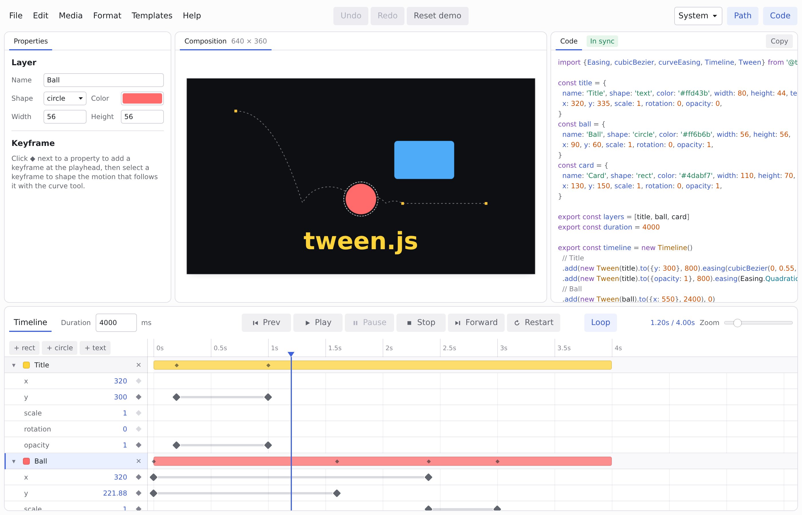
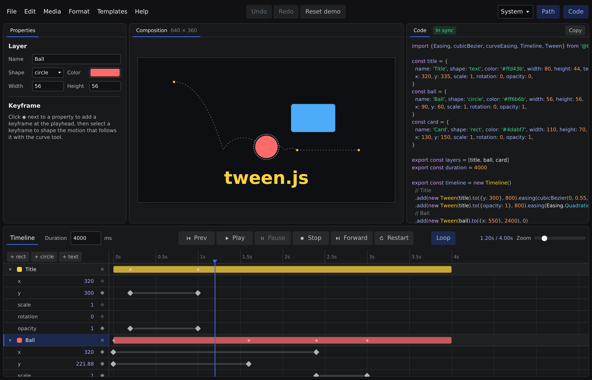

# Timeline editor

A keyframe editor for [tween.js](https://github.com/tweenjs/tween.js), in the spirit of After Effects or Premiere. You put **layers** (rectangles, circles, texts, even a three.js scene) on a stage, give their `x`, `y`, `scale`, `rotation` and `opacity` **keyframes** on a timeline, and shape the motion between keyframes with **easings** or curves you draw. All the while the **Code** panel shows the same animation as a tween.js `Timeline`, and it works both ways: edit the code and the timeline follows.

It runs in your browser. Nothing is uploaded; a shared link carries the code in its address.

## Who it is for

- You use tween.js and want to _see_ a `Timeline` instead of counting milliseconds.
- You want to draw an easing curve and get a `cubicBezier(…)` you can paste into code.
- You want to start from a finished scene (a sign-in flow, a product film, a dot globe) and take it apart.
- You are moving an animation between tween.js, es6-tween and Kute.js.

## Where to go

<div class="cards">
<a href="#/how-it-works"><b>How it works</b><span>Two views of one animation, and what runs underneath</span></a>
<a href="#/guide-first-animation"><b>Your first animation</b><span>Build a bouncing ball from an empty timeline</span></a>
<a href="#/guide-easing"><b>Easing and curves</b><span>Presets, cubic-bezier and the curve tool</span></a>
<a href="#/guide-code"><b>Timeline and code</b><span>Write code or drag keyframes: both stay in sync</span></a>
<a href="#/guide-product-motion"><b>Product motion scenes</b><span>The long, many-layer templates and how they are built</span></a>
<a href="#/guide-three"><b>Three.js scenes</b><span>A layer drawn by real three.js code</span></a>
<a href="#/guide-share"><b>Sharing links</b><span>The code in the address, and what a broken link tells you</span></a>
<a href="#/guide-migrate"><b>Other libraries</b><span>Import from and export to es6-tween and Kute.js</span></a>
<a href="#/ref-window"><b>The window</b><span>Panels, dividers and what is locked while playing</span></a>
<a href="#/ref-menu"><b>Menus</b><span>Every menu and every action</span></a>
<a href="#/ref-layers"><b>Layers and Properties</b><span>Every field of a layer</span></a>
<a href="#/ref-timeline"><b>Timeline and playback</b><span>Keyframes, ruler, playback buttons</span></a>
<a href="#/ref-curve"><b>Curve tool</b><span>Nodes, handles and how a curve becomes code</span></a>
<a href="#/ref-code"><b>Code format</b><span>The exact contract of layers, timeline and duration</span></a>
<a href="#/ref-scene"><b>Scene contract</b><span>What a three.js scene function receives and returns</span></a>
<a href="#/ref-share"><b>Share links</b><span>The link format, byte for byte</span></a>
<a href="#/ref-templates"><b>Templates</b><span>Every template, with a picture</span></a>
<a href="#/ref-shortcuts"><b>Shortcuts</b><span>Every key and gesture</span></a>
<a href="#/ref-themes"><b>Themes</b><span>System, light and dark</span></a>
</div>

## Getting started

Five minutes, no setup. The numbered steps use the demo the editor opens with.

1. **Open [the editor](../ ':ignore').** The first time, it opens with a small demo: a _Title_, a _Ball_ and a _Card_, four seconds long. (After that it opens with whatever you were working on: the timeline is saved in your browser as you edit. **Reset demo** at the top brings the demo back.)
2. **Play it.** Press the **Play** button in the playback bar under the stage, or press <kbd>Space</kbd> (it pauses with <kbd>Space</kbd> too). The playhead sweeps across the ruler. _Loop_ is on, so it starts over at the end.
3. **Pause, and select a layer.** Click the _Ball_ row in the timeline, or click the circle on the stage. The **Properties** panel shows its name, shape, colour and size, and the stage draws the dashed **path** it travels, with a square at each keyframe.
4. **Add a keyframe.** Drag the ruler to move the playhead, then click the **◆** next to a property (say `scale`) in the timeline. A diamond appears on that property's row, at the playhead. Change the property's value in the row, and the keyframe changes with it; move the playhead somewhere else and change it again, and you have a second keyframe, and a motion between the two.
5. **Drag it.** Drag a diamond left or right to move it in time; it snaps to 10 ms. Or select it and type a time in Properties.
6. **Change the easing.** With a keyframe selected, the **Easing** list in Properties shapes the motion from that keyframe to the next one. Pick `Back.Out`, or choose **Custom curve** and drag the curve's points. See [Easing and curves](guide-easing).
7. **Read the code.** The **Code** panel shows the same animation as tween.js code. Change a number in it and, a moment after you stop typing, the timeline follows; the status next to _Code_ says **In sync**. See [Timeline and code](guide-code).
8. **Share it.** **File › Share…** puts a link to your animation on the clipboard (or shows it). Whoever opens it sees the code first and is asked before it runs. See [Sharing links](guide-share).

> [!NOTE]
> While the timeline **plays**, nothing can be moved or changed: the fields are greyed out and a drag shows a "not allowed" cursor with _Pause to edit_. Select, scrub, zoom and read all work. Pause, and you can edit again.

> [!TIP]
> In a hurry? Open the **Templates** menu, pick a finished scene, and change it. Undo (<kbd>Ctrl</kbd>+<kbd>Z</kbd>) brings your own timeline back.

### Try it here

Press Play, or drag the playhead. It is the editor's demo timeline, played by a small player on this page.

<div data-timeline data-title="Ball, title and card"><script type="application/json">{"duration":4000,"layers":[{"shape":"text","text":"tween.js","color":"#ffd43b","w":160,"h":44,"size":44,"x":320,"y":335,"tracks":{"y":[[200,335,[0,0.55,0.45,1]],[1000,300]],"opacity":[[200,0,"quad-out"],[1000,1]]}},{"shape":"circle","color":"#ff6b6b","w":56,"h":56,"tracks":{"x":[[0,90],[2400,550]],"y":[[0,60,"bounce-out"],[1600,230]],"scale":[[2400,1,"back-in"],[3000,0]]}},{"shape":"rect","color":"#4dabf7","w":110,"h":70,"x":130,"y":150,"tracks":{"x":[[600,130,[0.3,1.45,0.6,1]],[1800,420]],"rotation":[[1800,0,"cubic-in-out"],[3400,180]]}}]}</script></div>

<figure class="themed"><figcaption>The window: <b>Properties</b>, the stage (<b>Composition</b>), <b>Code</b>, and the <b>Timeline</b> with its playback bar. The menus are along the top; <b>Path</b> and <b>Code</b> at the right of the top bar show or hide the path and the code panel.</figcaption></figure>

New to the screen? [The window and panels](ref-window) names every part of it.

## Run it yourself

The editor is a static web app built with Solid and Vite. From its folder:

```sh
bun install
bun run dev        # http://localhost:5173
```

and these docs are served by the same app at `/docs/index.html`. The project README has the details, including how to run the tests.
