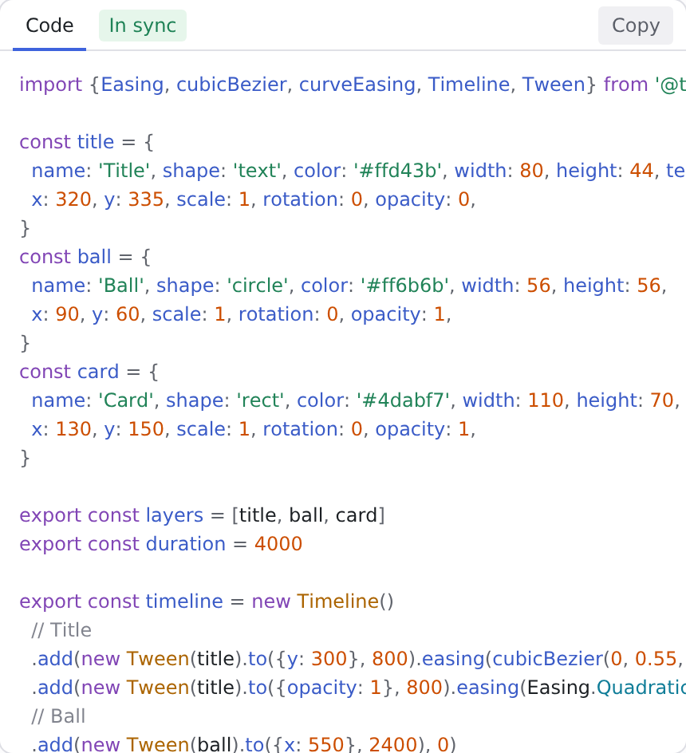
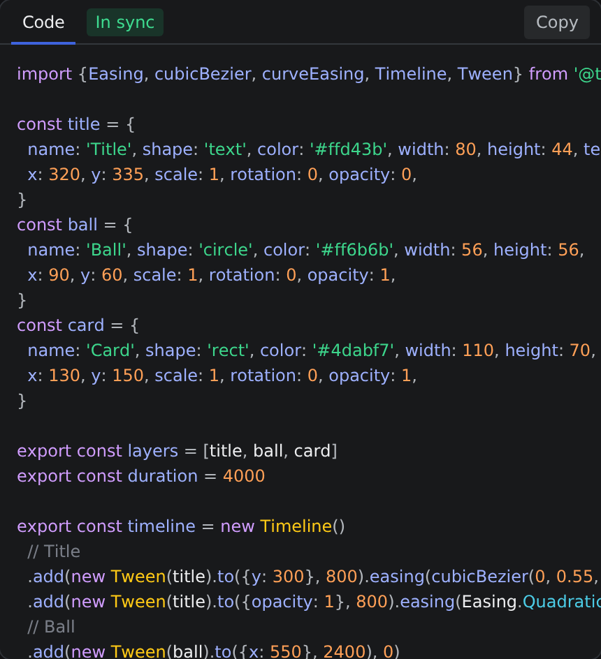

# Timeline and code, two ways

The timeline and the code are two views of one animation, and you can work in whichever suits the moment: drag a keyframe, or change a number. This guide is about the code side: what it reads, what it refuses, what it tells you, and how to take it elsewhere.

## Two directions

- **Every change in the editor rewrites the code.** The Code panel always shows the current animation, in the editor's own style.
- **Typing in the code panel updates the timeline.** About a third of a second after you stop typing (350 ms), the editor _runs_ the code and rebuilds the timeline from what it did. If the code is the same animation you already had, nothing changes and there is nothing to undo.

<figure class="themed"><figcaption>The Code panel, with its status next to the title and a Copy button.</figcaption></figure>

### The status

The badge next to **Code** tells you where the two stand:

| Status       | Colour | Meaning                                                                                                           |
| ------------ | ------ | ----------------------------------------------------------------------------------------------------------------- |
| **In sync**  | green  | The timeline is what the code says.                                                                               |
| **Editing…** | amber  | You are typing; the code is read when you pause.                                                                  |
| _A warning_  | amber  | The code works, but something was accepted and not kept, or was changed. The text says what.                      |
| _An error_   | red    | The code does not work. The message says why, and **the timeline keeps its last working state** until you fix it. |

A badge too long for its place is cut with an ellipsis; hover it to read it all.

## What the code must define

```js
export const layers = [/* plain objects: the layers */]
export const timeline = new Timeline() /* with tweens that animate those objects */
export const duration = 4000 // optional: the length, in milliseconds
```

- **`layers`** is an array of plain objects. `name`, `shape`, `color`, `width`, `height` and the five properties describe each one. See [Code format](ref-code) for every field.
- **`timeline`** is a `new Timeline()`.
- **`duration`** is optional. Without it the timeline is as long as its last keyframe (at least 1000 ms); with it, it is that long, but never shorter than its last keyframe.

Without `layers` the status says _The code must define `layers`: an array of layer objects._; without a `Timeline`, _The code must define `timeline`: a `new Timeline()`._

## How a tween becomes keyframes

A tween that **ends** at time _t_ with value _v_ becomes a keyframe at _t_ with value _v_. It also gives a keyframe at its **start**, holding the value the property had there, and that start keyframe carries the tween's easing. So:

```js
.add(new Tween(ball).to({x: 550}, 2400).easing(Easing.Quadratic.InOut), 0)
```

is two keyframes on `x`: one at 0 (easing `Quadratic.InOut`) and one at 2400 (value 550). A tween starts from wherever the property is, like in tween.js: the previous keyframe, or the starting value on the layer object.

## Write it freely

Because the code is **run**, anything that builds layers and a timeline works: loops, variables, functions, `delay()`, tweens added without an offset (they follow the previous one), labels, and nested timelines. Here a loop makes five layers and staggers their tweens:

```js
import {Easing, Timeline, Tween} from '@tweenjs/tween.js'

export const layers = Array.from({length: 5}, (_, i) => ({
	name: 'Dot ' + (i + 1),
	shape: 'circle',
	color: '#4dabf7',
	width: 30,
	height: 30,
	x: 80 + i * 120,
	y: 60,
	scale: 1,
	rotation: 0,
	opacity: 1,
}))
export const duration = 2400

export const timeline = new Timeline()
layers.forEach((dot, i) => {
	timeline.add(new Tween(dot).to({y: 280}, 800).easing(Easing.Bounce.Out), i * 200)
})
```

When you change anything in the editor, the code is rewritten in its own style: five `dot` objects, one tween each. Your loop is gone, because the editor stores the _result_, not the program. Comments and your own formatting are replaced too.

> [!TIP]
> Keep a copy of code you want to keep as written: **File › Save** downloads the code exactly as it is in the panel (`timeline.js`), and **File › Open…** reads such a file back.

Offsets, `delay()` and nesting are added up for you:

```js
import {Easing, Timeline, Tween} from '@tweenjs/tween.js'

const card = {name: 'Card', shape: 'rect', color: '#4dabf7', width: 110, height: 70, x: 100, y: 180}

// A reusable move, placed twice at different times.
const slide = (to, ms) => new Timeline().add(new Tween(card).to({x: to}, ms).easing(Easing.Cubic.InOut), 0)

export const layers = [card]
export const duration = 3000

export const timeline = new Timeline()
	.add(slide(500, 800), 200)
	.add(new Tween(card).to({rotation: 90}, 600).delay(100), 1200)
	.add(new Tween(card).to({opacity: 0}, 500))
```

Here the `slide` timeline is placed at 200 ms, so `x` goes from 100 to 500 between 200 and 1000 ms; the rotation starts at 1200 + 100 (the `delay`) = 1300 ms; and the last tween, added without an offset, starts when everything before it has ended.

## What the editor cannot show

These are refused, with a message, rather than guessed:

| In the code                                                  | Message                                                                                         |
| ------------------------------------------------------------ | ----------------------------------------------------------------------------------------------- |
| `.repeat(n)`                                                 | `Tween.repeat() is not supported by the timeline editor.`                                       |
| `.yoyo(true)`                                                | `Tween.yoyo() is not supported by the timeline editor.`                                         |
| `.chain(other)`                                              | `Tween.chain() is not supported by the timeline editor.`                                        |
| `.interpolation(fn)`                                         | `Tween.interpolation() is not supported by the timeline editor.`                                |
| The same tween added twice                                   | `Repeating a tween (repeat, yoyo, or adding it twice) is not supported by the timeline editor.` |
| A nested timeline repeated                                   | `Repeating a nested timeline is not supported by the timeline editor.`                          |
| A value that is not a number (`x: '100'`, or `x: [1, 2, 3]`) | `Ball x at 0ms: only numeric values are supported.`                                             |
| Two tweens of one property that overlap in time              | `Ball x at 200ms: tweens of one property may not overlap.`                                      |
| A tween of an object that is not in `layers`                 | `The tween of x at 0ms (500ms long) animates an object that is not in `layers`.`                |
| A timeline that never ends                                   | `A timeline that never ends is not supported by the timeline editor.`                           |

To get a repeat in the editor, add its keyframes: a bounce back and forth is just a keyframe at the far end and another back at the start.

## What it accepts but does not keep

These make the status amber, with a note, and the timeline carries on:

| In the code                                                            | Note                                                                  |
| ---------------------------------------------------------------------- | --------------------------------------------------------------------- |
| `onStart`, `onUpdate`, `onComplete`, … on a tween or timeline          | `Tween.onUpdate() callbacks are not kept by the editor.`              |
| A property that is not one of `x`, `y`, `scale`, `rotation`, `opacity` | `"z" is not an animatable property (x, y, scale, rotation, opacity).` |
| An easing function of your own                                         | `A custom easing function was traced into an editable curve.`         |

The last one is not a loss: the function is turned into a curve you can edit. See [Easings you write yourself](guide-easing?id=easings-you-write-yourself).

## Errors

Anything the code does wrong shows up as an error with the browser's own message: a syntax error (`Unexpected token 'const'`), a thrown error (`boom`), a name that is not defined. The timeline stays as it was. Two helpers sit in the **Format** menu:

- **Check code** compiles the code and tells you what it found _without changing_ the timeline: _No problems found. 3 layers, 9 keyframes, 4000ms._ or the notes, or the error.
- **Format code** rewrites the code in the editor's own style. If the code does not compile it shows the same report as Check instead.

## Using the code in your page

The code is a module, and a normal tween.js `Timeline`. To play it in your own page, start it and update it every frame:

```js
import {timeline} from './timeline.js'

timeline.start()
requestAnimationFrame(function frame(time) {
	timeline.update(time)
	requestAnimationFrame(frame)
})
```

The tweens move the plain objects in `layers`; what you draw from them is up to you. Remember the note in [Easing and curves](guide-easing): `cubicBezier` and `curveEasing` are not exports of `@tweenjs/tween.js` yet, so code that uses them needs them defined (the editor supplies them to its own copy). A layer with the shape `three` also needs three.js; see [Three.js scenes](guide-three).

## Next

- [Code format](ref-code): every field and every rule, exactly.
- [Sharing links](guide-share): the code _is_ the link.
- [Moving to and from other libraries](guide-migrate): the same idea for es6-tween and Kute.js.
