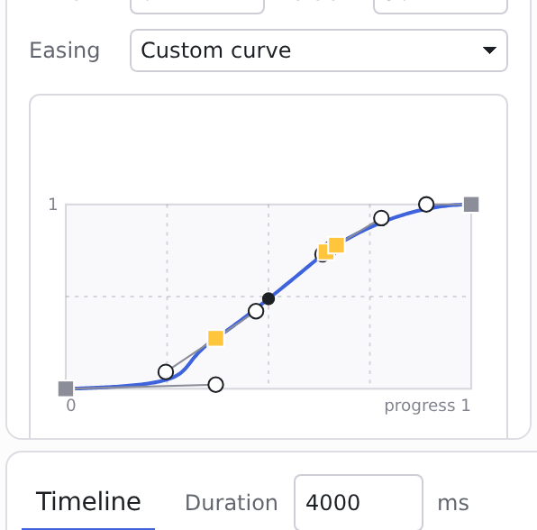
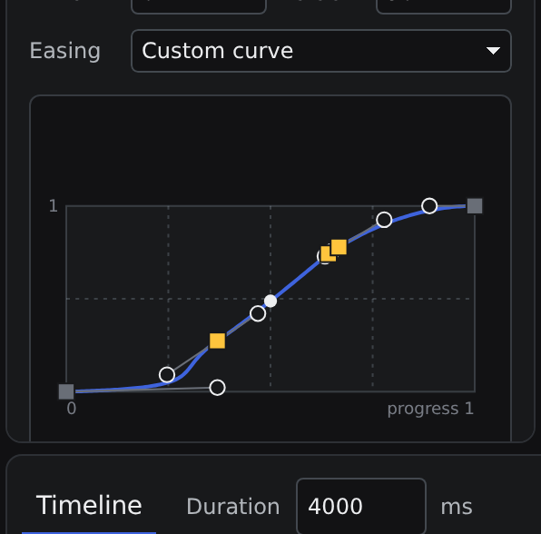

# Easing and curves

An **easing** decides _how_ a value gets from one keyframe to the next. Without one the value moves at a constant speed. With one it can start gently, rush, overshoot its target and settle, or bounce.

Formally, an easing is a function from **progress** (how much of the time has passed, 0 to 1) to **how far along** the value is (0 is the first keyframe's value, 1 is the next one's). Linear is `f(k) = k`. Everything else is a different shape for that line.

In the editor an easing belongs to a **keyframe**, and shapes the motion that **leaves** it, from that keyframe to the next one. So to change how a ball moves between its first and second keyframes, select the first. The last keyframe of a property has no easing (the list is disabled and says so): nothing follows it.

## The built-in easings

Select a keyframe and open **Easing** in Properties. The list has the tween.js easings, grouped by family:

| Family                             | In code                     | What it feels like                                                                                       |
| ---------------------------------- | --------------------------- | -------------------------------------------------------------------------------------------------------- |
| Linear                             | `Easing.Linear.None`        | Constant speed. This is the default, and it is not written to the code at all.                           |
| Quadratic, Cubic, Quartic, Quintic | `Easing.Quadratic.InOut`, … | Gentle to strong acceleration, in that order. `Quadratic` is the everyday choice; `Quintic` is dramatic. |
| Sinusoidal                         | `Easing.Sinusoidal.Out`     | A very soft start or stop.                                                                               |
| Exponential                        | `Easing.Exponential.Out`    | A burst that settles quickly.                                                                            |
| Circular                           | `Easing.Circular.In`        | A quarter circle: nearly stopped, then a sudden pull.                                                    |
| Back                               | `Easing.Back.Out`           | Overshoots the target and returns; `In` pulls back first.                                                |
| Elastic                            | `Easing.Elastic.Out`        | A springy wobble around the target.                                                                      |
| Bounce                             | `Easing.Bounce.Out`         | Falls and bounces to rest.                                                                               |

Each family (but Linear) comes in three: **In** (slow at the start), **Out** (slow at the end) and **InOut** (both). `Out` is what most interface motion wants, because things arrive and settle; `In` is for things leaving.

<div data-timeline data-title="Six easings over the same 2 seconds"><script type="application/json">{"duration":3000,"layers":[{"shape":"circle","color":"#8b8d98","w":30,"h":30,"x":40,"y":30,"tracks":{"x":[[200,40,"linear"],[2200,600]]}},{"shape":"circle","color":"#4dabf7","w":30,"h":30,"x":40,"y":90,"tracks":{"x":[[200,40,"quad-in-out"],[2200,600]]}},{"shape":"circle","color":"#69db7c","w":30,"h":30,"x":40,"y":150,"tracks":{"x":[[200,40,"expo-out"],[2200,600]]}},{"shape":"circle","color":"#ffd43b","w":30,"h":30,"x":40,"y":210,"tracks":{"x":[[200,40,"back-out"],[2200,600]]}},{"shape":"circle","color":"#ff6b6b","w":30,"h":30,"x":40,"y":270,"tracks":{"x":[[200,40,"bounce-out"],[2200,600]]}},{"shape":"circle","color":"#b197fc","w":30,"h":30,"x":40,"y":330,"tracks":{"x":[[200,40,"elastic-out"],[2200,600]]}}]}</script></div>

These six are drawn by a small player on this page, with the common easing formulas. Elastic and Back differ a little from tween.js's own; in the editor you always see the real ones.

## Curves: when a preset is not the shape you want

Choose **Custom curve** and the keyframe gets a curve you can edit. Switching _from_ a built-in easing keeps its shape (it is traced into a curve), so you can start from `Back.Out` and nudge it. Under the graph are ready-made curves:

| Button      | Written as                                             | Use it for                                                   |
| ----------- | ------------------------------------------------------ | ------------------------------------------------------------ |
| Linear      | `cubicBezier(0.33, 0.33, 0.67, 0.67)`                  | A curve that is (nearly) straight: a starting point to bend. |
| Ease        | `cubicBezier(0.25, 0.1, 0.25, 1)`                      | The classic CSS `ease`: quick start, long settle.            |
| Ease in     | `cubicBezier(0.55, 0, 1, 0.45)`                        | Things that leave.                                           |
| Ease out    | `cubicBezier(0, 0.55, 0.45, 1)`                        | Things that arrive.                                          |
| Ease in-out | `cubicBezier(0.65, 0, 0.35, 1)`                        | Moves between two resting places.                            |
| Overshoot   | `cubicBezier(0.3, 1.45, 0.6, 1)`                       | Goes past the target and springs back.                       |
| Anticipate  | `cubicBezier(0.4, 0, 0.7, -0.45)`                      | Pulls back first, then goes.                                 |
| Bounce      | `curveEasing([[0, 0, 0, 0, 0.2, 0], …])` (five points) | Falls and bounces to rest.                                   |

### `cubicBezier(x1, y1, x2, y2)`

A curve with two points is a cubic Bézier, exactly the CSS `cubic-bezier()`: the curve starts at `(0, 0)`, ends at `(1, 1)`, and is pulled by two control points `(x1, y1)` and `(x2, y2)`. Both `x` values stay between 0 and 1; the `y` values may go beyond. In code:

```js
.easing(cubicBezier(0.65, 0, 0.35, 1))
```

Drag the handles. The dot on the line is a ball moving along it; the code under it is what the editor would write.

<div data-easing="0.65 0 0.35 1" data-editable data-title="Ease in-out"></div>

<div data-easing="0 0.55 0.45 1" data-editable data-title="Ease out"></div>

A curve with more than two points is written as `curveEasing([[x, y, ix, iy, ox, oy], …])`: each row is a point and the offsets of its two handles. See [Code format](ref-code) and [Curve tool](ref-curve).

> [!NOTE]
> `cubicBezier` and `curveEasing` are not exports of `@tweenjs/tween.js` yet. The editor supplies them when it runs your code, which is why the import line it writes (`import {Easing, cubicBezier, Timeline, Tween} from '@tweenjs/tween.js'`) works _inside the editor_. In a page of your own the import fails until the library exports them, or until you define the two functions yourself.

## Overshoot and anticipation

The `y` values of a curve are not limited to 0..1. A control point **above 1** makes the value go past its target and come back (overshoot); **below 0** makes it go the wrong way first (anticipation). Both are small, deliberate exaggerations, which is what makes motion feel physical.

<div data-easing="0.3 1.45 0.6 1" data-editable data-title="Overshoot"></div>

<div data-easing="0.4 0 0.7 -0.45" data-editable data-title="Anticipate"></div>

In the curve tool, drag above the top of the graph or below its bottom. Your first animation uses the overshoot on a falling ball: [Shape the motion](guide-first-animation?id=_5-shape-the-motion).

## Drawing a curve

<figure class="themed"><figcaption>The curve tool. Grey squares are the fixed ends, gold squares are points, white circles are handles, and the black dot is where the playhead is on the curve.</figcaption></figure>

1. Select a keyframe that has a keyframe after it, and choose **Custom curve** in **Easing** (or click one of the ready-made buttons).
2. **Drag a point** to move it, and **a handle** to bend the curve around its point. Handles of a point stay in line, so the curve stays smooth.
3. Hold <kbd>Alt</kbd> while dragging a handle to bend **one side only**. That makes a sharp corner.
4. **Double-click the graph** to add a point; **double-click a point** to remove it. The two ends cannot be removed.
5. Play the timeline while the keyframe is selected: the black dot shows where the playhead is on the curve.

> [!TIP]
> The curve tool only edits while the timeline is paused.

## Easings you write yourself

Any function works in code: `.easing(k => k * k)`. The editor cannot draw a function, so it **traces** it into a curve (see [How it works](how-it-works?id=easings-are-traced)) and tells you so: _A custom easing function was traced into an editable curve._ The trace is within 0.01 of the original, with at most 16 points, so a function with sharp corners (such as a bounce) is followed corner by corner.

## Next

- [Timeline and code](guide-code): what else you can write, and what you cannot.
- [Curve tool](ref-curve): every gesture, and how a curve is stored.
