# Your first animation

You will build a ball that glides across the stage while it drops and bounces past its mark, in about ten steps, starting from an empty timeline. At the end you will have the same animation as code, and you will have seen how each action in the editor turns into a line of it.

> [!TIP]
> Want to see where this ends before you start? Press Play on the result below.

<div data-timeline data-title="The ball, as built in the walk-through"><script type="application/json">{"duration":4000,"code":"import {Easing, cubicBezier, Timeline, Tween} from '@tweenjs/tween.js'\n\nconst ball = {\n\tname: 'Ball', shape: 'circle', color: '#ff6b6b', width: 56, height: 56,\n\tx: 90, y: 60, scale: 1, rotation: 0, opacity: 1,\n}\n\nexport const layers = [ball]\nexport const duration = 4000\n\nexport const timeline = new Timeline()\n\t// Ball\n\t.add(new Tween(ball).to({x: 550}, 2400).easing(Easing.Quadratic.InOut), 0)\n\t.add(new Tween(ball).to({y: 230}, 1600).easing(cubicBezier(0.3, 1.45, 0.6, 1)), 0)\n","layers":[{"shape":"circle","color":"#ff6b6b","w":56,"h":56,"x":90,"y":60,"tracks":{"x":[[0,90,"quad-in-out"],[2400,550]],"y":[[0,60,[0.3,1.45,0.6,1]],[1600,230]]}}]}</script></div>

## 1. Start from nothing

Choose **File › Create**. The layers vanish, the timeline is 4000 ms long, and the playhead waits at **0.00s**, paused. (Create, Open and importing always stop playback and rewind, so nothing runs while you set up.)

<figure class="themed">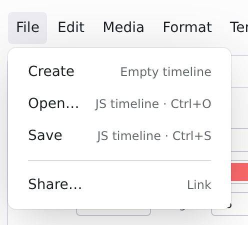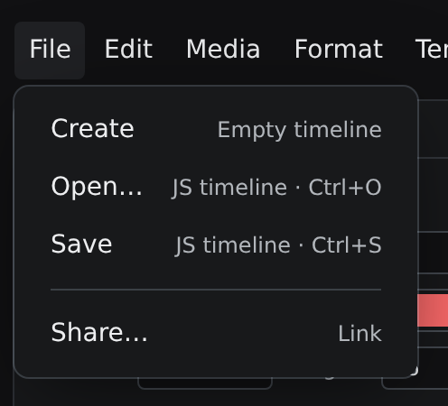<figcaption>File: <b>Create</b> an empty timeline, <b>Open…</b> or <b>Save</b> its code, <b>Share…</b> a link.</figcaption></figure>

## 2. Add a layer

At the top left of the timeline, in the ruler's row, are three buttons: **+ rect**, **+ circle** and **+ text**. Click **+ circle**. A layer named _Circle 1_ appears at the top of the list and in the middle of the stage (`x` 320, `y` 180), already selected. New layers go on top: the first layer in the list is drawn in front.

In **Properties**:

- Change **Name** to `Ball`.
- Set **Width** and **Height** to `56`.

The colour is coral already (`#ff6b6b`); layers take their colours in turn.

<figure class="themed">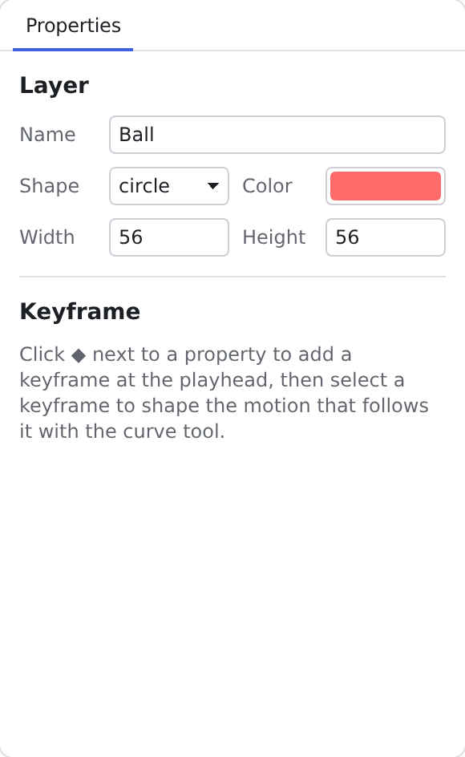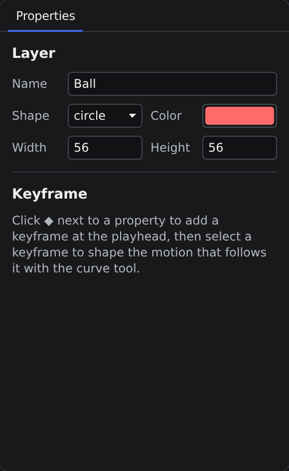<figcaption>The layer's fields. <a href="#/ref-layers">Layers and Properties</a> describes each.</figcaption></figure>

## 3. Make it move sideways

The ball has no keyframes yet, so every property is _static_: changing it changes it for the whole timeline. A property starts moving when it gets keyframes.

1. With the playhead at 0, click the **◆** at the end of the **x** row. A diamond appears at 0 s, holding the current value, 320.
2. In the same row, type `90` in the value field and press <kbd>Enter</kbd>. The keyframe now holds 90, and the ball jumps to the left.
3. Click the ruler near **2.4s** to move the playhead there. (The playback bar shows the exact time.)
4. Click **◆** on the **x** row again. A second keyframe appears under the playhead, holding the value the motion has there: 90.
5. Type `550` in the row's value field. The ball moves to the right.
6. The ruler snaps to 10 ms, but one pixel is 5 ms at the usual zoom, so you will probably land a little off 2.4 s. Click the new diamond to select it, and in **Properties** set **Time** to `2400`.

Press <kbd>Space</kbd>: the ball slides from left to right and stops. Press it again to pause (you need to pause to edit).

<figure class="themed">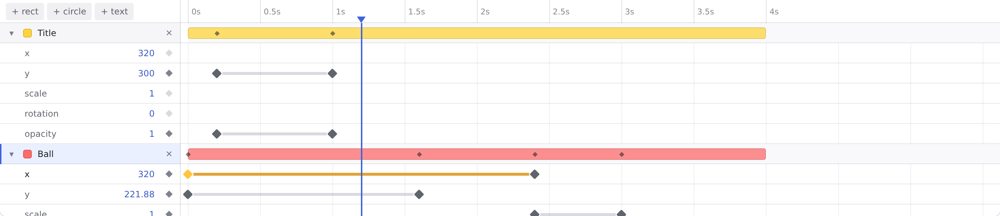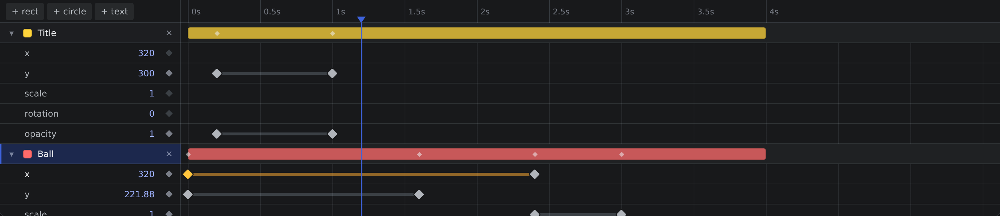<figcaption>Each layer has a row, and under it one row per property. A diamond is a keyframe; the bar between two diamonds is the motion between them.</figcaption></figure>

> [!NOTE]
> You can also **drag the layer on the stage** instead of typing: with the playhead on a keyframe it moves that keyframe's `x` and `y`; with a property that has keyframes but none under the playhead, it adds one there.

## 4. Make it drop

Do the same for **y**, which should fall from 60 down to 230 in 1.6 seconds:

1. Move the playhead to 0 (press <kbd>Home</kbd>), click **◆** on **y**, and type `60`.
2. Move the playhead near **1.6s**, click **◆** on **y**, and type `230`.
3. Select the new keyframe and set its **Time** to `1600`.

Play it. The ball now moves in straight lines: both motions are linear, which is what a keyframe's easing is until you change it.

## 5. Shape the motion

An easing belongs to a keyframe and shapes the motion **from that keyframe to the next one**. So to change how the ball moves sideways, select the _first_ `x` keyframe (the one at 0).

1. Click the first **x** diamond. Properties now shows **Keyframe · Ball x**, with its Time, Value, **Easing** and a graph of the curve.
2. Open **Easing** and choose **Quadratic › Quadratic.InOut**. The motion now starts slowly, speeds up in the middle and slows to a stop.
3. Click the first **y** diamond. Under the graph is a row of buttons: _Linear_, _Ease_, _Ease in_, _Ease out_, _Ease in-out_, _Overshoot_, _Anticipate_, _Bounce_. Click **Overshoot**. The easing list now reads **Custom curve**, and the graph rises above its top: the ball will fall past 230 and spring back.

<figure class="themed">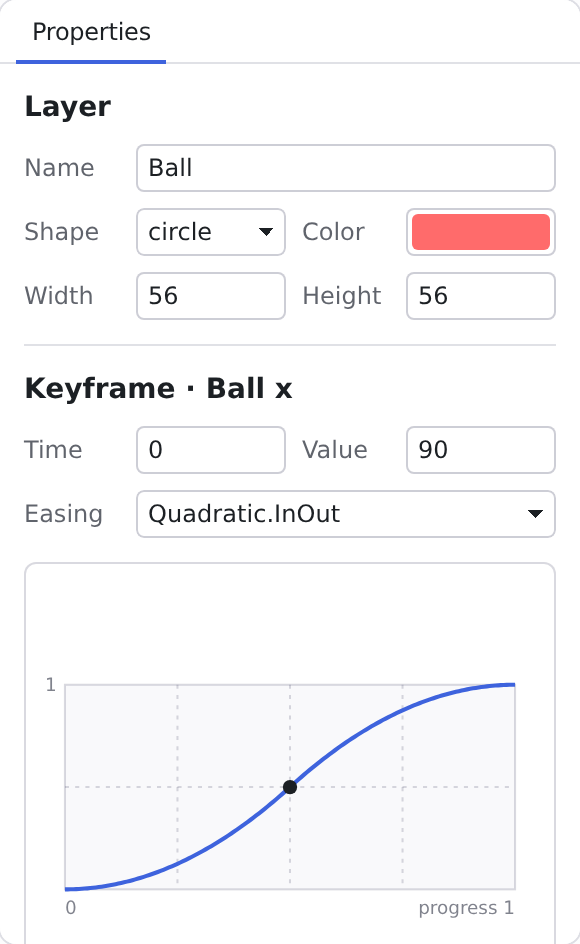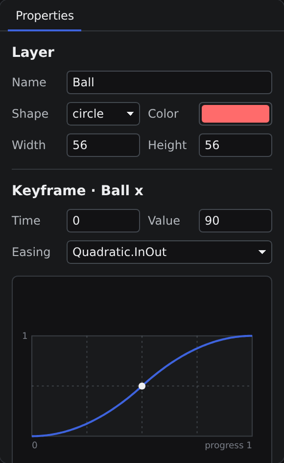<figcaption>A selected keyframe: its Time, its Value, its Easing and the curve of the motion that leaves it. The last keyframe of a property has no easing, since nothing follows it.</figcaption></figure>

## 6. Play it

Press the **Play** button (or <kbd>Space</kbd>). Click **Path** in the top bar to show or hide the dashed line the ball travels on the stage. Turn **Loop** off in the playback bar if you want it to stop at the end. If the animation ends at 2.4 s and the timeline goes on to 4 s, change **Duration** in the playback bar to `2400`: the length of the timeline is yours to set, but never shorter than the last keyframe.

<figure class="themed">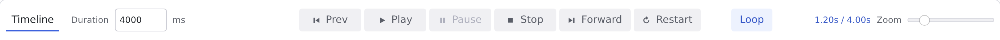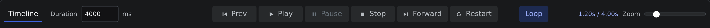<figcaption>The playback bar: the timeline's duration, the transport buttons, Loop, the time readout and Zoom.</figcaption></figure>

## 7. Read the code

The **Code** panel has been following along. This is what it holds now:

```js
import {Easing, cubicBezier, Timeline, Tween} from '@tweenjs/tween.js'

const ball = {
	name: 'Ball',
	shape: 'circle',
	color: '#ff6b6b',
	width: 56,
	height: 56,
	x: 90,
	y: 60,
	scale: 1,
	rotation: 0,
	opacity: 1,
}

export const layers = [ball]
export const duration = 4000

export const timeline = new Timeline()
	// Ball
	.add(new Tween(ball).to({x: 550}, 2400).easing(Easing.Quadratic.InOut), 0)
	.add(new Tween(ball).to({y: 230}, 1600).easing(cubicBezier(0.3, 1.45, 0.6, 1)), 0)
```

Match it to what you did:

| In the editor                                                 | In the code                                                                                                                       |
| ------------------------------------------------------------- | --------------------------------------------------------------------------------------------------------------------------------- |
| The layer, its name, shape, colour and size                   | The `ball` object. Its `x`, `y`, `scale`, `rotation` and `opacity` are the layer's _starting_ values: here, the first keyframe's. |
| **File › Create**: the timeline is 4000 ms                    | `export const duration = 4000`                                                                                                    |
| The two `x` keyframes (0 and 2400) with _Quadratic.InOut_     | `new Tween(ball).to({x: 550}, 2400).easing(Easing.Quadratic.InOut)` added at `0`                                                  |
| The two `y` keyframes (0 and 1600) with the _Overshoot_ curve | `new Tween(ball).to({y: 230}, 1600).easing(cubicBezier(0.3, 1.45, 0.6, 1))` added at `0`                                          |

Every pair of neighbouring keyframes is one `Tween` placed on a `Timeline` at the first keyframe's time, with the first keyframe's easing. A curve with two points is written as `cubicBezier(x1, y1, x2, y2)`; anything with more points as `curveEasing([...])`.

<figure class="themed">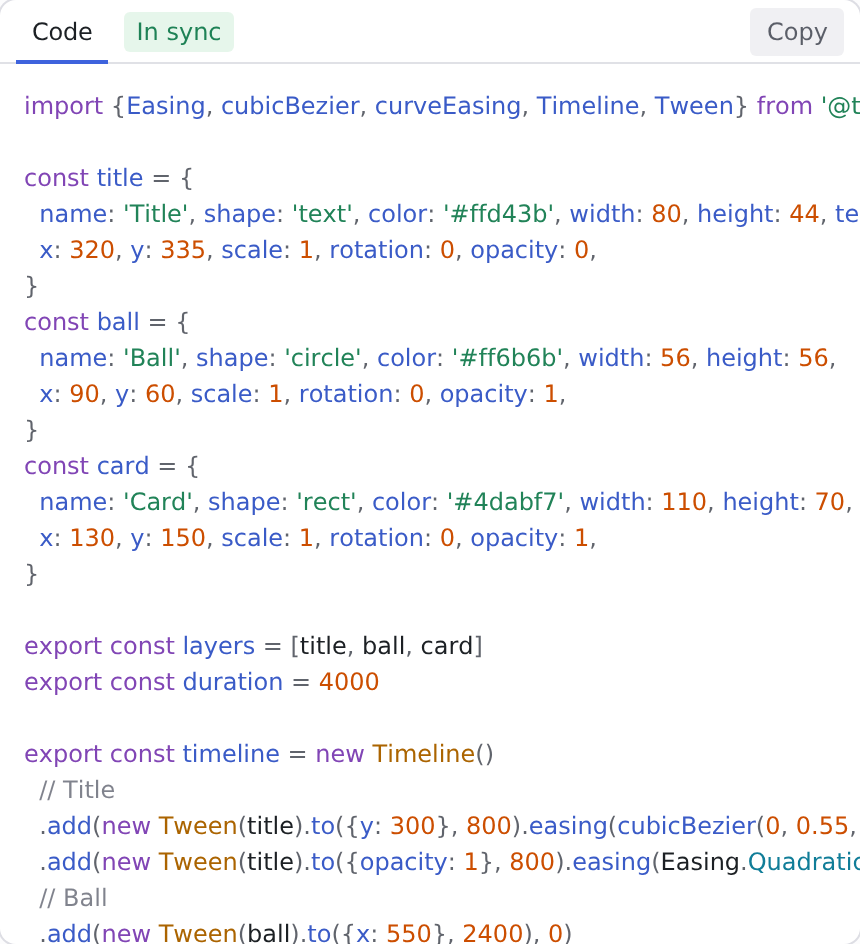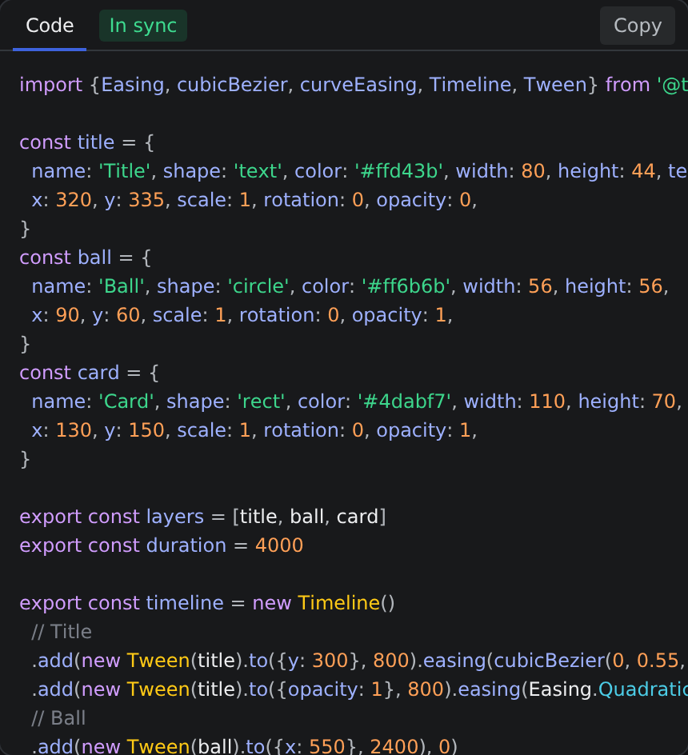<figcaption>The Code panel. <b>In sync</b> says that what you see in the timeline is what the code says.</figcaption></figure>

Now go the other way. In the code panel change `2400` (the first `Tween`'s duration) to `1200`, and stop typing. After a moment the status passes through _Editing…_ and back to **In sync**, and the `x` keyframe has moved from 2400 to 1200.

## Where to go next

- Add a second layer, and a third; give them keyframes that start later, so they take turns. Restack them with **Edit › Bring to top** and its neighbours.
- [Easing and curves](guide-easing): what each preset does, and how to draw your own.
- [Timeline and code](guide-code): write the animation as code, with loops and variables.
- [Sharing links](guide-share): send your ball to someone.
