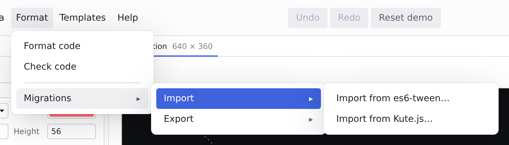
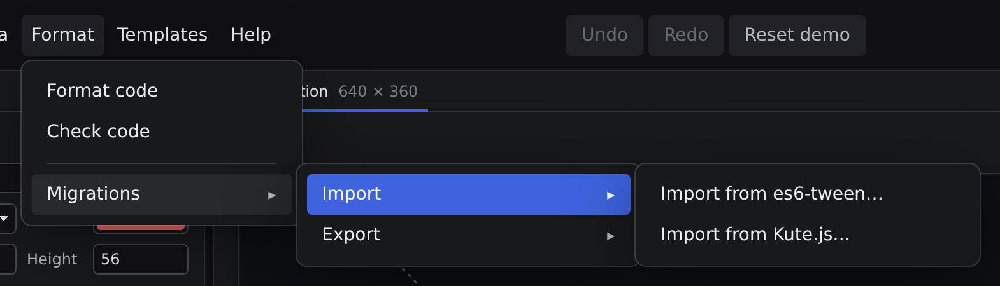
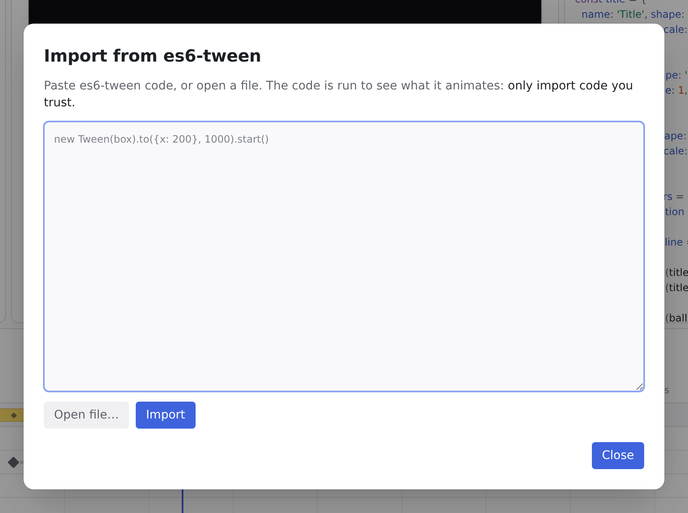
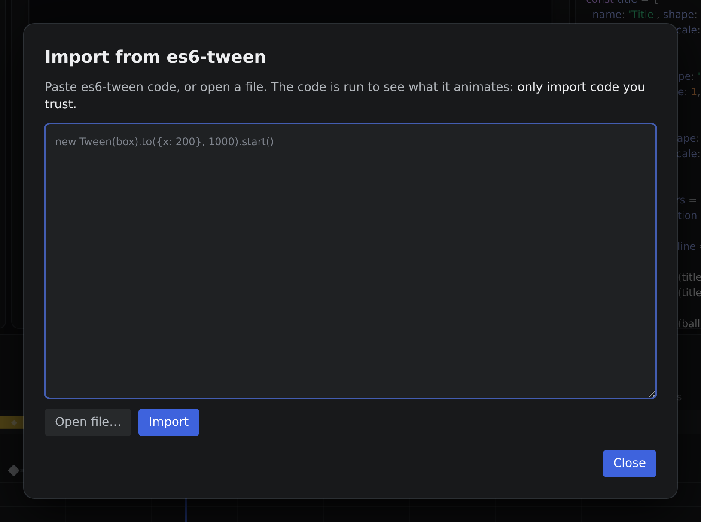
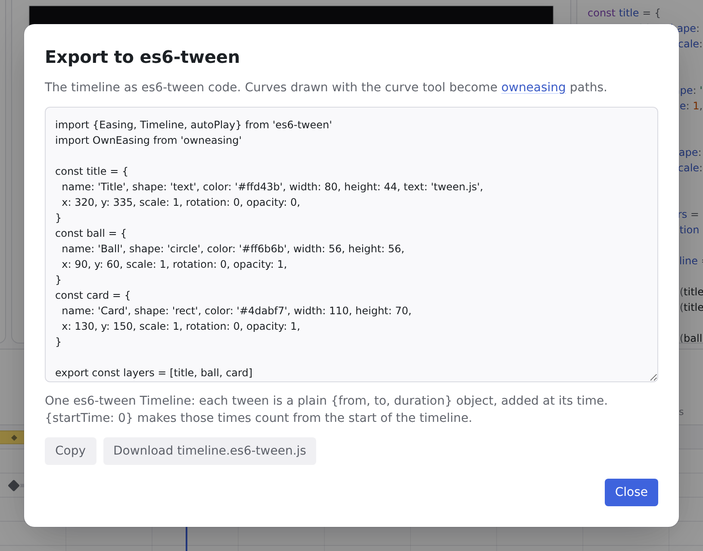
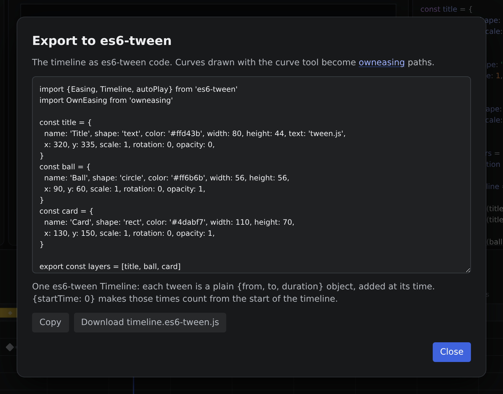

# Moving to and from other libraries

**Format › Migrations** moves a timeline to and from two other tween libraries: [es6-tween](https://github.com/tweenjs/es6-tween) and [Kute.js](https://thednp.github.io/kute.js/). Each has an **Export** and an **Import**.

<figure class="themed"><figcaption>Format › Migrations › Import / Export.</figcaption></figure>

| Item              | What it does                                                                                                                                                                       |
| ----------------- | ---------------------------------------------------------------------------------------------------------------------------------------------------------------------------------- |
| **Export to …**   | Shows the timeline as code for that library, to **Copy** or **Download** (`timeline.es6-tween.js`, `timeline.kute.js`). The timeline in the editor stays as it is.                 |
| **Import from …** | Reads code written for that library, pasted or from a file (**Open file…**), and **replaces the timeline** with what it animates. Undo brings yours back. The player stops at 0 s. |

> [!WARNING]
> An import **runs the code** in this page to see what it animates. Only import code you trust.

<figure class="themed"><figcaption>The import dialog. A problem with the code is shown under the text area and nothing is replaced.</figcaption></figure>

## Curves

Neither library has the curve tool. A curve drawn here is exported as an [owneasing](https://www.npmjs.com/package/owneasing) path:

```js
OwnEasing('M0,100 C25,90 25,0 100,0')
```

It is SVG path data in a 100 × 100 box, from the bottom left (start) to the top right (end). **Import** reads `OwnEasing(…)` easings back as curves you can edit. Add `owneasing` to your project to run exported code that uses it. Built-in easings such as `Easing.Cubic.InOut` are kept by name.

## es6-tween

<figure class="themed"><figcaption>An export: the code, a note about the library, Copy and Download.</figcaption></figure>

### Export

The export is one es6-tween `Timeline`. For the demo timeline it ends like this (the layer objects above it are the same as in the editor's own code):

```js
// `startTime: 0`: the positions below count from the start of the timeline.
export const timeline = new Timeline({startTime: 0})
	// Ball
	.add({from: ball, to: {x: 550}, duration: 2400}, 0)
	.add({from: ball, to: {scale: 0}, duration: 600, easing: Easing.Back.In}, 2400)
	// Card
	.add({from: card, to: {rotation: 180}, duration: 1600, easing: Easing.Cubic.InOut}, 1800)

timeline.start()
```

- Each pair of keyframes is a plain `{from, to, duration, easing}` object added at its time. es6-tween makes the tween: no `new Tween()` is needed.
- **`{startTime: 0}` is needed.** Without it, es6-tween counts the times from when the page loaded, and every tween starts late.
- An es6-tween `Timeline` ends at its longest tween, or at **twice its last time**, whichever is later. That can be before the last tween ends. When it is, the export adds one entry as long as the animation, which animates nothing, to keep the timeline open.
- The file also has `autoPlay(true)` and `import {Easing, Timeline, autoPlay} from 'es6-tween'` (and `import OwnEasing from 'owneasing'` when a curve is used).

### Import

The import reads these, on plain objects, and places every tween where es6-tween 5.5.11 plays it:

| Code                                                       | Notes                                                                                                                                 |
| ---------------------------------------------------------- | ------------------------------------------------------------------------------------------------------------------------------------- |
| `.add(tween, time)`, `.add([tweens], time)`                | Tween instances. The time is a number or a label from `.addLabel()`.                                                                  |
| `.add({from, to, duration, easing, delay}, time)`          | A plain object instead of a tween.                                                                                                    |
| `.to([objects], values, {duration, stagger, mode, label})` | One tween per object. Modes: `none`, `reverse`, `sequence`, `async`, `oneByOne`. Values and parameters may be functions of the index. |
| `new Tween(object).to(…).delay(…).start()`                 | Tweens without a timeline.                                                                                                            |

A small example you can paste into **Import from es6-tween**:

```js
import {Timeline, Easing} from 'es6-tween'

const box = {name: 'Box', shape: 'rect', x: 0, y: 0}

const timeline = new Timeline({startTime: 0})
	.add({from: box, to: {x: 300}, duration: 1200, easing: Easing.Cubic.Out}, 0)
	.add({from: box, to: {y: 120}, duration: 800}, 1200)

timeline.start()
```

It becomes one layer, `Box`, with `x` going 0 → 300 in the first 1.2 s and `y` going 0 → 120 right after. Without a `layers` list, each tweened object is a layer; with one, the objects in it come first, in that order.

**Warnings** are shown in the code panel's status line (the import still happens):

- `A Timeline made without {startTime: 0} starts its tweens late, by the age of the page. It is read as if it started at 0.`
- `Timeline.to() starts the timeline, so es6-tween plays what is added after it late, by the age of the page. It is read at the time it was given.` Use one `.to()`, last, or use `.add()`.
- `Timeline.to() with one plain object adds nothing in es6-tween. Pass an array: to([object], …).`
- `es6-tween ends this Timeline at …ms, before its last tween ends at …ms. It is read to the end.` See the note about the length above.
- `…() listeners are not kept by the editor.` for callbacks.

**Refused** (the import stops with a message that says what is not supported): `Tween.repeat()`, `yoyo`, `reverse()`, `interpolation()`, chained tweens, `Timeline.repeat()` and `yoyo`, tweening an element or a selector, `Timeline.from()` and `fromTo()` (they only animate elements), and `to()` with mode `shuffle`, which is random.

## Kute.js

[Kute.js](https://thednp.github.io/kute.js/) animates **elements**, not objects, and that shapes both directions.

### Export

The exported code starts with a comment that lists the elements it expects:

```js
// Kute.js animates elements, and one tween writes the whole transform of its
// element. Properties that move on their own timing therefore sit on their own
// nested element. This code expects:
//
//   <div id="ball" style="transform: translateX(90px)"><div id="ball-y" style="transform: translateY(60px)"><div id="ball-scale"></div></div></div>
//   <div id="card" style="transform: translateX(130px) translateY(150px)"><div id="card-rotation"></div></div>

export const tweens = [
	// Ball
	KUTE.fromTo('#ball', {translateX: 90}, {translateX: 550}, {duration: 2400, easing: 'linear'}),
	KUTE.fromTo('#ball-scale', {scale: 1}, {scale: 0}, {duration: 600, delay: 2400, easing: 'easingBackIn'}),
]

for (const tween of tweens) tween.start()
```

- **One Kute.js tween writes its element's whole `transform`.** Properties that move on different timings are therefore exported to **nested elements**, such as `#ball` and `#ball-y`.
- Kute.js reads positions and angles as **whole numbers**, so they are rounded.
- Kute.js code only holds what moves. Layers and properties that never change are in the elements listed in that comment, so they **do not come back** when the code is imported.

### Import

It understands `KUTE.to()` and `KUTE.fromTo()` with `translateX`, `translateY`, `translate` (and `translate3d`), `rotate` (and `rotateZ`), `scale` and `opacity`, plus `duration`, `delay`, `easing` and `chain()`. Another property is skipped with a note (`Kute.js "…" has no matching layer property, so it was left out.`). A name like `#ball-y` is read as the element `#ball`. For example:

```js
KUTE.fromTo(
	'#box',
	{translateX: 0, rotate: 0},
	{translateX: 200, rotate: 90},
	{duration: 1000, easing: 'easingCubicOut'},
).start()
KUTE.to('#dot', {translateY: 120, opacity: 0}, {duration: 600, delay: 400}).start()
```

makes two layers, `box` and `dot`, named after their selectors. Call `start()` on each tween: without it nothing is imported (`No tweens were started. Call start() on each Kute.js tween.`). `repeat`, `yoyo`, `allTo()` and `allFromTo()` are refused.

## What is never kept

- **Repeats and yoyo**, in either direction.
- Callbacks (`onUpdate` and the like): accepted by the import, never exported.
- Anything that is not one of the five properties `x`, `y`, `scale`, `rotation` and `opacity`.
- A three.js scene: the es6-tween export keeps it in the layer objects, with its imports. The Kute.js export has no layer objects (it only lists elements), so a scene is not in it.

The migrations are tested against this editor's own importers; the Kute.js export is not checked against Kute.js running in a browser.

## See also

- [Timeline and code, two ways](guide-code): what the editor's own code format can and cannot hold.
- [Code format](ref-code)
