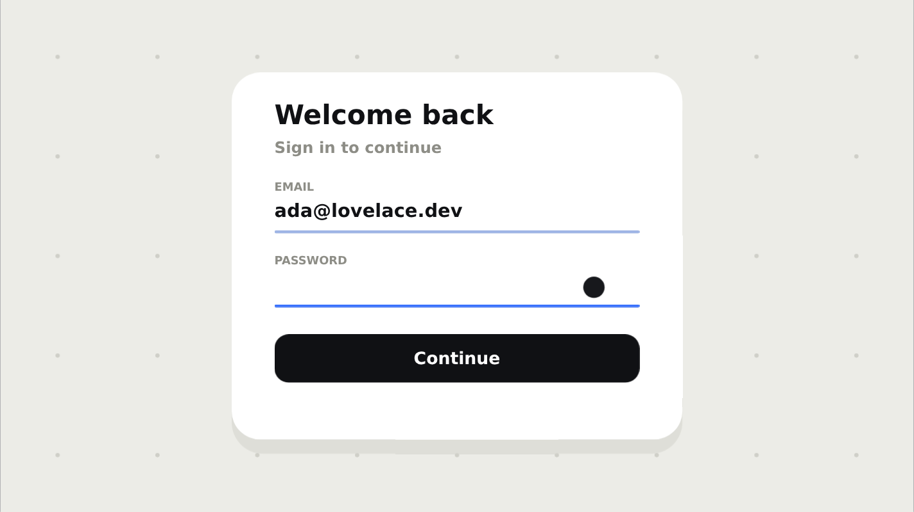

# Product motion scenes

Sign-in flow, Launch film and Dashboard are the three templates that look like a product video: an interface builds itself on screen, a pointer uses it, and each step leads to the next. They are 15 to 17 seconds long and have **127, 138 and 173 layers**. Every one of those layers is a plain rectangle, circle or text, with keyframes on position, scale, rotation and opacity: nothing else exists in the editor, so everything in them can be taken apart.

Open one from **Templates › Pre-ready** ([Templates reference](ref-templates)), then press **Play**. The layers are folded, so the timeline shows one row per layer: click the arrow (▸) in front of a layer to show its properties.

<figure><figcaption>Sign-in flow, a moment after the email has been typed.</figcaption></figure>

| Template     | Layers | Length | What happens                                                                                                                                                                              |
| ------------ | ------ | ------ | ----------------------------------------------------------------------------------------------------------------------------------------------------------------------------------------- |
| Sign-in flow | 127    | 16.4 s | A button is pressed and turns into a card. An email is typed, a password, a six-digit code. Then a profile appears and its bell rings. On a light ground.                                 |
| Launch film  | 138    | 15.6 s | A mark, a prompt, code streaming past, and the page it makes: a glass card with a headline and a button that asks to be pressed. On a dark ground with slow warm light.                   |
| Dashboard    | 173    | 17.2 s | A side bar, numbers that count, bars that grow, a line that draws itself with a reader running along it, and a progress meter. The pointer changes the view twice and everything answers. |

## The tricks

A layer in the editor cannot change its width, and it cannot be cut by another layer. So these scenes use a handful of tricks that you can use too. Each one is a few layers and a few keyframes.

### A button press and a ripple

A press is two quick moves of **scale**: down to 0.94 in 90 ms with `Quadratic.Out`, then back to 1 in 270 ms with `Back.Out`, which overshoots a little. The pointer gets the same press. The ripple is a faint circle that starts small, and in one frame becomes visible; then it spreads (`scale` to 2.2, `Cubic.Out`) while it fades to nothing.

The ripple appears with a **one-millisecond move**: a change with no motion is two keyframes 1 ms apart (the scenes call this a jump). The pointer travels with different easings on x and y (`Cubic.InOut` and `Quartic.InOut`), so its path is a gentle curve instead of a straight line.

### Typing

Text cannot be revealed letter by letter, so it is **uncovered**. The text sits on top of a field. A rectangle of the field's colour (the cover) sits on top of the text and slides to the right in bursts, with short stops between them, like someone thinking. A thin rectangle, the caret, rides on the cover's edge. At the end the cover is hidden and the caret blinks twice.

> [!NOTE]
> The cover has to be wider than the text and on the same colour. Fonts differ from computer to computer, so the scenes make the cover a little wider than the text is likely to be, and set the text with `align: 'left'` so that its start does not move (see [`align`](ref-layers)).

### A card that pops in, texts that rise

`pop` is a scale from 0.6 to 1 with `Back.Out` and a quick fade in. `rise` is a move of 12 px upwards into the place the layer will rest in, with a fade. Starting the texts a little after the card, one after the other, is what makes it read as a designed entrance.

### The rest

- **A bar that grows** rises from behind a strip of the background colour.
- **A number that counts** is one text sliding out as the next slides in.
- **A glow** is a stack of faint circles.
- **A grid of dots** like a design canvas: each dot gets a small scale pulse a moment after the one closer to the middle, which makes a wave.
- **Pulse** is a heartbeat: scale up by 6 % and back in 0.7 s with `Sinusoidal.InOut`.
- **The end of the loop**: everything that can still be seen fades out together, so that the film restarts from nothing.

## How they were built

The three scenes are written as TypeScript in `src/model/motion.ts` in the editor's source. A small `Scene` builder adds layers **from the back to the front** and the finished document lists them the other way, front first, like the layer list in the editor. It has one method per kind of piece:

| Method                            | What it makes                                                                                                                                 |
| --------------------------------- | --------------------------------------------------------------------------------------------------------------------------------------------- |
| `rect`, `dot`, `text`, `textFrom` | A rectangle (with a `radius`), a circle, a text centred on `x`, a text that starts at `x`. All of them start hidden unless you say otherwise. |
| `ripple`                          | A ring that spreads from a click and fades.                                                                                                   |
| `typed`                           | Text with its cover and caret, as above.                                                                                                      |
| `pointer`                         | A dark dot with a light edge, with `show`, `hide`, `move` and `click`.                                                                        |
| `clear`                           | Fades out everything that can still be seen: the end of the loop.                                                                             |

and a few helpers that write keyframes: `to` (move a property between two times), `show`, `hide`, `pop`, `rise`, `press` and `pulse`.

> [!IMPORTANT]
> `to` writes moves **in the order they happen**. A layer keeps the value it had, so a move that starts before the previous move on the same property ended would have to change a keyframe that is already written. Instead of guessing it throws, for example `Button scale: 1500ms is before its last keyframe, 2060ms`. When you write your own scene this way, put the moves of one property in time order.

This is the same rule the editor has: two keyframes of one property can never share a time, and [tweens of one property may not overlap](guide-code) when you write the code by hand.

These builders are part of the editor's source, not something you call from the editor: in the editor you make the same scenes by hand, in the timeline, or by writing a timeline in the code panel ([Timeline and code](guide-code)).

## Make your own

1. **Start from the ground.** One full-size rectangle (640 × 360) in the colour of your page, at x 320, y 180. Everything else goes on top of it.
2. **Draw back to front.** Add the layers in the order they are stacked; the first layer in the list is the one in front, so use **Edit › Send to bottom** for the ground ([Menus](ref-menu)).
3. **Make everything start hidden**: set `opacity` to 0 and let a keyframe show it. A layer that exists the whole time is easier to manage than one that is added.
4. **Write the moves in time order** for one property at a time, and give them names that tell you what they do (`Button`, `Button shadow`, `Email cover`).
5. **Reuse the tricks above.** A press, a ripple, a cover that slides: they are always the same few keyframes. When you have made one, copy the layers.
6. **Round corners** with `radius` on a rectangle: 6 without it, half the height for a pill ([Layers and Properties](ref-layers)).
7. **Fold the layers** (the ▸ arrow) in the timeline when there are many: an unfolded layer shows a row for each of its properties.

> [!TIP]
> To see how a trick is done, select a layer in a template and look at its keyframes on the timeline and at the curve of the one you select ([Timeline](ref-timeline), [Curve tool](ref-curve)). Press `Page Down` to step from keyframe to keyframe.

## Two fields these scenes needed

| Field    | What it does                                                                                                                                                                             |
| -------- | ---------------------------------------------------------------------------------------------------------------------------------------------------------------------------------------- |
| `radius` | The corners of a rectangle, in pixels. 6 if left out.                                                                                                                                    |
| `align`  | `'left'` or `'right'` for a text: the side of the text that sits at `x`. The middle if left out. A text's width depends on the font, so a text that has to _start_ somewhere needs this. |

Both are written into the code of the timeline, and shown in the Properties panel ([Layers and Properties](ref-layers)).
