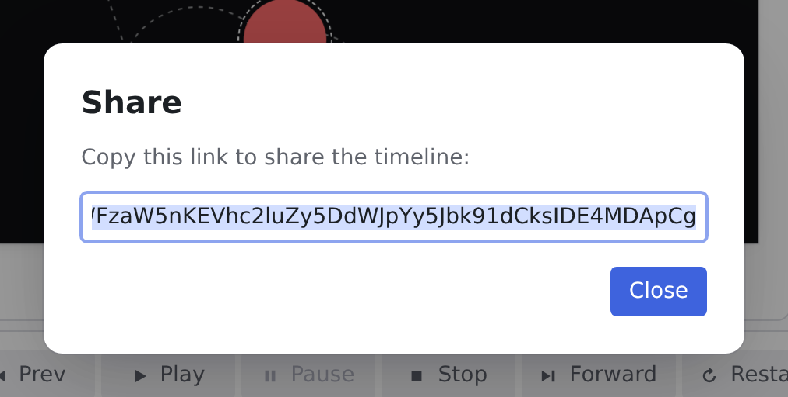
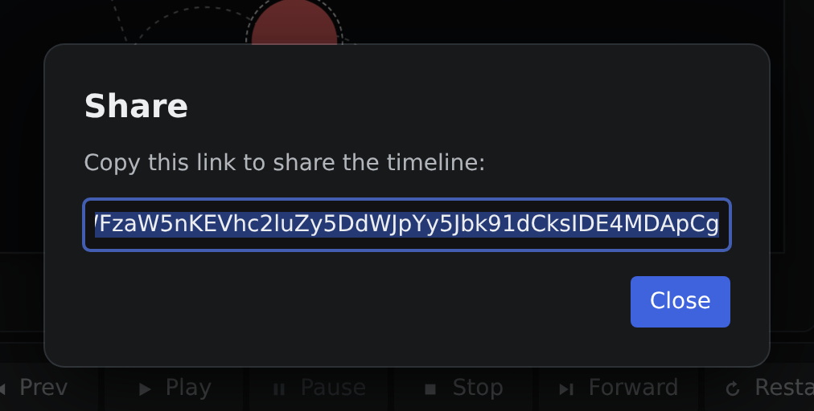
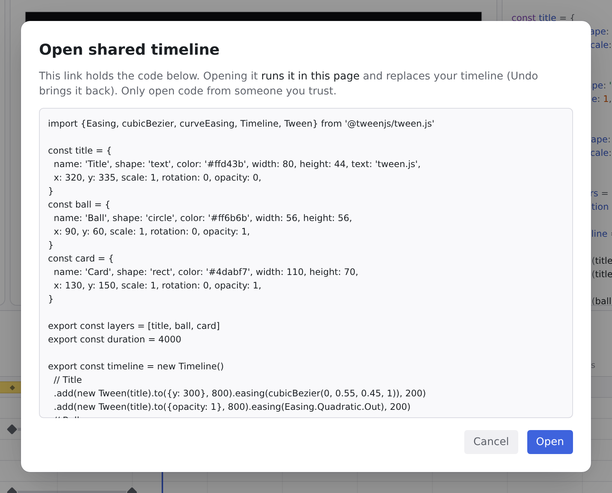
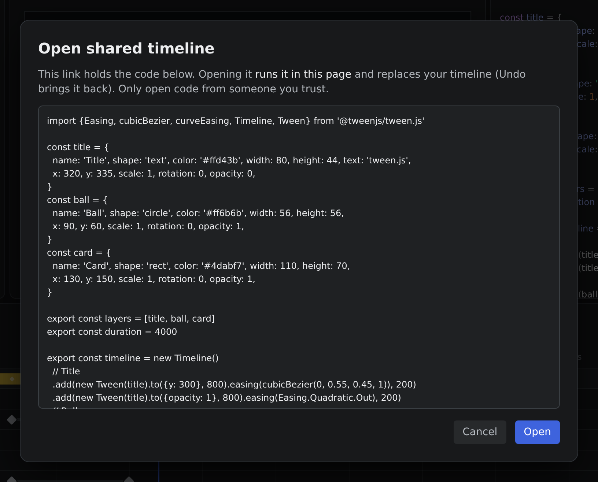
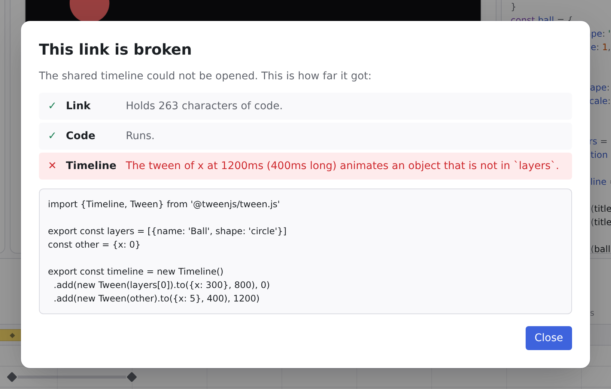
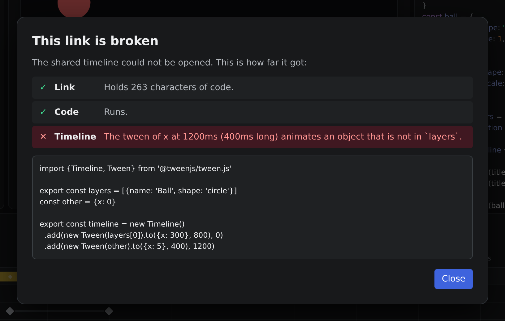

# Sharing and opening links

**File › Share** turns the timeline into a link. The link holds the whole timeline as **code**, so there is nothing to upload and nobody to sign in to: you paste the link into a chat or an e-mail, and whoever opens it gets the same timeline.

<figure class="themed"><figcaption>Where the browser has no share sheet and no clipboard access, the link is shown, selected, ready to copy.</figcaption></figure>

## Make a link

1. Choose **File › Share…**.
2. What happens next depends on your browser:
   - If it has a share sheet (phones, some desktop browsers), the sheet opens.
   - Otherwise the link is **copied to the clipboard** and a toast says so.
   - If the clipboard is not available either, the link is shown in a dialog, with the link selected.

The link is the page's address, a `#`, and the code, written in base64:

```text
https://example.org/#aW1wb3J0IHtFYXNpbmcsIFRpbWVsaW5lLCBUd2Vlbn0gZnJvbSAnQHR3ZWVuanMvdHdlZW4uanMnCg…
```

Everything after the `#` is called the fragment, and **a browser never sends the fragment to a server**. So the code in a link is not uploaded anywhere: it lives only in the link.

The code is the code you see in the code panel. If the code panel has your own edits and they compile, **those** are shared, as you wrote them, comments included. If they do not compile, the code of the timeline that is shown on the stage is shared instead.

> [!NOTE]
> The alphabet is the URL-safe one (`-` and `_`, no `=` padding), so that a link survives being pasted into a chat. Standard base64 is read as well, and so is a link that was broken over lines or had its characters escaped.

### Make one by hand

A link is just base64 of the code, so you can make or read one yourself. In Node.js:

```js
import {readFileSync} from 'node:fs'

// The link of a saved timeline (File › Save makes timeline.js):
const code = readFileSync('timeline.js', 'utf8')
console.log('https://example.org/#' + Buffer.from(code, 'utf8').toString('base64url'))

// and back, from the text after the # of a link:
const fragment = 'aW1wb3J0IHtUaW1lbGluZSwgVHdlZW59…'
console.log(Buffer.from(fragment, 'base64url').toString('utf8'))
```

In a browser, the **Open in editor** button on the code blocks of these docs does the same.

## Open a link

When the page is opened with a link, the editor does **not** just run it. Code is run to find out what it animates, and code from somebody else could do anything, so it is shown first:

<figure class="themed"><figcaption>"Opening it runs it in this page." Read the code first, and open it only if you trust the sender.</figcaption></figure>

- **Cancel** and nothing changes. The link is removed from the address bar either way.
- **Open** runs the code and replaces your timeline with it. The code appears in the code panel **as it was written**, and the status reads **In sync**. The player stops at 0 s and waits for Play ([Timeline, keyframes and playback](ref-timeline)).
- **Undo** brings your own timeline back.

> [!WARNING]
> Opening a link runs code from the link in your browser, in the editor's page. Treat it like running a script you were sent. Read the code in the dialog first. The editor does not sandbox it.

## A broken link

A link can fail in three different places. The editor tells you which, in a dialog with three rows, **Link**, **Code** and **Timeline**. The first row that fails is marked red, and the ones after it say _Not reached_:

<figure class="themed"><figcaption>This link got as far as the timeline: its code runs, but one tween animates an object that is not in <code>layers</code>.</figcaption></figure>

### Link: the link itself is damaged

The text after the `#` is not base64 of text. It was cut when it was pasted, or something was added to it. The message is one of:

| Message                          | Cause                                                                              |
| -------------------------------- | ---------------------------------------------------------------------------------- |
| `The link does not hold base64.` | Characters that are not base64, such as `not*base64`.                              |
| `The link does not hold text.`   | It decodes, but not to UTF-8 text: random bytes.                                   |
| `The shared code is too large.`  | More than about 2.8 million characters after the `#`, which is about 2 MB of code. |

The dialog also says how many characters there were after the `#`. **Fix:** ask the sender for the link again, and check that your chat or mail did not cut the end of it.

### Code: the code cannot be read or run

The link is fine, but the code is not. Code that is not well-formed JavaScript is refused **before** you are asked to run it, with the browser's own message:

```text
Unexpected token '}'
```

Code that is well-formed but fails when it runs (you chose **Open**) shows the error it threw, for example `ReferenceError: missing is not defined`, and the Timeline row says _Not reached_. **Fix:** copy the code from the dialog into the editor's code panel, where the status line shows what is wrong, and correct it there. Then share a new link.

### Timeline: it runs, but it cannot be shown

The code runs, but what it builds is not something a timeline can show. The message says **which animation**. For example:

| Message                                                                                           | Cause and fix                                                                                    |
| ------------------------------------------------------------------------------------------------- | ------------------------------------------------------------------------------------------------ |
| ``The code must define `layers`: an array of layer objects.``                                     | There is no `export const layers = […]`.                                                         |
| ``The code must define `timeline`: a `new Timeline()`.``                                          | There is no `export const timeline = new Timeline()`.                                            |
| ``The tween of x at 1200ms (400ms long) animates an object that is not in `layers`.``             | A tween's target is missing from `layers`. Add the object to the list.                           |
| `A x at 200ms: tweens of one property may not overlap.`                                           | Two tweens of the same property of layer A run at once. Give the second a later time.            |
| `A x at 0ms: only numeric values are supported.`                                                  | A value such as `'far'`. Use a number.                                                           |
| `Tween.repeat() is not supported by the timeline editor.`                                         | `repeat`, `yoyo`, `chain` and `interpolation` cannot be shown ([Timeline and code](guide-code)). |
| ``THREE is used outside of a scene function. Use three.js inside the function given as `scene`.`` | three.js used outside the scene function ([Three.js scenes](guide-three)).                       |

A dialog that names `A x at 200ms` tells you the layer (`A`), the property (`x`) and the time of the tween that is wrong.

## Old links

Links made before the editor shared code looked like `…/#t=z…`: the timeline as compressed JSON. They **still open**, and they do not ask first, because they hold only data. For the same reason they refuse a custom three.js scene (`This timeline has a three.js scene of its own. Scenes are code: share it as a link from File › Share.`), while the two built-in ones, the cube and the black hole, are fine.

## Size

A link holds all of the code, so a big timeline makes a long link. The templates are the extreme: Sign-in flow, Launch film and Dashboard are 65 KB, 92 KB and 117 KB of code, so their links are 87,000 to 156,000 characters long. Many chat apps and some browsers cut links that long, and the editor refuses links over 2 MB of code. For big timelines use **File › Save** and send the `.js` file instead; the receiver opens it with **File › Open**, which also stops playback at 0 s.

## See also

- [Share links](ref-share): the exact format and the limits.
- [Timeline and code, two ways](guide-code)
- [Menus and actions](ref-menu)
