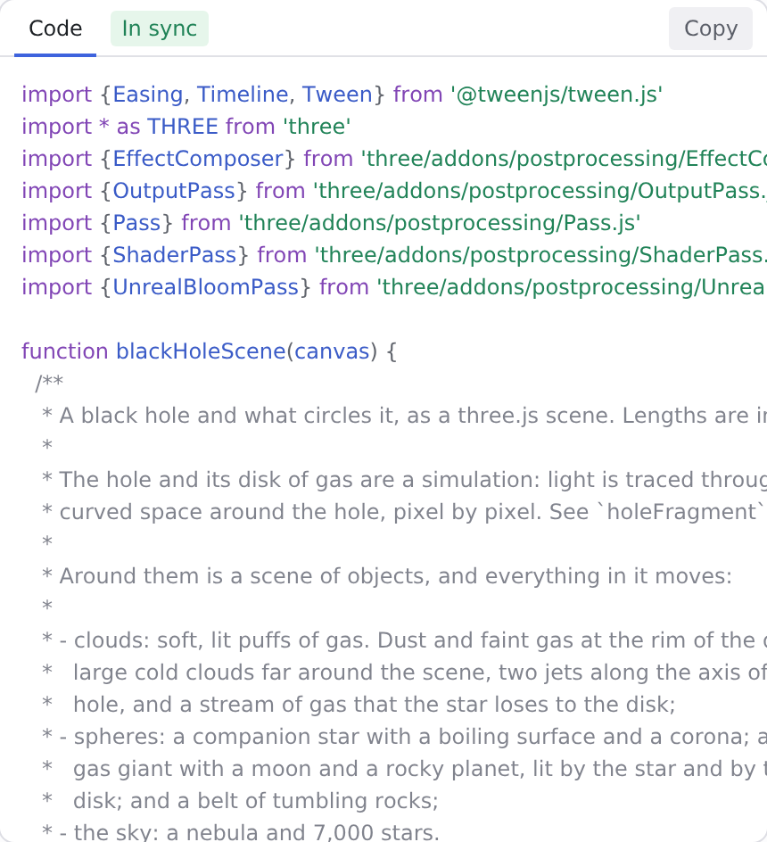
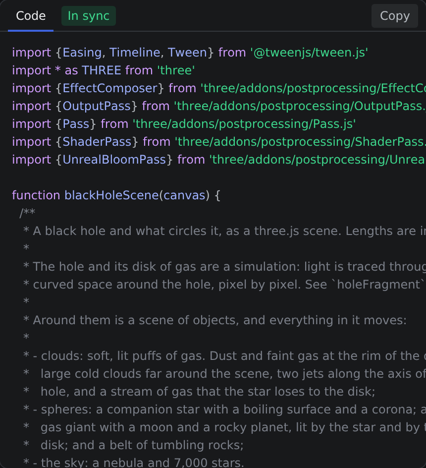
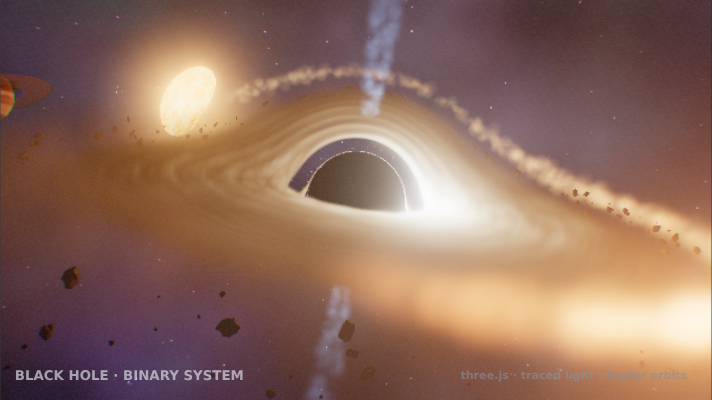

# Three.js scenes

A layer does not have to be a rectangle, a circle or a text. A layer with the shape **`three`** is a 3D scene drawn with [three.js](https://threejs.org/), and the drawing is **real code**: a function in the code panel, next to the timeline, with real `import` lines for three.js at the top of the code. You can read it, change it, and it is saved, shared and undone with the timeline like everything else.

<figure class="themed"><figcaption>The code panel on the Black hole template: its imports, and the scene function that draws it.</figcaption></figure>

## Add a scene

There are two ways to get one:

- **Change a layer's shape.** Select a layer, and in the Properties panel set **Shape** to `three`. The layer gets a small spinning cube, and its code appears in the code panel ([`scene3d/cube.js`](ref-scene) is its source).
- **Open the Black hole template** from **Templates › Pre-ready**. It is one `three` layer and two captions, and the scene is a simulation of light bent around a black hole, with planets, a star and a belt of rocks.

<figure><figcaption>Black hole: one layer, drawn by about 1,300 lines of three.js code.</figcaption></figure>

> [!NOTE]
> three.js is big, so it is loaded only when a timeline has a `three` layer. The first time may take a moment.

## What the code looks like

Here is the timeline of a cube layer, as the editor writes it. A scene is the function given as `scene` in the layer object; the imports are the lines for `three` at the top.

```js
import {Easing, Timeline, Tween} from '@tweenjs/tween.js'
import * as THREE from 'three'

function cubeScene(canvas) {
	// A three.js layer is a function. It gets the layer's canvas, builds a scene
	// with three.js, and returns what draws one frame of it.
	const renderer = new THREE.WebGLRenderer({canvas, antialias: true, alpha: true})
	const scene = new THREE.Scene()
	const camera = new THREE.PerspectiveCamera(45, 1, 0.1, 100)

	const cube = new THREE.Mesh(
		new THREE.BoxGeometry(1.4, 1.4, 1.4),
		new THREE.MeshStandardMaterial({color: '#4dabf7', roughness: 0.35, metalness: 0.1}),
	)
	const sun = new THREE.DirectionalLight('#ffffff', 2.5)
	sun.position.set(2, 3, 4)
	scene.add(cube, sun, new THREE.AmbientLight('#ffffff', 0.6))

	let size = ''
	return {
		// `frame` is the playhead (`time` of `duration`, in milliseconds) and the
		// layer as the timeline has it at that moment: `rotation`, `scale`,
		// `width`, `height`. Draw from those alone, so that scrubbing works.
		draw(frame) {
			if (size !== frame.width + 'x' + frame.height) {
				size = frame.width + 'x' + frame.height
				renderer.setPixelRatio(window.devicePixelRatio)
				renderer.setSize(frame.width, frame.height, false)
				camera.aspect = frame.width / frame.height
				camera.updateProjectionMatrix()
			}
			// Keyframes on the layer's rotation turn the cube, and on its scale bring it closer.
			cube.rotation.y = (frame.rotation * Math.PI) / 180
			cube.rotation.x = (frame.time / frame.duration) * Math.PI * 2
			camera.position.z = 4 / Math.max(0.1, frame.scale)
			renderer.render(scene, camera)
		},
		dispose() {
			cube.geometry.dispose()
			cube.material.dispose()
			renderer.dispose()
			renderer.forceContextLoss()
		},
	}
}

const cube = {
	name: 'Cube',
	shape: 'three',
	color: '#ff6b6b',
	width: 320,
	height: 240,
	x: 320,
	y: 180,
	scale: 1,
	rotation: 0,
	opacity: 1,
	scene: cubeScene,
}

export const layers = [cube]
export const duration = 3000

export const timeline = new Timeline()
	// Cube
	.add(new Tween(cube).to({rotation: 360}, 3000), 0)
```

A scene is `function (canvas) { … return {draw(frame), dispose()} }`:

- It gets the layer's `<canvas>`, builds its scene **once**, and returns an object with a `draw(frame)` method. (It may also return a function, which is used as `draw`.)
- `draw(frame)` is called on every frame the stage is drawn, and also when you scrub. `frame` holds `time`, `duration`, `playing`, the layer's `width` and `height`, and the layer's `x`, `y`, `scale`, `rotation` and `opacity` **at that moment**. Draw from those alone, so that the picture is the same whenever the playhead is put on a time.
- `dispose()` is optional: it is called when the canvas goes away, to free the GPU memory.

The full contract is in [Three.js scene contract](ref-scene).

## The timeline drives the scene

A `three` layer has the same five properties as every layer, and they are how the timeline talks to the scene:

| Property            | What the layer does with it                                                           | What the scene gets                                               |
| ------------------- | ------------------------------------------------------------------------------------- | ----------------------------------------------------------------- |
| `x`, `y`            | The canvas is moved on the stage, like any layer.                                     | `frame.x`, `frame.y`                                              |
| `opacity`           | The canvas fades.                                                                     | `frame.opacity`                                                   |
| `rotation`, `scale` | **Not** applied to the picture: a 3D scene is not turned or scaled like a flat image. | `frame.rotation`, `frame.scale`: the scene uses them as it likes. |

In the cube, `rotation` turns the cube and `scale` moves the camera closer. In the Black hole, `rotation` is where the camera is on its orbit around the hole (-70° to 290°: once around, so the film loops) and `scale` is how close it is (1 far, 1.5 close over the disk). So you animate a 3D scene with the keyframes and curves you already know.

The canvas has the layer's `width` and `height` and sits on a black background; the `color` field is not used for a `three` layer.

## Edit a scene, live

Because the scene is code, you can change it and see the result. Open the **Black hole** template, find a line such as `const starCount = 7000` in the code panel and make it `500`. A moment after you stop typing the status reads **In sync**, the canvas is built again, and the sky has far fewer stars.

> [!IMPORTANT]
> A new canvas is made every time the scene's code changes, because a WebGL context cannot be reused. Playing and scrubbing do not rebuild it.

If the scene's code is wrong, the stage does not go blank in silence: the error is written over the layer, for example `This scene stopped: missing is not defined`, and the details are in the browser's console. Fix the code and it starts again.

## Which modules can be imported

The code panel is text, not a file, so the editor resolves the imports itself and only knows these modules:

| Import                                           | What it is                            |
| ------------------------------------------------ | ------------------------------------- |
| `three`                                          | three.js itself                       |
| `three/addons/geometries/RoundedBoxGeometry.js`  | A box with rounded corners            |
| `three/addons/postprocessing/EffectComposer.js`  | The post-processing chain             |
| `three/addons/postprocessing/RenderPass.js`      | Renders the scene into the chain      |
| `three/addons/postprocessing/ShaderPass.js`      | A custom shader as a pass             |
| `three/addons/postprocessing/UnrealBloomPass.js` | A glow                                |
| `three/addons/postprocessing/OutputPass.js`      | Colour output at the end of the chain |
| `three/addons/postprocessing/Pass.js`            | The base class of the passes          |

`three/examples/jsm/…` is read as `three/addons/…`. Any other path is refused: `'three/addons/controls/OrbitControls.js' cannot be imported in the editor. It has: three, three/addons/geometries/RoundedBoxGeometry.js, …` (and the rest of the table). Namespace imports (`import * as THREE from 'three'`), named imports (`import {Mesh, Scene} from 'three'`, also `as` aliases) and default imports are all read. Each `import` must be on **one line**.

## The function must hold everything it uses

When the timeline is read back from the code, the scene is kept as **the source text of the function** and the three.js import lines, and nothing else. It is run later, with only the imports in reach. So:

- Everything the scene uses has to be **inside the function** (helpers, classes, constants) or be one of its imports.
- Anything written at the top level of the code, outside the function, is not there when the scene runs.

If a top-level line uses three.js, the editor tells you straight away:

```text
THREE is used outside of a scene function. Use three.js inside the function given as `scene`.
```

and if the function reaches for a variable of the outer code, the scene stops with a message like `This scene stopped: helper is not defined`. Move the helper inside.

Two more rules, with the messages the editor gives:

- A layer with the shape `three` needs a `scene`: ``A has the shape 'three', so it needs `scene`: a function that gets a canvas and draws on it.``
- Write it as a function or an arrow function, not as a method (`scene(canvas) {…}`): ``Write the `scene` of A as a function or an arrow function, not as a method.``

## Try writing one

A small scene of your own: a flat-shaded crystal that turns with the layer's `rotation` and comes closer with its `scale`. Press **Open in editor** on the block below, accept the dialog that shows the code, and press Play.

```js
import {Timeline, Tween} from '@tweenjs/tween.js'
import * as THREE from 'three'

function crystal(canvas) {
	const renderer = new THREE.WebGLRenderer({canvas, antialias: true})
	const scene = new THREE.Scene()
	const camera = new THREE.PerspectiveCamera(45, 1, 0.1, 100)
	const mesh = new THREE.Mesh(new THREE.IcosahedronGeometry(1.2, 0), new THREE.MeshNormalMaterial({flatShading: true}))
	scene.add(mesh)

	let size = ''
	return {
		draw(frame) {
			if (size !== frame.width + 'x' + frame.height) {
				size = frame.width + 'x' + frame.height
				renderer.setSize(frame.width, frame.height, false)
				camera.aspect = frame.width / frame.height
				camera.updateProjectionMatrix()
			}
			mesh.rotation.y = (frame.rotation * Math.PI) / 180
			mesh.rotation.x = 0.4
			camera.position.z = 4 / frame.scale
			renderer.render(scene, camera)
		},
		dispose() {
			mesh.geometry.dispose()
			mesh.material.dispose()
			renderer.dispose()
		},
	}
}

export const layers = [{name: 'Crystal', shape: 'three', width: 320, height: 240, x: 320, y: 180, scene: crystal}]
export const duration = 4000

export const timeline = new Timeline().add(new Tween(layers[0]).to({rotation: 360, scale: 1.6}, 4000), 0)
```

## Sharing a scene

A scene is code, so it travels as code: **File › Share** makes a link of the whole code, and anyone who opens it **sees the code and is asked** before it runs ([Sharing and opening links](guide-share)). Old links that carry a timeline as data (`#t=…`) cannot carry code, so they refuse a scene of its own and say so: `This timeline has a three.js scene of its own. Scenes are code: share it as a link from File › Share.` The two built-in scenes, the cube and the black hole, are the exceptions: they are known to the editor.
