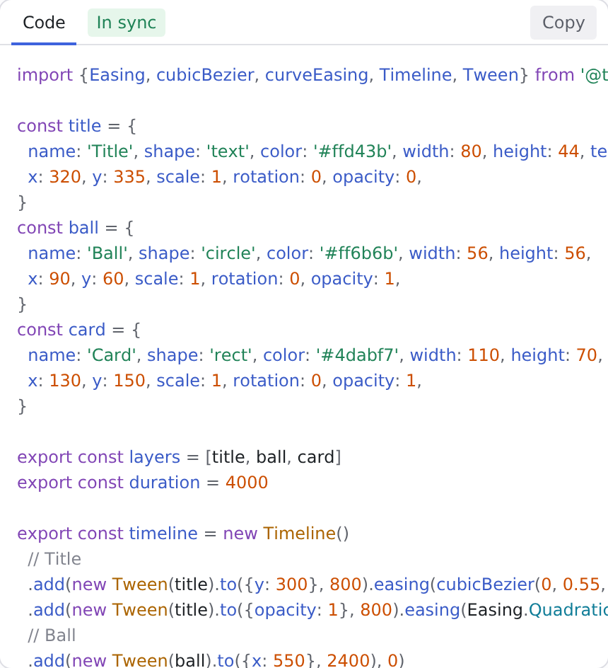
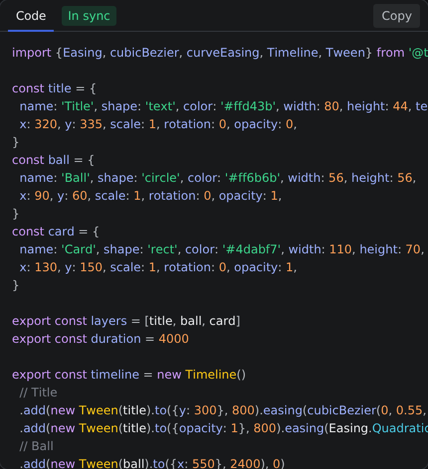

# Code format

The timeline and the code panel are two views of one animation. This page is the exact contract: what the code must define, every field of a layer, what the generated code looks like, how code is read back, and what it cannot express.

For a walk-through see [Timeline and code, two ways](guide-code). The curves that appear in `.easing()` are described in [Curve tool](ref-curve); three.js layers in [Three.js scene contract](ref-scene).

## What the code must define

A timeline is a JavaScript module that defines three things:

| Name       | Required | What it is                                                                                                                                                   |
| ---------- | -------- | ------------------------------------------------------------------------------------------------------------------------------------------------------------ |
| `layers`   | yes      | An **array of plain objects**, one per layer, first = drawn on top. Each describes the look of a layer and the starting values of its properties.            |
| `timeline` | yes      | A `new Timeline()` with the tweens that animate those objects.                                                                                               |
| `duration` | no       | The length of the timeline in milliseconds. Without it, or if it is not a number above 0, the length is the end of the last tween, or 1000 if there is none. |

`export const layers = …` is how the editor writes them, but `export` is optional: `const layers = …` is read just as well, and so is `export default timeline`. The final duration is never shorter than the last keyframe, whatever `duration` says. `duration` is rounded to a whole millisecond.

## Layer objects

Every field is optional. A missing or invalid one gets the default.

| Field             | Type                                      | Default                               | Notes                                                                                                         |
| ----------------- | ----------------------------------------- | ------------------------------------- | ------------------------------------------------------------------------------------------------------------- |
| `name`            | string                                    | `Layer 1`, `Layer 2`, … (by position) | Shown in the layer list. Also gives the variable name in generated code.                                      |
| `shape`           | `'rect'`, `'circle'`, `'text'`, `'three'` | `'rect'`                              | Any other value becomes `'rect'`. See [Layers and Properties](ref-layers).                                    |
| `color`           | string, a CSS colour                      | One of six colours, by position       | The fill of a rect or circle, the colour of a text. A `three` layer's picture is drawn by its scene on black. |
| `width`, `height` | number                                    | 80 and 80                             | In stage units (the stage is 640 × 360). For a `three` layer, the size of its canvas.                         |
| `radius`          | number ≥ 0                                | 6                                     | Corner radius of a `rect`. Written to code only for a rect whose radius is not 6.                             |
| `text`            | string                                    | `'Text'`                              | The words of a `text` layer. Written only for texts.                                                          |
| `align`           | `'left'` or `'right'`                     | the text's middle                     | Which side of a `text` layer is at `x`. Written only for texts that have it.                                  |
| `scene`           | function                                  | (required for `three`)                | `function (canvas) { … }` that draws the layer with three.js: see [Three.js scene contract](ref-scene).       |
| `x`, `y`          | number                                    | 0, 0                                  | The **centre** of the layer on the stage (its left or right edge for an aligned text).                        |
| `scale`           | number                                    | 1                                     | For a `three` layer it is passed to the scene instead of scaling the picture.                                 |
| `rotation`        | number, degrees                           | 0                                     | Same for `three`.                                                                                             |
| `opacity`         | number                                    | 1                                     | Drawn between 0 and 1.                                                                                        |

`x`, `y`, `scale`, `rotation` and `opacity` are the five **animatable properties**. The value in the object is the layer's value while it has **no** keyframes. Once a property has keyframes the layer starts from the first one, and the generated code writes that first value into the object.

Unknown fields are ignored. A `three` layer without a function `scene` is refused with ``<name> has the shape 'three', so it needs `scene`: a function that gets a canvas and draws on it.``

## The generated code

Every change in the editor rewrites the code. This is the code of the starting demo, exactly as the editor writes it:

```js
import {Easing, cubicBezier, curveEasing, Timeline, Tween} from '@tweenjs/tween.js'

const title = {
	name: 'Title',
	shape: 'text',
	color: '#ffd43b',
	width: 80,
	height: 44,
	text: 'tween.js',
	x: 320,
	y: 335,
	scale: 1,
	rotation: 0,
	opacity: 0,
}
const ball = {
	name: 'Ball',
	shape: 'circle',
	color: '#ff6b6b',
	width: 56,
	height: 56,
	x: 90,
	y: 60,
	scale: 1,
	rotation: 0,
	opacity: 1,
}
const card = {
	name: 'Card',
	shape: 'rect',
	color: '#4dabf7',
	width: 110,
	height: 70,
	x: 130,
	y: 150,
	scale: 1,
	rotation: 0,
	opacity: 1,
}

export const layers = [title, ball, card]
export const duration = 4000

export const timeline = new Timeline()
	// Title
	.add(new Tween(title).to({y: 300}, 800).easing(cubicBezier(0, 0.55, 0.45, 1)), 200)
	.add(new Tween(title).to({opacity: 1}, 800).easing(Easing.Quadratic.Out), 200)
	// Ball
	.add(new Tween(ball).to({x: 550}, 2400), 0)
	.add(
		new Tween(ball).to({y: 230}, 1600).easing(
			curveEasing([
				[0, 0, 0, 0, 0.2, 0],
				[0.4, 1, -0.08, -0.45, 0.06, -0.24],
				[0.72, 1, -0.06, -0.24, 0.04, -0.1],
				[0.9, 1, -0.04, -0.1, 0.03, -0.035],
				[1, 1, -0.03, -0.035, 0, 0],
			]),
		),
		0,
	)
	.add(new Tween(ball).to({scale: 0}, 600).easing(Easing.Back.In), 2400)
	// Card
	.add(new Tween(card).to({x: 420}, 1200).easing(cubicBezier(0.3, 1.45, 0.6, 1)), 600)
	.add(new Tween(card).to({rotation: 180}, 1600).easing(Easing.Cubic.InOut), 1800)
```

How it is written:

- **The import line** is always one statement from `'@tweenjs/tween.js'`, and lists `Easing`, the helpers `cubicBezier` and `curveEasing` **only if the code uses them**, then `Timeline` and `Tween`, in that order. A three.js layer adds its own `import … from 'three…'` lines after it.
- **One object per layer**, named after the layer: its name in camelCase (`Rect 2` becomes `rect2`), `layer` in front of a name that does not start with a letter, `Layer` after a reserved word, and a number to keep names unique. The names `layers`, `duration`, `timeline`, `tween`, `tweens`, `Tween`, `Timeline`, `Easing`, `cubicBezier`, `curveEasing` and `THREE` are never taken.
- **One tween per pair of neighbouring keyframes** of a property, added at its **absolute start time**: `.add(new Tween(layer).to({prop: value}, duration), start)`. Properties of a layer that move over the same time span with the same easing share one tween: `.to({x: 100, y: 40}, 800)`. A comment with the layer's name starts each layer's tweens, which are in time order.
- A property with **one keyframe** is written as a zero-length tween (`.to({x: 5}, 0)`) so the keyframe survives the round trip.
- **Easing**: nothing for linear, `Easing.Family.Kind` for a preset, `cubicBezier(…)` or `curveEasing([…])` for a custom curve (see [Curve tool](ref-curve#in-code)).
- **Numbers** have at most three decimals.
- `export const layers` and `export const duration` (always) come before `export const timeline`.

Typing the same code back changes nothing: the editor compares what the code **means** with what it already has, so reformatting is not an edit and does not add an undo step. What you wrote stays in the panel until the next change **made in the editor**, which rewrites the whole code: comments and your own formatting are replaced then.

> [!NOTE]
> `cubicBezier` and `curveEasing` are the editor's own helpers. `@tweenjs/tween.js` does not export them yet, so the editor supplies them while it runs your code, but code that imports them does not run in your own page until the library exports them or you add `src/model/easingCurve.js` yourself.

## How code is read

Whenever the code changes (350 ms after you stop typing) the editor runs it and rebuilds the timeline from what it **observed**:

1. The `import` statements are removed. The names the code uses must be defined by the code itself or be one of the names the editor provides: `Tween`, `Timeline`, `Easing`, `cubicBezier`, `curveEasing`, `OwnEasing` (see [Curve tool](ref-curve#svg-path-data)) and a stub `requestAnimationFrame`. So `import … from` anything is accepted, but a name that is not provided or defined is a `ReferenceError`.
2. `export const`, `export let`, `export var`, `export function` and `export class` lose their `export`, and `export default x` becomes the timeline. Everything else is read by name: `layers`, `timeline` and `duration`.
3. The result runs as a **function body** in strict mode, in the page, with `Tween` and `Timeline` replaced by **recording** versions of the real classes. Nothing is animated: the recorders only note every tween.
4. The real `Timeline` works out where each tween starts. One update at the very end of the timeline reports every start, so offsets, `delay()`, labels, tweens added **without** an offset (they follow the previous one) and **nested timelines** all work.
5. For each tween the editor takes the target (which must be one of the objects in `layers`), the values given to `.to()`, the duration, the delay and the easing, and builds the keyframes: a tween from time _t₀_ to _t₁_ gives a keyframe at _t₀_ (the value the property had there) and one at _t₁_ (the new value), the first with the tween's easing.

So the code can be written freely: loops, variables, helper functions and arithmetic all work, because the code is simply run.

```js
import {Timeline, Tween, Easing} from '@tweenjs/tween.js'

const dots = [0, 1, 2, 3].map(i => ({
	name: 'Dot ' + (i + 1),
	shape: 'circle',
	width: 30,
	height: 30,
	x: 100,
	y: 60 + i * 70,
}))

export const layers = dots
export const timeline = new Timeline()

dots.forEach((dot, i) => {
	timeline.addLabel('dot' + i, i * 200)
	timeline.add(new Tween(dot).to({x: 540}, 1200).easing(Easing.Quadratic.InOut), 'dot' + i)
})
```

Where a tween starts is where the real thing would start it: a tween begins from wherever its property **is** at that moment, the previous keyframe's value or the layer's value. A gap between two tweens of one property keeps the property still, with a keyframe at the start of the second tween.

### What the code can use

| Used in the code                                                                           | How it is read                                                                                               |
| ------------------------------------------------------------------------------------------ | ------------------------------------------------------------------------------------------------------------ |
| `.to({x: 100, y: 20}, 500)`                                                                | One keyframe pair per property. Values must be numbers.                                                      |
| `.delay(100)`                                                                              | Added to the tween's start.                                                                                  |
| `.duration(500)`                                                                           | Sets the duration.                                                                                           |
| `.easing(fn)`                                                                              | A preset, a curve or a traced function: see [Curve tool](ref-curve#tracing-an-easing-function-into-a-curve). |
| `timeline.add(tween, offset)`, `add(tween)`, `add(tween, 'label')`, `addLabel(name, time)` | Positions, resolved by tween.js itself.                                                                      |
| `timeline.add(otherTimeline, offset)`                                                      | Nested timelines, at their offset.                                                                           |
| Tweens that end where the next begins                                                      | Share a keyframe. Two tweens at the same time on one property give the second's easing to that keyframe.     |

### What the editor cannot show

These are refused, and the status says so. The timeline keeps its last working state.

| In the code                                               | The message                                                                                     |
| --------------------------------------------------------- | ----------------------------------------------------------------------------------------------- |
| `.repeat()`                                               | `Tween.repeat() is not supported by the timeline editor.`                                       |
| `.yoyo()`                                                 | `Tween.yoyo() is not supported by the timeline editor.`                                         |
| Adding the same tween twice, or `add(tween, {repeat: …})` | `Repeating a tween (repeat, yoyo, or adding it twice) is not supported by the timeline editor.` |
| `.chain()`                                                | `Tween.chain() is not supported by the timeline editor.`                                        |
| `.interpolation()`                                        | `Tween.interpolation() is not supported by the timeline editor.`                                |
| Repeating a nested timeline                               | `Repeating a nested timeline is not supported by the timeline editor.`                          |
| A timeline that never ends                                | `A timeline that never ends is not supported by the timeline editor.`                           |
| A value that is not a number (`.to({x: '100'}, …)`)       | `<layer> <prop> at <time>ms: only numeric values are supported.`                                |
| Two tweens of one property that overlap in time           | `<layer> <prop> at <time>ms: tweens of one property may not overlap.`                           |
| A tween of an object that is not in `layers`              | `The tween of <props> at <time>ms (<n>ms long) animates an object that is not in `layers`.`     |
| No `layers` array                                         | `The code must define `layers`: an array of layer objects.`                                     |
| Something other than an object in `layers`                | `` `layers` must contain objects.``                                                             |
| No `timeline`                                             | `The code must define `timeline`: a `new Timeline()`.`                                          |
| An easing that is not a function                          | `easing expects a function.`                                                                    |
| A syntax error, or any error the code throws when it runs | The browser's own message, such as `Unexpected end of input` or `x is not defined`.             |

Because the code is run, the names matter: `Tween` and `Timeline` must be used **as named**. An alias (`import {Timeline as T}`) leaves `T` undefined, and `export {layers, timeline}` is a syntax error: use `export const` or `export default`.

Not an error, but dropped:

| In the code                                                                                         | What the status shows                                                                  |
| --------------------------------------------------------------------------------------------------- | -------------------------------------------------------------------------------------- |
| A property that is not `x`, `y`, `scale`, `rotation` or `opacity`                                   | `"z" is not an animatable property (x, y, scale, rotation, opacity).`                  |
| `onStart`, `onEveryStart`, `onUpdate`, `onRepeat`, `onComplete`, `onStop`, on a tween or a timeline | `Tween.onUpdate() callbacks are not kept by the editor.` (`Timeline.…` for a timeline) |
| An easing function that is not one of tween.js's and has no curve                                   | `A custom easing function was traced into an editable curve.`                          |

Warnings are joined into one line.

A `three` layer has two more refusals: a `scene` written as a **method** (`scene(canvas) {}`) gives ``Write the `scene` of <name> as a function or an arrow function, not as a method.``, and a name from a `three` import used **outside** the scene function gives `THREE is used outside of a scene function. Use three.js inside the function given as `scene`.` See [Three.js scene contract](ref-scene).

There is no layer limit in code. A document that is read back from the browser's storage or from an old link keeps at most **400 layers**, 2000 keyframes per property, 200 characters of name or text and sizes up to 10000.

## The status line

Next to **Code** the status says where the code stands:

| Status                    | Colour | Meaning                                                                                                                          |
| ------------------------- | ------ | -------------------------------------------------------------------------------------------------------------------------------- |
| `In sync`                 | green  | The code compiled and the timeline is what it says.                                                                              |
| `Editing…`                | amber  | You are typing. After 350 ms without a key the code is run.                                                                      |
| The warnings, in one line | amber  | The code compiled, with the notes above. The timeline follows the code.                                                          |
| The error message         | red    | The code does not compile. The timeline keeps its **last working state**, and the status shows why. Fix the code and it resumes. |

While a drag is in progress in the editor, the code is written once when it ends, not on every pointer move.

## Format and Check

Both are in the **Format** menu (see [Menus and actions](ref-menu)).

- **Format code** compiles the code, and if it works rewrites it in the editor's own style, with the toast _Code formatted._ If it does not compile it shows the same dialog as Check.
- **Check code** compiles the code and **does not change the timeline**. A dialog says either _No problems found._ or _The code compiles, with notes:_ followed by the warnings, with a summary such as `3 layers, 12 keyframes, 4000ms.`. For code that fails it says _The code does not compile. The timeline keeps its last working state until this is fixed._ and the message.

<figure class="themed"><figcaption>The code panel with its status. The code is coloured as it is typed.</figcaption></figure>

## Opening and saving code

**File › Open** reads a `.js`, `.mjs` or `.ts` file into the panel as if you had typed it: it compiles, or reports why not. **File › Save** downloads the code as `timeline.js`. A file saved this way is a module that imports `'@tweenjs/tween.js'`. See [Menus and actions](ref-menu) and [Share links](ref-share).

> [!WARNING]
> The code is **run in the page**, with the page's own privileges. Only open code from someone you trust. A shared link shows its code first and asks before running it.
