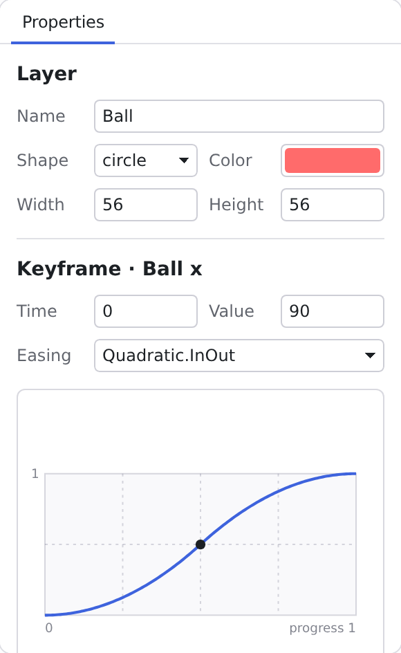
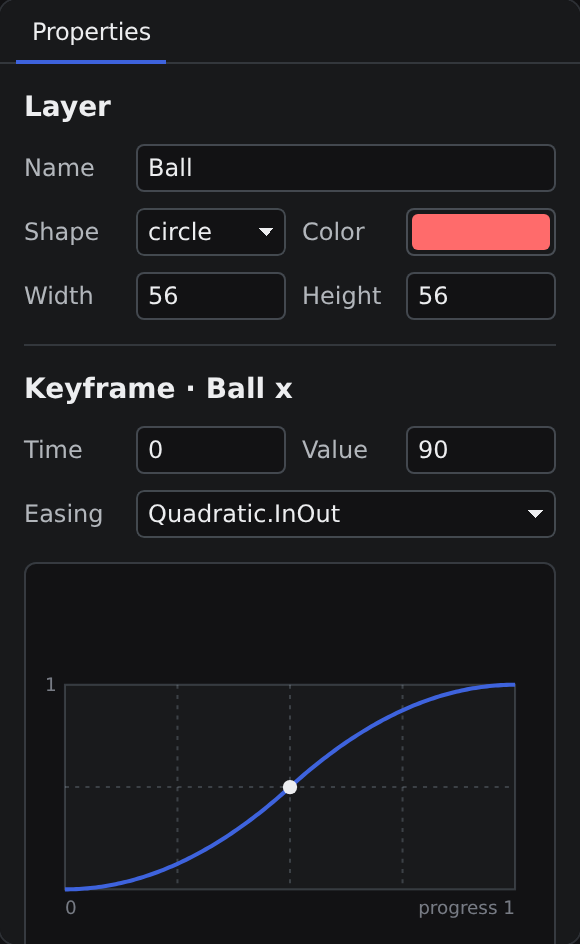
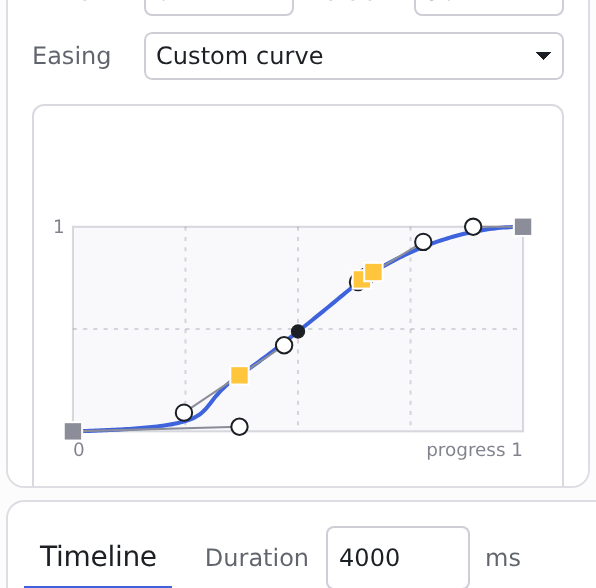
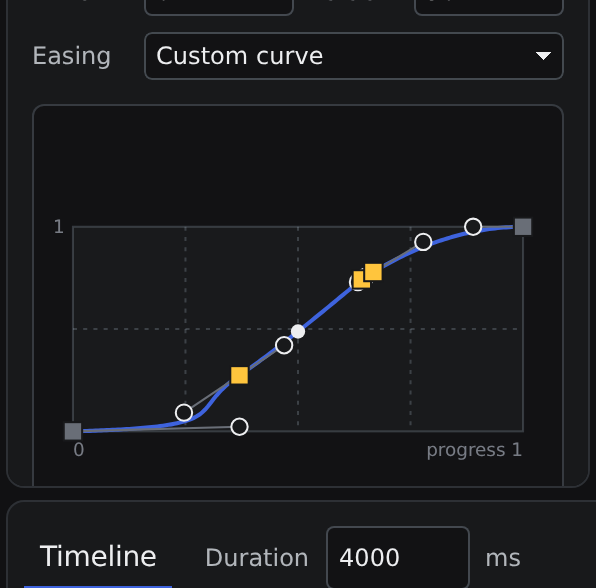

# Curve tool

The curve tool shapes the motion from one keyframe to the next. This page is the exact reference: what the graph shows, every gesture, the rules a curve always follows, how a curve is stored, how it is written to code, and how an easing function found in code is turned into a curve you can edit.

For a gentler introduction see [Easing and curves](guide-easing). The fields around the graph are described in [Timeline, keyframes and playback](ref-timeline).

## Which segment an easing belongs to

A keyframe's easing shapes the segment that **leaves** it, the motion towards the next keyframe of the same property. So the **last** keyframe of a property has no easing (its Easing select is disabled, and the panel asks you to add a keyframe after it).

Every keyframe has one of two kinds of easing:

| Kind             | What it is                                                             | Shown in the graph                    | Written to code as                                                   |
| ---------------- | ---------------------------------------------------------------------- | ------------------------------------- | -------------------------------------------------------------------- |
| **Preset**       | A tween.js easing by name, such as `Quadratic.InOut`                   | The curve, drawn but not editable     | `.easing(Easing.Quadratic.InOut)` (nothing at all for `Linear.None`) |
| **Custom curve** | A list of nodes joined by cubic béziers, which you edit with the graph | The curve, with its nodes and handles | `cubicBezier(...)` or `curveEasing([...])`, see [below](#in-code)    |

The **Easing** select in the Properties panel lists _Custom curve_ first, then every preset grouped by family: Linear (only `Linear.None`), Quadratic, Cubic, Quartic, Quintic, Sinusoidal, Exponential, Circular, Elastic, Back and Bounce, each with `In`, `Out` and `InOut`.

Choosing _Custom curve_ on a keyframe that has a preset keeps the shape: the preset is traced into a curve first (see [Tracing](#tracing-an-easing-function-into-a-curve)). Choosing a preset replaces the curve.

<figure class="themed"><figcaption>The Keyframe section: Time, Value, Easing and the graph of the easing. Here the easing is the preset <code>Quadratic.InOut</code>, so the graph only shows it.</figcaption></figure>

## The graph

<figure class="themed"><figcaption>A custom curve: grey squares are the pinned ends, amber squares are anchors you can move, circles are handles, and the dot is the playhead.</figcaption></figure>

| Part                | Meaning                                                                                                                                                                                                          |
| ------------------- | ---------------------------------------------------------------------------------------------------------------------------------------------------------------------------------------------------------------- |
| Horizontal axis     | **Progress** through the segment, 0 at its first keyframe and 1 at the next. Labelled `0` and `progress 1`. Dashed grid lines at 0.25, 0.5 and 0.75.                                                             |
| Vertical axis       | The **eased value**: 0 is the first keyframe's value and 1 the next keyframe's value. The box drawn is 0 to 1; the plot continues from **−0.5 to 1.5**, so a curve may leave the box to overshoot or anticipate. |
| Blue line           | The easing, sampled at 161 points.                                                                                                                                                                               |
| Square, grey        | The two **end anchors**. They are pinned to (0, 0) and (1, 1) and cannot be moved. They only have one handle each: the first an outgoing one, the last an incoming one.                                          |
| Square, amber       | An **anchor** between them. Drag it to move it.                                                                                                                                                                  |
| Circle and its line | A **handle**: the **arm** is the line from its anchor. It sets the direction and strength of the curve as it enters (left handle) and leaves (right handle) the anchor.                                          |
| Dot                 | The **playhead**: where the current time is on this curve. It is only shown while the playhead is inside the segment, and it follows playback. Its height is clamped to the plotted range.                       |

The graph is drawn for the selected keyframe of the selected property. Select a keyframe in the timeline first (see [Timeline, keyframes and playback](ref-timeline)).

> [!NOTE]
> Only a **custom curve** can be edited. With a preset selected the graph is a picture: choose _Custom curve_ in the Easing select, or pick one of the shapes below the graph, to draw it by hand.

## Gestures

| Gesture                                  | Result                                                                                                                                                                        |
| ---------------------------------------- | ----------------------------------------------------------------------------------------------------------------------------------------------------------------------------- |
| Drag an amber anchor                     | Moves it in both directions. Its handles travel with it.                                                                                                                      |
| Drag a handle                            | Changes the direction and length of its arm. A handle cannot cross its anchor horizontally: the left handle never points right and the right handle never points left.        |
| Drag a handle of a middle anchor         | The **opposite handle stays in line** with it, on the other side, keeping its own length: the point stays smooth.                                                             |
| **Alt**-drag a handle                    | Bends **one side only**: the opposite handle does not follow, so the anchor becomes a sharp corner.                                                                           |
| Double-click empty graph                 | **Adds** an anchor at that progress. It sits on the curve, with handles that follow the local slope, so the shape barely changes.                                             |
| Double-click an amber anchor             | **Removes** it. The two end anchors cannot be removed.                                                                                                                        |
| Drag a point above 1 or below 0          | **Overshoot** (above 1) or **anticipation** (below 0): the value goes past the target and comes back, or backs away first. Down to −0.5 and up to 1.5 can be reached by hand. |
| One of the shape buttons under the graph | Replaces the curve with a preset (see [Presets](#presets)).                                                                                                                   |

Every change by hand is one undo step; a drag is a single step however long it takes. While the timeline plays, nothing in the graph can be changed: the cursor shows "not allowed" and a toast says _Pause to edit_.

## Rules every curve follows

A curve is always a **function of progress**, so it can be used as an easing function. Whatever is dragged, typed in code or imported, the editor applies these rules (`normalizeNodes`) and the curve you see is the one that is used:

1. The first node is at (0, 0) and the last at (1, 1).
2. Node `x` values strictly increase, with at least **0.01** between neighbours.
3. An incoming handle never points to the right (`ix ≤ 0`) and an outgoing handle never points to the left (`ox ≥ 0`).
4. A handle never reaches past its neighbouring anchor: if it would, it is **scaled down**, keeping its direction.

## How a curve is stored

A curve is a list of **nodes**, each with six numbers. Handles are stored **relative to their node**.

| Field | Meaning                                                  |
| ----- | -------------------------------------------------------- |
| `x`   | Progress of the anchor, 0 to 1                           |
| `y`   | Eased value of the anchor (may be below 0 or above 1)    |
| `ix`  | Incoming handle, horizontal offset from the anchor (≤ 0) |
| `iy`  | Incoming handle, vertical offset                         |
| `ox`  | Outgoing handle, horizontal offset (≥ 0)                 |
| `oy`  | Outgoing handle, vertical offset                         |

Neighbouring nodes are joined by a cubic bézier: from `(a.x, a.y)` through the controls `(a.x + a.ox, a.y + a.oy)` and `(b.x + b.ix, b.y + b.iy)` to `(b.x, b.y)`.

A two-node curve with no handle on the inside of the ends is the same thing as CSS `cubic-bezier(x1, y1, x2, y2)`:

```js
;[
	{x: 0, y: 0, ix: 0, iy: 0, ox: x1, oy: y1},
	{x: 1, y: 1, ix: x2 - 1, iy: y2 - 1, ox: 0, oy: 0},
]
```

In the saved document (and in a [share link](ref-share) made before links held code) a curve is `{"type": "curve", "nodes": [...]}`, and a preset is `{"type": "preset", "name": "Quadratic.InOut"}`. When a document is read back from storage or an old link, a curve with fewer than 2 or more than 64 nodes, or with a value that is not a finite number, is replaced by `Linear.None`.

### How a curve is played

`curveEasing(nodes)` bakes the curve into a function once: for each of 256 evenly spaced progress values it solves the bézier for `x` by bisection (32 steps), and stores `y`. The easing itself is then a **table lookup with linear interpolation**, so it costs about the same per frame as a built-in easing. The function returned has the nodes it came from as `easing.nodes`. Progress at or below 0 gives 0 and at or above 1 gives 1.

The editor keeps the tables of curves that did not change, because the document is recompiled after every edit.

## Presets

The shape buttons under the graph replace the curve with one of these. The first seven are two-node curves, written as `cubicBezier(x1, y1, x2, y2)`; **Bounce** has five nodes.

| Button      | `cubicBezier(x1, y1, x2, y2)` | Character                                                   |
| ----------- | ----------------------------- | ----------------------------------------------------------- |
| Linear      | `0.33, 0.33, 0.67, 0.67`      | Close to a straight line                                    |
| Ease        | `0.25, 0.1, 0.25, 1`          | CSS `ease`: quick start, long settle                        |
| Ease in     | `0.55, 0, 1, 0.45`            | Starts slowly                                               |
| Ease out    | `0, 0.55, 0.45, 1`            | Ends slowly                                                 |
| Ease in-out | `0.65, 0, 0.35, 1`            | Slow at both ends                                           |
| Overshoot   | `0.3, 1.45, 0.6, 1`           | Goes past the target and settles back                       |
| Anticipate  | `0.4, 0, 0.7, -0.45`          | Backs away first, then goes                                 |
| Bounce      | five nodes (`curveEasing`)    | Reaches the target, then falls back and bounces three times |

Drag the handles to see how the numbers shape the curve; the code under the graph is what the editor would write.

<div data-easing="0.65 0 0.35 1" data-editable data-title="Ease in-out"></div>

<div data-easing="0.3 1.45 0.6 1" data-editable data-title="Overshoot"></div>

<div data-easing="0.4 0 0.7 -0.45" data-editable data-title="Anticipate"></div>

## In code

Easing is written after `.to(...)`, with the tween's usual `.easing()`.

| Easing                                                | Code                                                                                                                             |
| ----------------------------------------------------- | -------------------------------------------------------------------------------------------------------------------------------- |
| Preset other than `Linear.None`                       | `.easing(Easing.Cubic.InOut)`                                                                                                    |
| `Linear.None`                                         | nothing: a tween without `.easing()` is linear                                                                                   |
| A custom curve of **two nodes** with no inner handles | `.easing(cubicBezier(0.3, 1.45, 0.6, 1))` (the four numbers are `ox`, `oy` of the first node and `1 + ix`, `1 + iy` of the last) |
| Any other custom curve                                | `.easing(curveEasing([[x, y, ix, iy, ox, oy], ...]))` one row per node                                                           |

Numbers are written with at most **three decimals**. A curve you drew is therefore stored in code rounded to three decimals, and reads back to the same curve.

```js
import {Timeline, Tween, cubicBezier} from '@tweenjs/tween.js'

const ball = {
	name: 'Ball',
	shape: 'circle',
	color: '#ff6b6b',
	width: 56,
	height: 56,
	x: 90,
	y: 180,
	scale: 1,
	rotation: 0,
	opacity: 1,
}

export const layers = [ball]
export const duration = 2000

export const timeline = new Timeline().add(
	new Tween(ball).to({x: 550}, 1500).easing(cubicBezier(0.3, 1.45, 0.6, 1)),
	200,
)
```

A custom curve with three nodes, as `curveEasing` rows `[x, y, ix, iy, ox, oy]` (a compact form of the node objects):

```js
import {Timeline, Tween, curveEasing} from '@tweenjs/tween.js'

const ball = {
	name: 'Ball',
	shape: 'circle',
	color: '#ff6b6b',
	width: 56,
	height: 56,
	x: 90,
	y: 60,
	scale: 1,
	rotation: 0,
	opacity: 1,
}

export const layers = [ball]
export const duration = 2000

export const timeline = new Timeline().add(
	new Tween(ball).to({y: 300}, 1600).easing(
		curveEasing([
			[0, 0, 0, 0, 0.2, 0],
			[0.4, 1, -0.08, -0.45, 0.06, -0.24],
			[1, 1, -0.3, 0, 0, 0],
		]),
	),
	0,
)
```

> [!NOTE]
> `cubicBezier` and `curveEasing` are the editor's own helpers (`src/model/easingCurve.js`). `@tweenjs/tween.js` does not export them yet, so code that imports them runs inside the editor, which provides them while it runs your code, but not in your own page until the library exports them or you add the helper yourself. The generated import line is always `import {Easing, cubicBezier, curveEasing, Timeline, Tween} from '@tweenjs/tween.js'`, listing only the helpers the code uses. See [Code format](ref-code).

## Tracing an easing function into a curve

When the editor reads code, each `.easing(...)` argument becomes the keyframe's easing like this:

| The argument                                                                                 | Result                                                                                                                     |
| -------------------------------------------------------------------------------------------- | -------------------------------------------------------------------------------------------------------------------------- |
| One of the `Easing` functions of tween.js (such as `Easing.Back.Out`)                        | The **preset** with that name (`Easing.Linear.*` becomes `Linear.None`)                                                    |
| A function with a `nodes` property, which is what `cubicBezier()` and `curveEasing()` return | A **curve** with exactly those nodes                                                                                       |
| Any other function, such as `k => k * k * k`                                                 | It is **traced** into a curve, and the status shows the note _A custom easing function was traced into an editable curve._ |
| Something that is not a function                                                             | The code is refused: `easing expects a function.`                                                                          |

Tracing (`fitCurveNodes`) samples the function and builds nodes until the curve stays within a **tolerance of 0.01** of it (at most 16 nodes):

1. A node is placed at each **corner**, where the slope jumps (each bounce of `Bounce.Out`, for example), with handles that follow the slope on each side, so corners stay sharp.
2. The curve is compared with the function at about 400 points. If the worst distance is above the tolerance, a node is added where it is largest, and the comparison repeats.
3. It stops when the error is within the tolerance, when the worst point is within 0.02 of an existing node, or at 16 nodes.
4. A handle is never longer than its segment rises, which stops near-vertical slopes (the `Circular` easings) from overshooting. These are the one family where the fit is looser: up to 0.06 off, where the others stay within 0.012.

How many nodes some built-in easings need when traced (for example by choosing _Custom curve_ on them): all the others 4 or fewer, `Cubic.InOut` 6, `Quintic.InOut` 7, `Circular.InOut` 7, `Back.InOut` 8, `Bounce.In` and `Bounce.Out` 8, `Exponential.InOut` 9, `Elastic.In` and `Elastic.Out` 9, `Bounce.InOut` 15 and `Elastic.InOut` 16.

Traced curves are **not exact**, which is why presets stay presets until you ask for a custom curve.

## SVG path data

The [`owneasing`](https://www.npmjs.com/package/owneasing) package describes an easing as SVG path data, and the editor reads and writes that form:

- `OwnEasing(d)` is available in code **without an import** (an `import ... from 'owneasing'` line is ignored when the code runs). `OwnEasing(d, accuracy, width, height)` returns a curve easing; `accuracy` is accepted and ignored, and `width` and `height` (default 100 each) are the size of the box the path is drawn in.
- A curve is written as path data in a 100 × 100 box with the value going **up** (y flipped), progress running left to right. For example the preset _Ease_ is `M0,100 C25,90 25,0 100,0`.
- Paths with the commands `M`, `L`, `H`, `V`, `C`, `S`, `Q` and `T`, absolute or relative, are read (lines and quadratics become cubic béziers). `Z` is ignored. Any other command, such as the arc `A`, is refused with `Easing paths with "A" commands are not supported.`; text that is not numbers gives `This easing path could not be read.`, and a path without segments `This easing path has no segments.`.
- The ends are pinned to (0, 0) and (1, 1) after reading, so a path that does not start at the bottom left and end at the top right is moved there.

This is how custom curves travel to [es6-tween and Kute.js](guide-migrate), which have no curve tool of their own. The project does not bundle or depend on `owneasing`; it is only named in exported code.

## See also

- [Easing and curves](guide-easing): the guide, with live examples.
- [Code format](ref-code): how easings sit in the code of a timeline.
- [Timeline, keyframes and playback](ref-timeline): selecting keyframes and the other keyframe fields.
