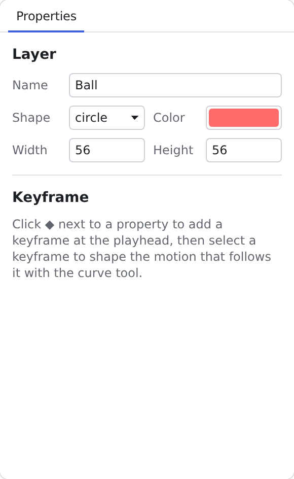
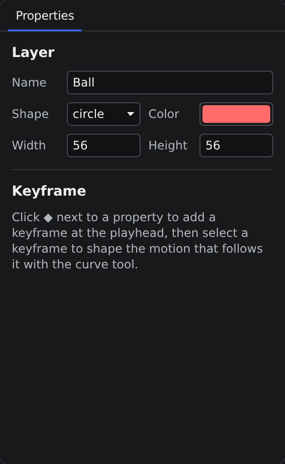

# Layers and Properties

A timeline is a stack of **layers**. Each layer is a shape with a name, a colour and a size, and five animatable properties. This page lists the shapes, every field of the Properties panel, and how layers are added, removed and restacked.

<figure class="themed">

<figcaption>The Properties panel with the Ball layer selected. Under Layer, the Keyframe section shows the selected keyframe, if any.</figcaption>
</figure>

## Shapes

| Shape    | What it draws                                                                          | Notes                                                                                                         |
| -------- | -------------------------------------------------------------------------------------- | ------------------------------------------------------------------------------------------------------------- |
| `rect`   | A rectangle of `width` × `height`, in the layer's colour.                              | Rounded corners: `radius`, 6 px unless set.                                                                   |
| `circle` | An ellipse that fills `width` × `height` (a circle when they are equal).               |                                                                                                               |
| `text`   | The layer's `text` in its colour, in bold, at a font size of `height` px.              | Anchored at its middle unless `align` says left or right. Its `width` is not used.                            |
| `three`  | A 3D scene drawn by three.js on a canvas of `width` × `height`, on a black background. | The scene is code: the function given as `scene` in the Code panel. See [Three.js scene contract](ref-scene). |

The **+ rect**, **+ circle** and **+ text** buttons add the first three. A `three` layer is made by choosing `three` in the **Shape** field of any layer; it starts as a spinning cube.

### Properties that animate

Every layer has the same five properties, each with a value while it has no keyframes and a track of keyframes when it is animated.

| Property   | Unit        | Default | What it does                                                                              |
| ---------- | ----------- | ------- | ----------------------------------------------------------------------------------------- |
| `x`        | stage units | 0       | Horizontal position of the layer's anchor (its middle, or the left/right side of a text). |
| `y`        | stage units | 0       | Vertical position, down from the top.                                                     |
| `scale`    | factor      | 1       | Size multiplier.                                                                          |
| `rotation` | degrees     | 0       | Turn, clockwise.                                                                          |
| `opacity`  | 0 to 1      | 1       | Values outside 0 to 1 are clamped when drawn.                                             |

The stage is 640 × 360 units. A `three` layer is the exception to `scale` and `rotation`: they are not applied to the picture, they are handed to the scene's code with every frame, which uses them as it likes (the Black hole moves its camera with them).

## The Layer fields

Select a layer (click it on the stage, or its row in the timeline) and the **Layer** section shows its fields. Each field applies when you leave it or press <kbd>Enter</kbd>, and each change is one undo step. All fields are disabled while the timeline plays.

| Field      | Applies to          | What it does                                                                                                                                           | Limits                                                                                                          |
| ---------- | ------------------- | ------------------------------------------------------------------------------------------------------------------------------------------------------ | --------------------------------------------------------------------------------------------------------------- |
| **Name**   | all                 | The layer's name in the timeline and in the code.                                                                                                      | Any text. When a timeline is loaded (storage, a file, a link) names are cut to 200 characters.                  |
| **Shape**  | all                 | `rect`, `circle`, `text` or `three`. Choosing `three` gives the layer the cube scene if it has none; choosing another shape removes the layer's scene. |                                                                                                                 |
| **Color**  | all                 | A colour picker.                                                                                                                                       | Stored as `#rrggbb`. On loading, a hex colour or a plain colour name is accepted, anything else gets a default. |
| **Width**  | rect, circle, three | Width in stage units.                                                                                                                                  | At least 1 (a smaller or empty entry becomes 1). Loaded values are capped at 10000.                             |
| **Height** | rect, circle, three | Height in stage units.                                                                                                                                 | Same.                                                                                                           |
| **Radius** | rect                | Corner radius in stage units.                                                                                                                          | 0 or more. A radius equal to the default, 6, is not stored.                                                     |

### Text fields

For a `text` layer the size fields are replaced:

| Field     | What it does                                                                         | Limits                                                                                            |
| --------- | ------------------------------------------------------------------------------------ | ------------------------------------------------------------------------------------------------- |
| **Text**  | The words drawn.                                                                     | Cut to 200 characters when a timeline is loaded.                                                  |
| **Size**  | The font size in pixels (it is the layer's `height`).                                | At least 1.                                                                                       |
| **Align** | Which side of the text sits at `x`: **Left**, **Center** (the default) or **Right**. | Only left and right are stored in the code (`align: 'left'`); centre is the absence of the field. |

Text is drawn in the page's font, so its width depends on the device. `Align` makes a text grow away from a fixed edge, which is what you want for something that is typed or counted.

### Three.js layers

For a `three` layer the panel shows a short note instead of more fields: the scene is _the function given as `scene` in the code panel. Edit it there._ The scene is stored with the layer, and the canvas is made again whenever its code changes.

## Selecting, adding and removing layers

| To             | Do                                                                                                                                                                                                                                                                                                                                    |
| -------------- | ------------------------------------------------------------------------------------------------------------------------------------------------------------------------------------------------------------------------------------------------------------------------------------------------------------------------------------- |
| Select a layer | Click it on the stage, or click its row (name line) in the timeline. Selecting a property row or a keyframe selects its layer too.                                                                                                                                                                                                    |
| Select nothing | Click the empty stage. Nothing is selected when a timeline is opened.                                                                                                                                                                                                                                                                 |
| Add a layer    | **+ rect**, **+ circle** or **+ text** in the timeline's ruler row, or **Edit › New layer** (a rectangle). The layer is added at the centre of the stage (`x` 320, `y` 180), on top of the stack, and selected. Rectangles are named `Rect 2`, circles `Circle 1` (the count of that shape plus one). A text layer starts at size 40. |
| Delete a layer | The **✕** at the end of its row in the timeline. One undo step.                                                                                                                                                                                                                                                                       |
| Fold a layer   | The **▾ / ▸** at the start of its row hides or shows its five property rows. This is view state: it is saved with the timeline, but it is not code and not an undo step.                                                                                                                                                              |

New layers take their colour from a cycle of six (`#ff6b6b`, `#4dabf7`, `#ffd43b`, `#69db7c`, `#b197fc`, `#ffa94d`), by position.

## The stack

The **first layer in the list is drawn on top**. Restack the selected layer with the four items of the **Edit** menu (see [Menus and actions](ref-menu?id=edit)) or their keys:

| Action         | Keys                                          |
| -------------- | --------------------------------------------- |
| Bring to top   | <kbd>Ctrl</kbd>+<kbd>Shift</kbd>+<kbd>]</kbd> |
| Bring forward  | <kbd>Ctrl</kbd>+<kbd>]</kbd>                  |
| Send backward  | <kbd>Ctrl</kbd>+<kbd>[</kbd>                  |
| Send to bottom | <kbd>Ctrl</kbd>+<kbd>Shift</kbd>+<kbd>[</kbd> |

(On a Mac, <kbd>Cmd</kbd> works in place of <kbd>Ctrl</kbd>.) The order in the timeline is the order in the code's `layers` array.

## Limits

When a timeline is loaded from storage, a file or a link, the editor rebuilds it field by field: at most **400 layers**, at most **2000 keyframes** per property, sizes capped at 10000, and anything it does not know is dropped. See [Code format](ref-code) and [Share links](ref-share).

## The Keyframe section

Under the Layer fields, the **Keyframe** section edits the keyframe selected in the timeline: its time, value, easing and curve. Those are described with the timeline in [Timeline, keyframes and playback](ref-timeline?id=the-keyframe-fields) and the [Curve tool](ref-curve).
