# Menus and actions

The menu bar has six menus. Every item is an _action_: the same action can also be reached from a button or a key, which is noted where it applies.

## How the menus behave

- **Click** a menu title to open its menu. Nothing opens by hovering alone.
- Once a menu is open, **moving the pointer over another title opens that one instead**.
- **Moving the pointer out** of the menu bar and the open menu closes it.
- **Escape**, or a click anywhere outside, closes it too. Choosing an item closes the menu and runs the action.
- A **submenu** (an item with ▸) opens while the pointer is over it or the keyboard focus is inside it.
- Menu items are buttons, so they can be reached with <kbd>Tab</kbd> and pressed with <kbd>Enter</kbd> or <kbd>Space</kbd>.
- A **disabled** item is greyed out and says so in its tooltip.

> [!NOTE]
> Edits made from a menu (New layer, Bring to top, Scale…) are refused while the timeline plays, like any other edit. Pause first. See [the editing lock](ref-timeline?id=the-editing-lock).

## File

<figure class="themed">
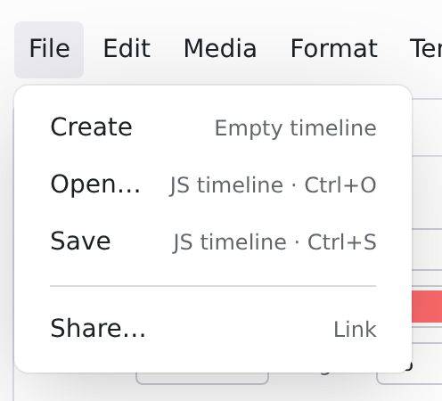
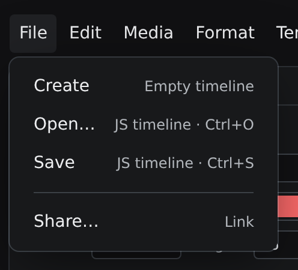
</figure>

| Item       | Hint                                       | What it does                                                                                                                                                                                                                                                                                                                                                                     |
| ---------- | ------------------------------------------ | -------------------------------------------------------------------------------------------------------------------------------------------------------------------------------------------------------------------------------------------------------------------------------------------------------------------------------------------------------------------------------- |
| **Create** | Empty timeline                             | Replaces the timeline with an empty one (4 s, no layers), as one undo step. Stops playback and puts the playhead at 0 s.                                                                                                                                                                                                                                                         |
| **Open…**  | JS timeline · <kbd>Ctrl</kbd>+<kbd>O</kbd> | Opens a file picker for `.js`, `.mjs` or `.ts` files. The file's text is put in the Code panel exactly as written and compiled, the same as typing it. If it compiles, playback stops at 0 s and the toast says `Opened <name>`. If it does not, the code stays in the panel and the _Check code_ dialog shows why. **The code is run in this page: open only files you trust.** |
| **Save**   | JS timeline · <kbd>Ctrl</kbd>+<kbd>S</kbd> | Downloads the code panel's text as `timeline.js`.                                                                                                                                                                                                                                                                                                                                |
| **Share…** | Link                                       | Makes a [share link](ref-share) of the code (the code as written if it compiles, else the code of the timeline shown). On devices with a share sheet it opens that; otherwise it copies the link to the clipboard (_Link copied to the clipboard._); if even that is refused, a dialog shows the link selected so you can copy it.                                               |

<figure class="themed">
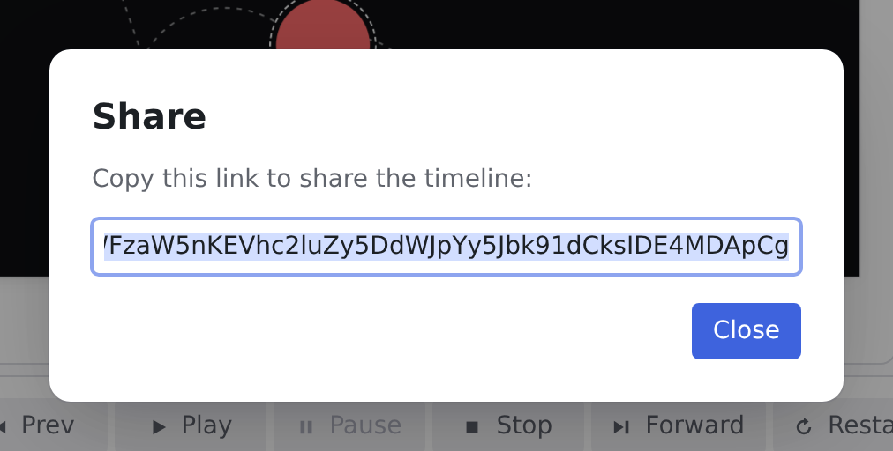
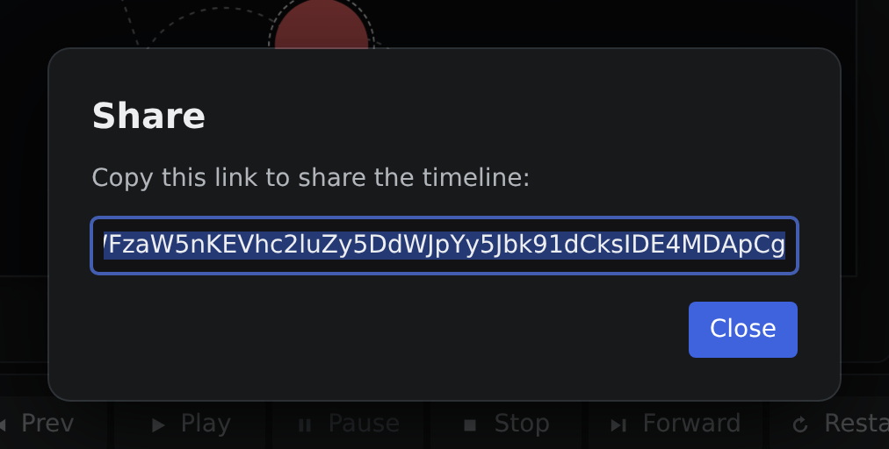
<figcaption>The Share dialog, when the link cannot be copied automatically.</figcaption>
</figure>

## Edit

<figure class="themed">
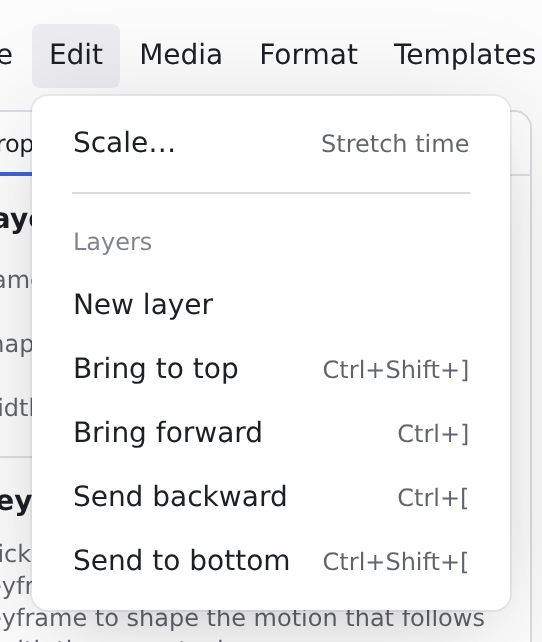
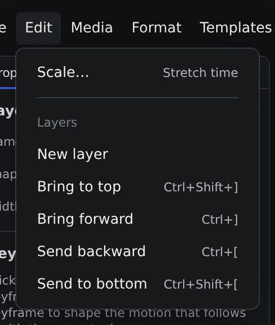
</figure>

| Item               | Hint                                          | What it does                                                                                                                                                                                                                                                                                                                               |
| ------------------ | --------------------------------------------- | ------------------------------------------------------------------------------------------------------------------------------------------------------------------------------------------------------------------------------------------------------------------------------------------------------------------------------------------ |
| **Scale…**         | Stretch time                                  | Opens a dialog with a percentage (1 to 10000, default 100). Every keyframe time and the duration are multiplied by it and rounded; values and easings are kept, the playhead keeps its place proportionally. 50% plays twice as fast, 200% half as fast. Keyframes that would round onto the same time are kept 1 ms apart. One undo step. |
| _Layers_           | (heading)                                     |                                                                                                                                                                                                                                                                                                                                            |
| **New layer**      |                                               | Adds a rectangle named `Rect 2`, `Rect 3`… (the count of rectangles plus one) at the centre of the stage, on top of the stack, and selects it.                                                                                                                                                                                             |
| **Bring to top**   | <kbd>Ctrl</kbd>+<kbd>Shift</kbd>+<kbd>]</kbd> | Moves the selected layer to the top of the stack (first in the list, drawn last).                                                                                                                                                                                                                                                          |
| **Bring forward**  | <kbd>Ctrl</kbd>+<kbd>]</kbd>                  | One step towards the top.                                                                                                                                                                                                                                                                                                                  |
| **Send backward**  | <kbd>Ctrl</kbd>+<kbd>[</kbd>                  | One step towards the bottom.                                                                                                                                                                                                                                                                                                               |
| **Send to bottom** | <kbd>Ctrl</kbd>+<kbd>Shift</kbd>+<kbd>[</kbd> | To the bottom of the stack.                                                                                                                                                                                                                                                                                                                |

The four restacking items need a selected layer (_Select a layer first._ otherwise) and say so if the layer is already there (_Card is already at the top._). The selection follows the layer. Each move is one undo step. Undo and Redo are not in a menu: they are the header buttons and <kbd>Ctrl</kbd>+<kbd>Z</kbd> / <kbd>Ctrl</kbd>+<kbd>Y</kbd>.

## Media

<figure class="themed">
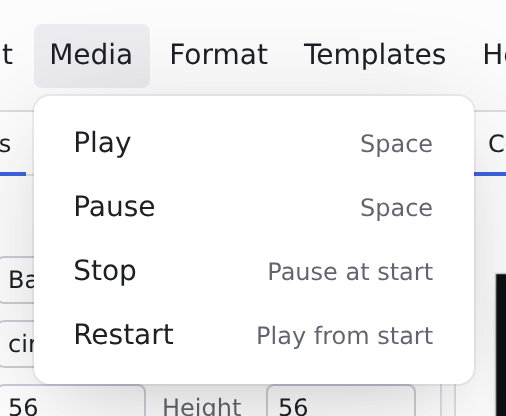
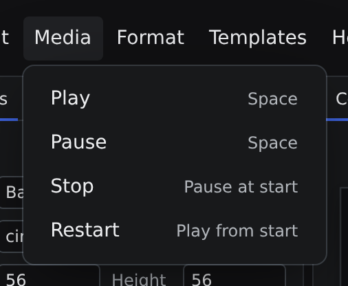
</figure>

| Item        | Hint             | What it does                                                                                                                                                           |
| ----------- | ---------------- | ---------------------------------------------------------------------------------------------------------------------------------------------------------------------- |
| **Play**    | <kbd>Space</kbd> | Starts playing from the playhead (from 0 s if it is at the end). Remembers that _you_ chose to play: see the [autoplay rule](ref-timeline?id=when-it-plays-by-itself). |
| **Pause**   | <kbd>Space</kbd> | Pauses. The playhead rests on the 10 ms grid.                                                                                                                          |
| **Stop**    | Pause at start   | Pauses and puts the playhead at 0 s.                                                                                                                                   |
| **Restart** | Play from start  | Pauses, goes to 0 s and plays.                                                                                                                                         |

They are the same actions as the buttons of the playback bar. Pause is never greyed out in the menu (pausing when nothing plays does nothing); the toolbar's Pause button is.

## Format

<figure class="themed">
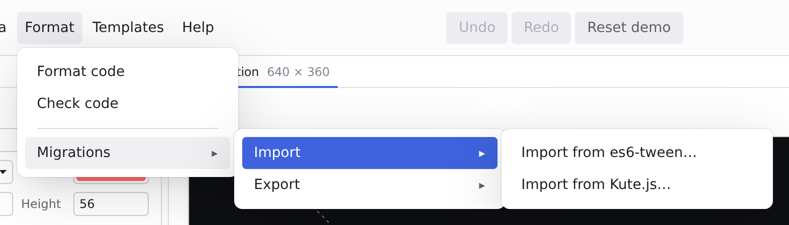
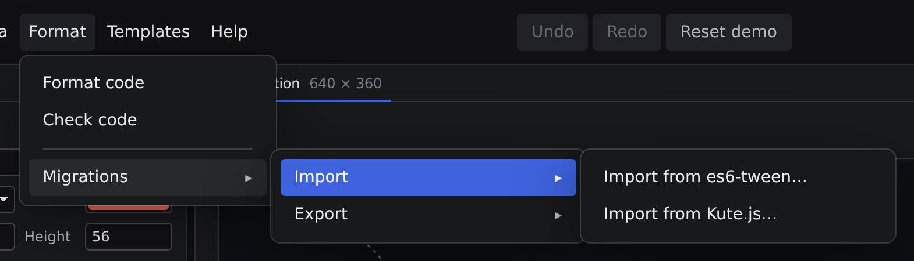
<figcaption>Format › Migrations › Import.</figcaption>
</figure>

| Item                                             | What it does                                                                                                                                                                                                                                                                                                                                                |
| ------------------------------------------------ | ----------------------------------------------------------------------------------------------------------------------------------------------------------------------------------------------------------------------------------------------------------------------------------------------------------------------------------------------------------- |
| **Format code**                                  | Compiles the code in the Code panel and, if it compiles, rewrites it in the editor's own style (the same text the editor would have generated). Toast: _Code formatted._ If it does not compile, shows _Check code_ instead. Your comments and layout are replaced.                                                                                         |
| **Check code**                                   | Compiles the code **without changing the timeline** and reports in a dialog: _No problems found._ with a summary (`3 layers, 12 keyframes, 4000ms.`), or _The code compiles, with notes:_ and each warning, or _The code does not compile_ and the error.                                                                                                   |
| **Migrations › Import › Import from es6-tween…** | Dialog: paste es6-tween code or open a file, then **Import**. The code is run to see what it animates (**only import code you trust**). On success it replaces the timeline (one undo step), stops at 0 s, and the toast says what was found; warnings go to the Code status. If it cannot be read, the problem is shown in the dialog and nothing changes. |
| **Migrations › Import › Import from Kute.js…**   | The same, for Kute.js code.                                                                                                                                                                                                                                                                                                                                 |
| **Migrations › Export › Export to es6-tween…**   | Dialog showing the timeline as es6-tween code, with **Copy** and **Download timeline.es6-tween.js**.                                                                                                                                                                                                                                                        |
| **Migrations › Export › Export to Kute.js…**     | The same, as Kute.js code (`timeline.kute.js`).                                                                                                                                                                                                                                                                                                             |

<figure class="themed">
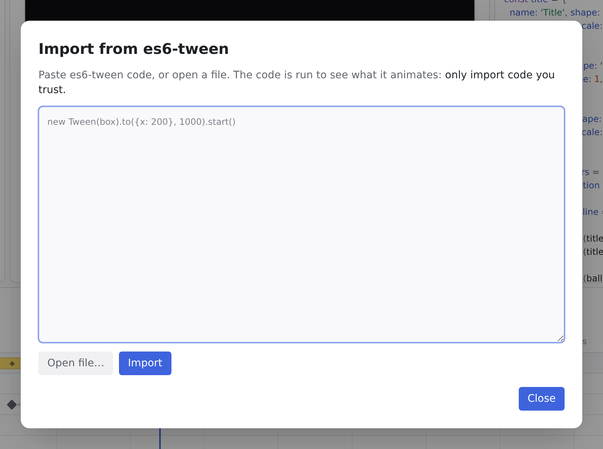
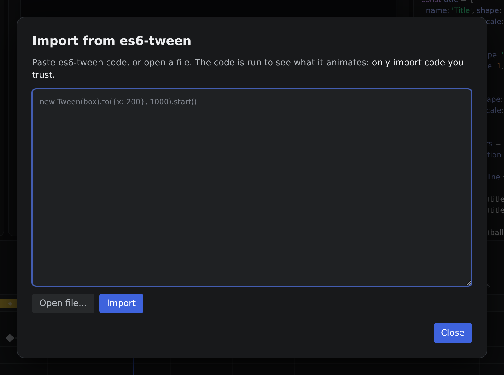
</figure>

More about what maps and what is lost: [Moving to and from other libraries](guide-migrate).

## Templates

<figure class="themed">
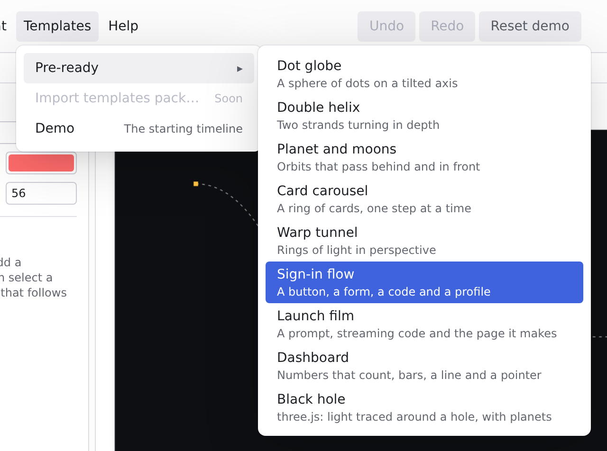
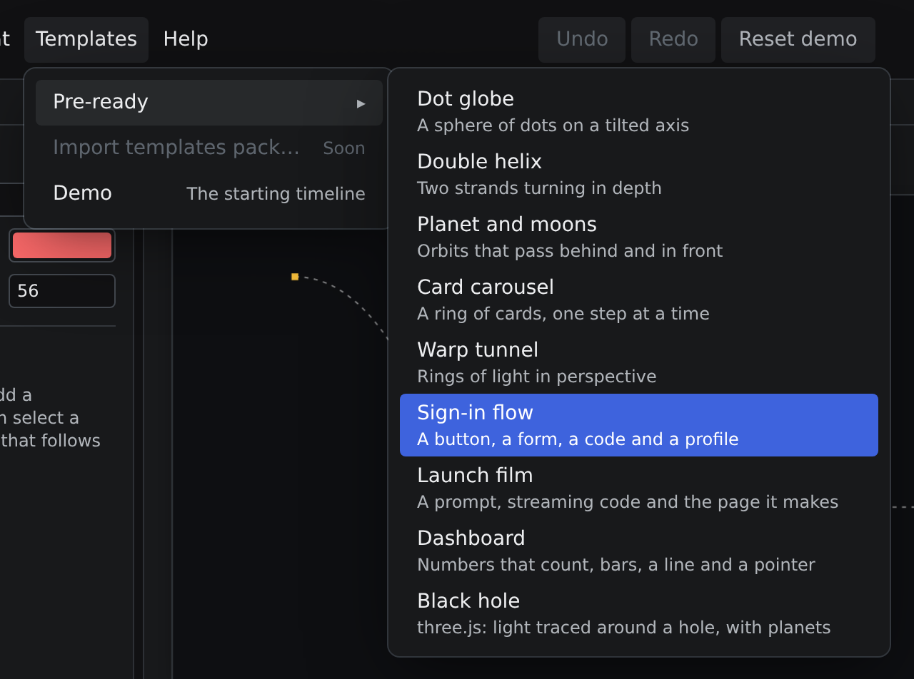
</figure>

| Item                       | What it does                                                                                                                                                                                                          |
| -------------------------- | --------------------------------------------------------------------------------------------------------------------------------------------------------------------------------------------------------------------- |
| **Pre-ready ▸**            | Nine ready-made timelines, each with a one-line description: Dot globe, Double helix, Planet and moons, Card carousel, Warp tunnel, Sign-in flow, Launch film, Dashboard, Black hole. See [Templates](ref-templates). |
| **Import templates pack…** | Disabled (hint: _Soon_).                                                                                                                                                                                              |
| **Demo**                   | The starting timeline (the same as the **Reset demo** button in the header).                                                                                                                                          |

Choosing a template or the demo replaces the timeline as **one undo step**, puts the playhead at 0 s, and plays **only if you had pressed Play before** (see [the autoplay rule](ref-timeline?id=when-it-plays-by-itself)). Undo brings your timeline back. The toast says `<name>: Space plays, Undo brings back your timeline.` (or `Space pauses…` if it is playing).

## Help

| Item      | What it does                                                                                                                                                  |
| --------- | ------------------------------------------------------------------------------------------------------------------------------------------------------------- |
| **About** | A dialog: what the editor is, the tween.js version it runs, and that timelines are saved in this browser only and links carry the code (nothing is uploaded). |
| **Docs**  | Opens these docs in a new tab.                                                                                                                                |
