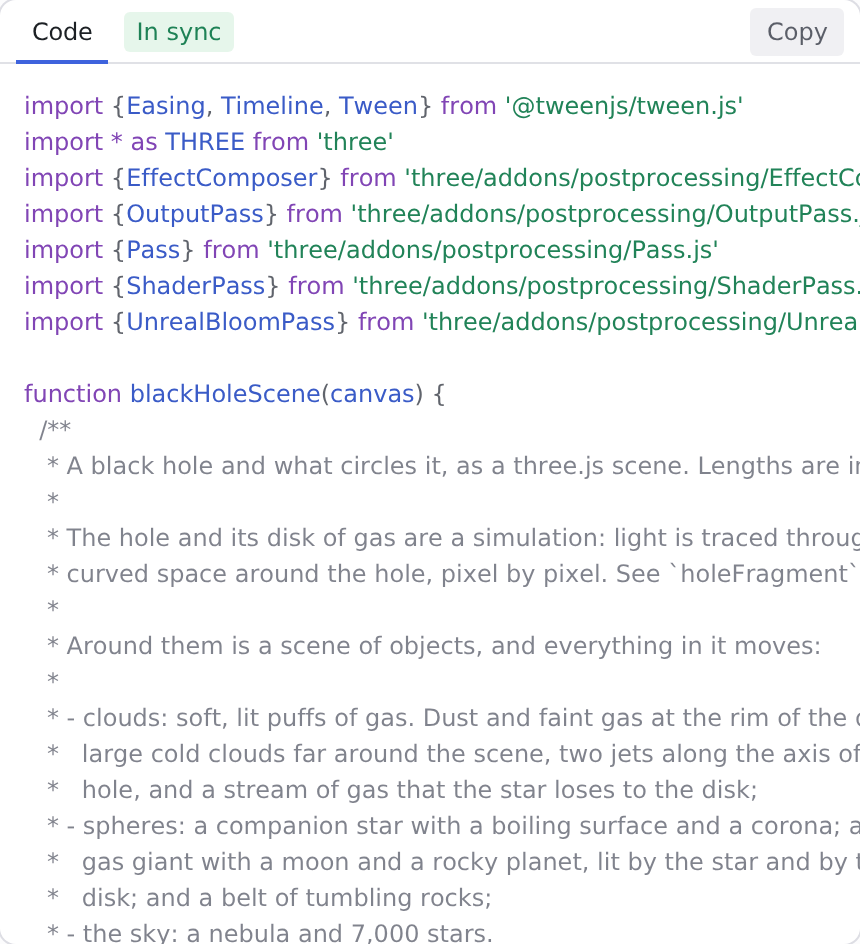
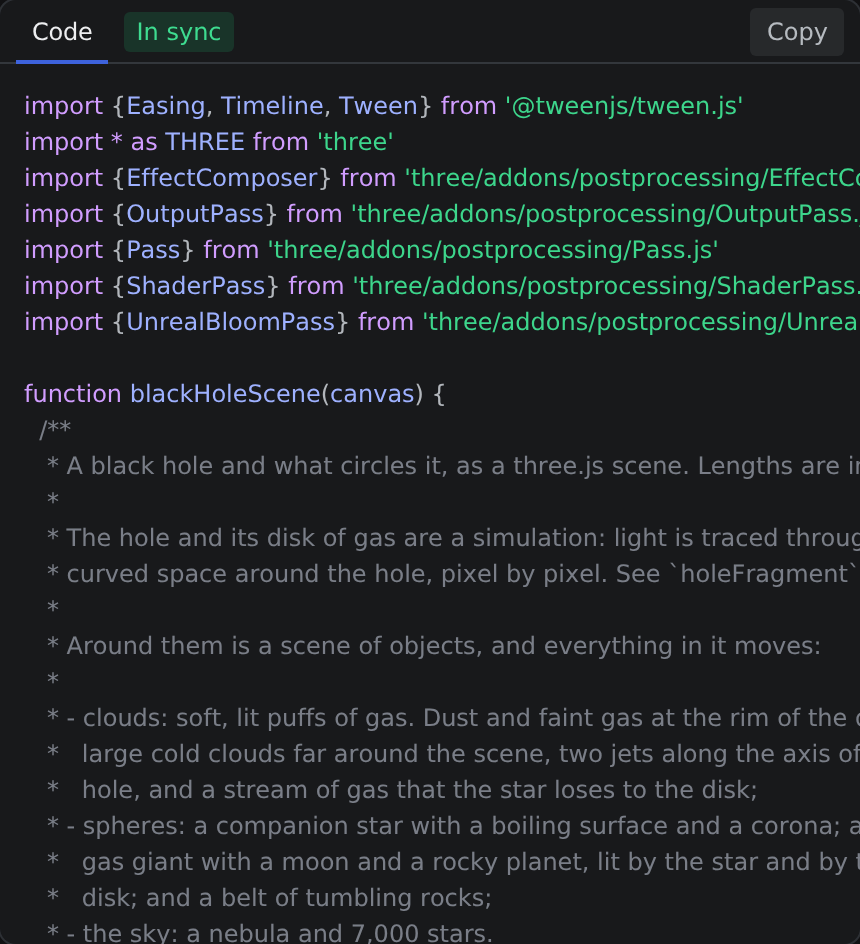

# Three.js scene contract

A layer with the shape `three` is drawn by **its own code**: a function in the code panel that gets a canvas and draws on it with [three.js](https://threejs.org/). This page is the exact contract: the function, the `frame` it is given, the modules it can import, how it is stored in the code, what happens when it fails, and what the two built-in scenes are.

For a guide with an example to try, see [Three.js scenes](guide-three). The rest of a layer's fields are in [Code format](ref-code).

## A three layer

A `three` layer is a layer like any other: it has a position, a size, an opacity, a place in the stack, and keyframes. What differs:

| Property            | For a `three` layer                                                                                                                                   |
| ------------------- | ----------------------------------------------------------------------------------------------------------------------------------------------------- |
| `width`, `height`   | The size of the layer's canvas, in stage units. The scene gets them in every `frame`.                                                                 |
| `x`, `y`            | Where the layer is, as for any layer. They are given to the scene in `frame` too.                                                                     |
| `opacity`           | Fades the whole canvas, as for any layer.                                                                                                             |
| `rotation`, `scale` | **Not applied to the picture.** They are given to the scene in `frame`, which uses them however it likes (the Black hole moves its camera with them). |
| `color`             | Not used: the layer is black behind the canvas, and the scene draws what it wants on it.                                                              |
| `scene`             | The function below. It is required: a `three` layer without one is refused when the code is read.                                                     |

Set a layer's shape to `three` in the Properties panel and it gets the [cube](#the-cube-the-default-scene) as its scene (unless it has one); set it to another shape and the scene is dropped. See [Layers and Properties](ref-layers).

## The scene function

```js
scene: function (canvas) {
	// build the scene, once
	return {
		draw(frame) {
			// draw one frame
		},
		dispose() {
			// optional: let go of what was built
		},
	}
}
```

| Part          | Contract                                                                                                                                                                                                                                |
| ------------- | --------------------------------------------------------------------------------------------------------------------------------------------------------------------------------------------------------------------------------------- |
| The function  | Called **once** with the layer's `<canvas>` when the scene starts. It builds the renderer, the scene and everything else. A function declaration, a function expression or an arrow function all work.                                  |
| Returns       | An object with `draw(frame)` (required) and `dispose()` (optional), **or** a function that is `draw` on its own: `canvas => frame => { … }`.                                                                                            |
| `draw(frame)` | Called every time the playhead is drawn: each frame while playing, and each time it is moved by scrubbing, by keys or by an edit. It must draw from `frame` alone, so that any moment looks the same every time and scrubbing is exact. |
| `dispose()`   | Called once when the canvas is removed from the page: the scene's code changed, the layer was removed, or the document was replaced. Release geometries, materials and the renderer here.                                               |

If the function does not return one of those, the scene stops with `The scene function must return {draw(frame) {...}}, or a function that draws a frame.`, and if `scene` is not a function with `` `scene` must be a function that gets the canvas. ``

### The frame

`draw` receives a plain object every time:

| Field      | Meaning                                                                                               |
| ---------- | ----------------------------------------------------------------------------------------------------- |
| `time`     | The playhead, in milliseconds, from 0 to `duration`.                                                  |
| `duration` | The length of the timeline, in milliseconds. `time / duration` is the progress of the whole timeline. |
| `playing`  | Whether the timeline is playing (`true`) or paused, scrubbed or stopped (`false`).                    |
| `width`    | The layer's `width`.                                                                                  |
| `height`   | The layer's `height`.                                                                                 |
| `x`, `y`   | The layer's position at this time.                                                                    |
| `scale`    | The layer's `scale` at this time.                                                                     |
| `rotation` | The layer's `rotation` at this time, in degrees.                                                      |
| `opacity`  | The layer's `opacity` at this time. The canvas is already faded by it: it is given for completeness.  |

`x`, `y`, `scale`, `rotation` and `opacity` are what the timeline's keyframes give at `time`. The values are rounded to three decimals.

The canvas is sized by the scene: the cube sets the renderer to `frame.width` × `frame.height` and the pixel ratio of the screen, when the size changes.

## Imports

A scene uses three.js through real `import` statements at the top of the code:

```js
import * as THREE from 'three'
import {EffectComposer} from 'three/addons/postprocessing/EffectComposer.js'
```

The browser does not load them: the code is text in the editor, not a file. The editor **resolves the imports itself**, from a fixed list, so the modules a scene can import are exactly these:

| Module                                           |
| ------------------------------------------------ |
| `three`                                          |
| `three/addons/geometries/RoundedBoxGeometry.js`  |
| `three/addons/postprocessing/EffectComposer.js`  |
| `three/addons/postprocessing/OutputPass.js`      |
| `three/addons/postprocessing/Pass.js`            |
| `three/addons/postprocessing/RenderPass.js`      |
| `three/addons/postprocessing/ShaderPass.js`      |
| `three/addons/postprocessing/UnrealBloomPass.js` |

Rules for the import lines:

- Only **single-line** statements of the form `import … from 'three'` or `from 'three/…'` are read as the scene's imports. Namespace (`* as THREE`), named (`{A, B as C}`) and default forms are understood. A path starting with `three/examples/jsm/` is read as `three/addons/`.
- Any other module fails when the scene starts: `'<path>' cannot be imported in the editor. It has: three, three/addons/….`, a name that the module does not have gives `'<path>' has no export named <name>.`, and a statement that cannot be read `This import cannot be read: <statement>`.
- Imports of anything that is not three.js are ignored by the editor, as for all code, and the scene cannot use them.
- three.js is a **lazy chunk**: it is only downloaded when a document has a `three` layer.

## Stored as code

A scene lives in the code panel with the timeline, and is saved, shared and undone with it.

- The `scene` of a layer is kept as the text of its function: `Function.prototype.toString()`. Along with it the document keeps the `import … from 'three…'` lines of the code.
- When the code is written back, the imports come after the `@tweenjs/tween.js` import, then the function, then the layer objects. A function with a **name** (`function blackHoleScene(canvas) {…}`) is written as it is, and the layer says `scene: blackHoleScene,`. A function **without** a name (an arrow function, say) is written as `const scene1 = <source>` with the first free name `scene1`, `scene2`, …, and the layer says `scene: scene1,`. Layers with the same scene share one function.
- The layer's own name for its variable never takes a scene function's name.

### It must hold everything it uses

Only the function and the `three` imports are kept. **Anything else you wrote at the top level of the code is not part of the scene**: a helper function, a constant, a texture loaded outside. When the scene starts it is a `ReferenceError` (`helper is not defined`), shown over the layer. Write helpers and constants **inside** the scene function.

Reading the code gives three more messages:

- A `three` layer without a function `scene`: ``<name> has the shape 'three', so it needs `scene`: a function that gets a canvas and draws on it.``
- A scene written as a method (`scene(canvas) { … }`), which cannot stand on its own: ``Write the `scene` of <name> as a function or an arrow function, not as a method.``
- A name from a three.js import used **outside** the scene function, where it does not exist while the timeline is read: ``THREE is used outside of a scene function. Use three.js inside the function given as `scene`.``

## When it runs and when it fails

- A scene starts when its layer is shown. The canvas is **recreated whenever the scene's code changes**, imports or source, because a WebGL context cannot be reused. Typing in the code panel therefore restarts the scene a moment after you stop (the status goes from `Editing…` to `In sync`).
- An error thrown while the scene starts, or in any `draw`, **stops that scene**. The message is drawn over the layer as _This scene stopped: …_ and logged to the browser's console. The rest of the timeline keeps working. Edit the scene's code and it starts again.
- A scene that failed is not drawn again until its code changes.

## The cube: the default scene

This is `src/scene3d/cube.js`, the scene a layer gets when its shape is set to `three`:

```js
import * as THREE from 'three'

function cubeScene(canvas) {
	// A three.js layer is a function. It gets the layer's canvas, builds a scene
	// with three.js, and returns what draws one frame of it.
	const renderer = new THREE.WebGLRenderer({canvas, antialias: true, alpha: true})
	const scene = new THREE.Scene()
	const camera = new THREE.PerspectiveCamera(45, 1, 0.1, 100)

	const cube = new THREE.Mesh(
		new THREE.BoxGeometry(1.4, 1.4, 1.4),
		new THREE.MeshStandardMaterial({color: '#4dabf7', roughness: 0.35, metalness: 0.1}),
	)
	const sun = new THREE.DirectionalLight('#ffffff', 2.5)
	sun.position.set(2, 3, 4)
	scene.add(cube, sun, new THREE.AmbientLight('#ffffff', 0.6))

	let size = ''
	return {
		// `frame` is the playhead (`time` of `duration`, in milliseconds) and the
		// layer as the timeline has it at that moment: `rotation`, `scale`,
		// `width`, `height`. Draw from those alone, so that scrubbing works.
		draw(frame) {
			if (size !== frame.width + 'x' + frame.height) {
				size = frame.width + 'x' + frame.height
				renderer.setPixelRatio(window.devicePixelRatio)
				renderer.setSize(frame.width, frame.height, false)
				camera.aspect = frame.width / frame.height
				camera.updateProjectionMatrix()
			}
			// Keyframes on the layer's rotation turn the cube, and on its scale bring it closer.
			cube.rotation.y = (frame.rotation * Math.PI) / 180
			cube.rotation.x = (frame.time / frame.duration) * Math.PI * 2
			camera.position.z = 4 / Math.max(0.1, frame.scale)
			renderer.render(scene, camera)
		},
		dispose() {
			cube.geometry.dispose()
			cube.material.dispose()
			renderer.dispose()
			renderer.forceContextLoss()
		},
	}
}
```

## A scene as a draw function

The shortest scene returns the draw function itself. This is a whole timeline: **Open in editor** loads it (the editor shows the code and asks before running it).

```js
import * as THREE from 'three'

const glow = {
	name: 'Glow',
	shape: 'three',
	color: '#000',
	width: 200,
	height: 200,
	x: 320,
	y: 180,
	scale: 1,
	rotation: 0,
	opacity: 1,
	scene: canvas => {
		const renderer = new THREE.WebGLRenderer({canvas, alpha: true})
		const scene = new THREE.Scene()
		const camera = new THREE.PerspectiveCamera(45, 1, 0.1, 100)
		camera.position.z = 3
		const ball = new THREE.Mesh(new THREE.IcosahedronGeometry(1, 1), new THREE.MeshNormalMaterial())
		scene.add(ball)
		return frame => {
			renderer.setSize(frame.width, frame.height, false)
			ball.rotation.y = (frame.rotation * Math.PI) / 180
			renderer.render(scene, camera)
		}
	},
}

export const layers = [glow]
export const duration = 2000

export const timeline = new Timeline().add(new Tween(glow).to({rotation: 360}, 2000), 0)
```

The ball turns by `frame.rotation`, and the timeline turns it: the one tween gives the layer's `rotation` keyframes. When the editor writes this back, the arrow function has no name, so it becomes `const scene1 = canvas => { … }` and the layer says `scene: scene1,`.

## The Black hole

The Black hole template is a `three` layer whose scene is `src/scene3d/blackhole.js`: about 46,000 characters of code, a single function `blackHoleScene(canvas)` with all its helpers, shaders and classes inside it, and these imports (visible in the code panel):

<figure class="themed"><figcaption>The Black hole's code: real imports of three.js and its post-processing addons, then the scene function.</figcaption></figure>

```js
import * as THREE from 'three'
import {EffectComposer} from 'three/addons/postprocessing/EffectComposer.js'
import {OutputPass} from 'three/addons/postprocessing/OutputPass.js'
import {Pass} from 'three/addons/postprocessing/Pass.js'
import {ShaderPass} from 'three/addons/postprocessing/ShaderPass.js'
import {UnrealBloomPass} from 'three/addons/postprocessing/UnrealBloomPass.js'
```

Each frame has four steps:

1. The scene of objects is rendered to a texture with depth: a companion star with a boiling surface and a corona, a ringed gas giant with a moon, a rocky planet, an instanced belt of tumbling rocks (on Kepler orbits), soft clouds (dust at the rim of the disk, far clouds, two jets, a stream of gas from the star), a nebula and 7,000 stars. Vertices behind the hole go through the gravitational lens equation, in custom shaders and (through `onBeforeCompile`) in three.js's standard material alike.
2. The hole and its disk are traced over it: a fragment shader follows a ray of light per pixel along the null geodesics of a Schwarzschild black hole and marches it through a volume of gas, with Kepler speeds, Doppler beaming and gravitational redshift. The depth of step 1 stops a ray at the first solid thing, so planets and rocks pass correctly in front of and behind the disk.
3. What is in front of the hole is drawn again over the result.
4. Bloom, a little lens colour and grain, from three.js post-processing.

All motion is a function of the playhead, in whole turns per loop, so scrubbing is exact and the loop is seamless. The layer's `rotation` and `scale` move the camera. While playing, the scene lowers its render resolution when frames arrive late and raises it again when they do not.

Since it is code, you can edit it: change `const starCount = 7000` to `500` in the code panel, and after a moment the scene restarts with fewer stars.

## Scenes in documents that are not yours

A scene is code, and code is never run without asking. The editor's own saved state may hold any scene. A share link made by **File › Share** carries the scene inside its code, which is shown and confirmed before it runs (see [Share links](ref-share)).

Documents that arrive as **data**, such as an old `#t=` link, are different: they may only hold the two built-in scenes, the Black hole and the cube. Any other scene is refused with:

> This timeline has a three.js scene of its own. Scenes are code: share it as a link from File › Share.

A document whose scene is missing or malformed (no source, an import that is not three.js, more than 40 imports, or a source over 500,000 characters) gets the cube instead. A document from the time the black hole was a shape of its own (`blackhole`) opens as a `three` layer with the Black hole scene.
