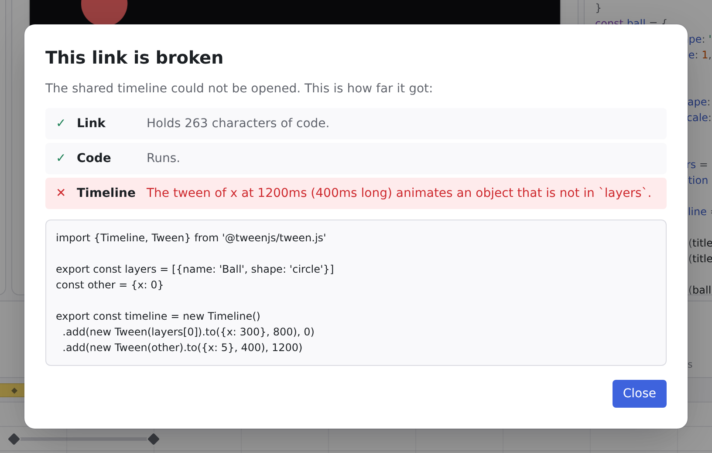
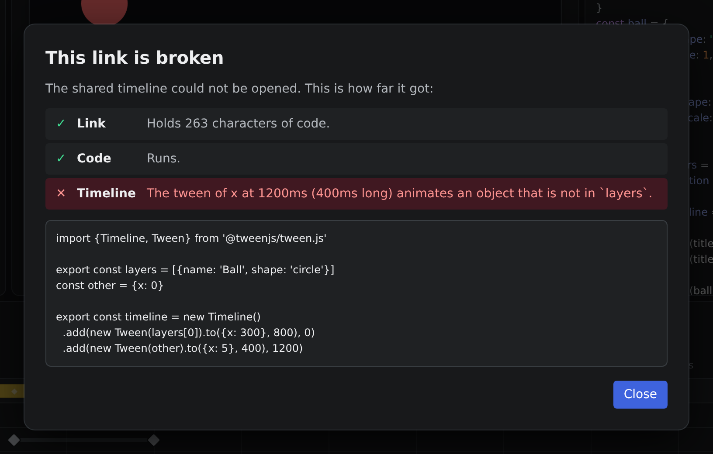

# Share links

The exact format of a share link, how the editor reads one, and every message it can show. For a walk-through with pictures, see [Sharing and opening links](guide-share).

## The format

A share link is the address of the editor, a `#`, and the **code** of the timeline:

```text
<origin><path><query>#<base64url of the code, as UTF-8>
```

- **`<origin><path><query>`** is the page's own address: `location.origin + location.pathname + location.search`. A link made on `https://example.org/tools/timeline/` opens there.
- **The code** is the text of the code panel, encoded as **UTF-8**, then as base64 with the URL-safe alphabet: `-` instead of `+`, `_` instead of `/`, and **no `=` padding**.
- Nothing is uploaded. Everything after the `#` is the fragment, and a browser does not send a fragment to a server.

Which code is in the link:

- If the code panel's text compiles, **that text** is shared exactly as it is written: comments, formatting and all.
- If it does not compile (or the panel is out of date with the stage), the code that the editor **generates** from the timeline on the stage is shared instead. See [Code format](ref-code).

How the link reaches the user: if the browser has a share sheet (`navigator.share`), **File › Share…** opens it with the title `tween.js timeline`. If not, or if the sheet fails for a reason other than being dismissed, the link is copied to the clipboard and a toast says _Link copied to the clipboard._ If the clipboard is not available, a **Share** dialog shows the link in a field, selected.

## Make and read one

### By hand

The same encoding in Node.js. `base64url` is exactly the editor's alphabet:

```js
import {readFileSync} from 'node:fs'

// The link of a saved timeline (File › Save makes timeline.js):
const code = readFileSync('timeline.js', 'utf8')
console.log('https://example.org/#' + Buffer.from(code, 'utf8').toString('base64url'))

// and back, from the text after the # of a link:
const fragment = 'aGVsbG8'
console.log(Buffer.from(fragment, 'base64url').toString('utf8'))
```

In a browser console, the editor's own `encodeCode` does:

```js
const bytes = new TextEncoder().encode(code)
let binary = ''
for (const byte of bytes) binary += String.fromCharCode(byte)
const fragment = btoa(binary).replace(/\+/g, '-').replace(/\//g, '_').replace(/=+$/, '')
```

Do not call `btoa(code)` on its own: it throws for any character beyond Latin-1, such as `›` or an emoji, and it is not UTF-8.

### Here

Paste code to get a link to this documentation's copy of the editor, or paste a link (or just its part after the `#`) to read its code. This is the same function as the editor's, and nothing leaves this page.

<div class="link-tool">
<textarea id="lt-code" rows="6" spellcheck="false" style="width:100%;font-family:var(--code-font-family,monospace)" placeholder="Code of a timeline…"></textarea>
<p>
<button onclick="(function(){var c=document.getElementById('lt-code').value,b=new TextEncoder().encode(c),s='';for(var i=0;i<b.length;i++)s+=String.fromCharCode(b[i]);document.getElementById('lt-link').value=location.origin+location.pathname.replace(/docs\/[^/]*$/,'')+'#'+btoa(s).replace(/\+/g,'-').replace(/\//g,'_').replace(/=+$/,'')})()">Make a link</button>
<button onclick="(function(){var t=document.getElementById('lt-link').value.trim(),i=t.indexOf('#');t=(i<0?t:t.slice(i+1));try{t=decodeURIComponent(t)}catch(e){}t=t.replace(/\s+/g,'');if(!/^[A-Za-z0-9+\/_-]+={0,2}$/.test(t)){document.getElementById('lt-code').value='The link does not hold base64.';return}try{var b=atob(t.replace(/-/g,'+').replace(/_/g,'/').replace(/=+$/,'')),u=Uint8Array.from(b,function(c){return c.charCodeAt(0)});document.getElementById('lt-code').value=new TextDecoder('utf-8',{fatal:true}).decode(u)}catch(e){document.getElementById('lt-code').value='The link does not hold text.'}})()">Read a link</button>
</p>
<input id="lt-link" style="width:100%" spellcheck="false" placeholder="A link, or the text after its #">
</div>

## How the editor reads a link

When the editor is opened with a `#fragment` (or the address changes to one: the editor listens to `hashchange`), it does this, in order:

1. **The fragment is removed from the address bar**, so that reloading does not open it again. This happens whatever the outcome.
2. A fragment that starts with `t=` is an [old link](#old-links).
3. Otherwise it is **decoded** (below). A failure here is the **Link** stage of a [broken link](#a-broken-link).
4. The code is checked for **syntax** only, without running any of it. A failure is the **Code** stage.
5. A dialog, **Open shared timeline**, shows the code and asks. Nothing has run yet.
6. On **Open**, the code is run to build the timeline. A failure is the **Code** stage (it threw) or the **Timeline** stage (it ran, but it builds something that cannot be shown).
7. On success the timeline replaces yours: the code appears in the code panel **as it was written**, the status reads _In sync_, the player stops at 0 s and waits ([Timeline, keyframes and playback](ref-timeline)), and a toast says _Opened the shared timeline. Undo brings back yours._ **Undo** restores your timeline.

**Cancel** changes nothing.

### Decoding

`decodeCode` is forgiving about how a link was pasted, strict about what it holds:

1. If the text is longer than **2,800,000 characters** (1.4 × 2,000,000), it is refused: `The shared code is too large.`
2. The text is URL-decoded (`decodeURIComponent`), when that works: some apps escape the fragment.
3. All **whitespace is removed**, so a link broken over lines still reads.
4. It must be only `A–Z a–z 0–9 + / - _`, with up to two `=` at the end. If not: `The link does not hold base64.`
5. `-` and `_` become `+` and `/`, the padding is dropped, and the text is decoded. If that fails: `The link does not hold base64.`
6. The bytes must be valid **UTF-8**. If not: `The link does not hold text.`

So `+` and `/` (standard base64) are read as well as `-` and `_`, and `=` padding is allowed but not needed.

### The limit

The editor refuses a fragment over **2.8 million characters**, which is about **2 MB of code**. A link that long is not practical anyway: many chat apps and browsers cut long addresses far sooner. For a big timeline, use **File › Save** and send the `.js` file; **File › Open** reads it.

## A broken link

When a link cannot be opened, a **This link is broken** dialog says how far it got. It has three rows, in this order. The first that fails is marked, and the rows after it say _Not reached._:

<figure class="themed"><figcaption>The Timeline row failed: the code runs, but what it builds cannot be shown.</figcaption></figure>

| Row          | It checks                             | When it fails, the detail is                                                                                                                         |
| ------------ | ------------------------------------- | ---------------------------------------------------------------------------------------------------------------------------------------------------- |
| **Link**     | The fragment is base64 of UTF-8 text. | The message from [decoding](#decoding), then `(N characters after the #.)`                                                                           |
| **Code**     | The code is well-formed, and it runs. | The browser's syntax message, before anyone is asked, or the error the code threw when it ran, for example `ReferenceError: missing is not defined`. |
| **Timeline** | What the code builds can be shown.    | The editor's message, such as ``The code must define `layers`: an array of layer objects.`` See the list in [Code format](ref-code).                 |

When the **Link** row passes, it reads `Holds N characters of code.` When the **Code** row passes, it reads `Runs.` The code is shown under the rows (except for a Link failure, where there is none).

Two things are worth knowing:

- **Syntax is checked first, and nothing is run for it.** Code that is not well-formed is refused before the **Open shared timeline** dialog, so you are never asked to run something that cannot even be read.
- **Which of Code and Timeline fails** is decided by the kind of error: an error of the editor's own (about what the code built) is a **Timeline** failure and the Code row is ok; any other error is the code failing to run, a **Code** failure.

When the code panel is open, the accepted code is put into it and read there. If that fails, you get the **Check code** dialog with the error, not this one (see [Format and Check](ref-code?id=format-and-check)).

## Old links

Links made before links held code look like `…/#t=<text>`: the timeline as **JSON**, deflate-compressed (`z` prefix) or plain (`j` prefix), then base64url. They **still open**, and they open **without asking**, because they hold data and not code.

- The text is limited to 2,000,000 characters, and the inflated JSON to 2,000,000 bytes. Beyond that: `The shared timeline is too large.`
- The document is rebuilt by the same checks as a document from storage, but it is **untrusted**: it may not bring code along as data. A custom three.js scene is refused with `This timeline has a three.js scene of its own. Scenes are code: share it as a link from File › Share.`; the two built-in scenes (the cube and the Black hole) are fine. See [Three.js scene contract](ref-scene).
- On success the toast says _Opened the shared timeline. Undo brings back yours._

The editor no longer makes `#t=` links.

## Safety

> [!WARNING]
> A share link holds **code**, and opening it **runs that code in the editor's page**. The editor shows the code first and asks, but it does not sandbox it. Read it, and open links only from people you trust.

The editor does not upload your timeline, and nothing about a link is recorded on a server. It also does not shorten, sign or verify links: whoever has the link has the code.

## See also

- [Sharing and opening links](guide-share): the same, as a guide.
- [Code format](ref-code): what the code is, and the messages it can give.
- [Menus and actions](ref-menu): where **Share…**, **Save** and **Open** are.
