# Templates

The **Templates** menu has ready-made timelines to learn from, and to start from. Every one is made only of the editor's own parts (rectangles, circles, texts and, once, a three.js scene), and every layer, keyframe and easing can be edited.

<figure class="themed">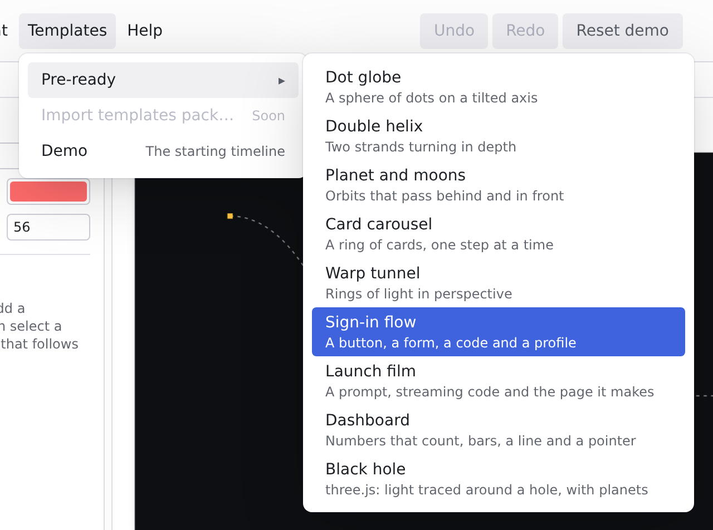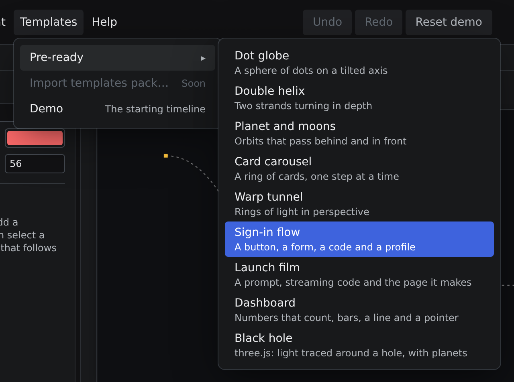<figcaption>Templates › Pre-ready, and below it Import templates pack… and Demo.</figcaption></figure>

## The menu

| Item                       | What it does                                                            |
| -------------------------- | ----------------------------------------------------------------------- |
| **Pre-ready**              | A submenu with the nine templates below.                                |
| **Import templates pack…** | Not available yet: the item is disabled and says _Soon_.                |
| **Demo**                   | The timeline a new editor starts with: a title, a ball and a card, 4 s. |

## When a template opens

- It **replaces your timeline**, as **one undo step**: press **Undo** (`Ctrl+Z`) and your timeline is back. A toast says so.
- It starts **paused at 0 s**, unless you had pressed **Play** (or **Restart**) earlier and not paused since. Then it **plays by itself from the start**. Pause, Stop, Create and Open turn that off ([Timeline, keyframes and playback](ref-timeline)).
- Editing is locked while it plays: pause first ([The window and panels](ref-window)).
- The code panel shows its code, and the status reads **In sync**. The big ones are long (the code of Dashboard is about 117 KB).
- **Every scene loops**: the end is the same as the start.

## At a glance

| Template                                              | Layers | Length | Keyframes | Made of                                               |
| ----------------------------------------------------- | ------ | ------ | --------- | ----------------------------------------------------- |
| [Dot globe](ref-templates?id=dot-globe)               | 42     | 6 s    | 1,004     | 42 circles                                            |
| [Double helix](ref-templates?id=double-helix)         | 42     | 4 s    | 553       | 28 circles, 14 rectangles                             |
| [Planet and moons](ref-templates?id=planet-and-moons) | 71     | 8 s    | 545       | 71 circles                                            |
| [Card carousel](ref-templates?id=card-carousel)       | 15     | 6 s    | 960       | 10 rectangles (5 cards, front and back), 5 pager dots |
| [Warp tunnel](ref-templates?id=warp-tunnel)           | 51     | 3.6 s  | 1,474     | 51 circles                                            |
| [Sign-in flow](ref-templates?id=sign-in-flow)         | 127    | 16.4 s | 793       | 31 rectangles, 69 circles, 27 texts                   |
| [Launch film](ref-templates?id=launch-film)           | 138    | 15.6 s | 1,387     | 78 rectangles, 42 circles, 18 texts                   |
| [Dashboard](ref-templates?id=dashboard)               | 173    | 17.2 s | 1,801     | 102 rectangles, 23 circles, 48 texts                  |
| [Black hole](ref-templates?id=black-hole)             | 3      | 16 s   | 14        | 1 three.js scene, 2 texts                             |
| Demo                                                  | 3      | 4 s    | 14        | a circle, a rectangle, a text                         |

_Keyframes_ counts every keyframe of every property of every layer.

## Flat layers that look 3D

The first five are 3D-looking scenes made of **flat layers**. The editor is flat: a layer has a position, a scale, a rotation and an opacity. So depth is drawn the way a 2D animator draws it:

- Each scene is written as 3D motion, **projected** to 2D, and **baked into ordinary keyframes**: between two keyframes the editor can only ease, so each stretch of the motion is matched against the built-in easings (a quarter turn of a circle is exactly `Sinusoidal.In` or `.Out`), then traced with the [curve tool](ref-curve), and split in two where neither follows it closely enough.
- **Far things are smaller and dimmer.**
- Something that passes **behind** another thing is a pair of layers, named _(front)_ and _(back)_, one above and one below the other. Only one shows at a time, and they swap at the crossing.
- Motion that no built-in easing describes, such as perspective, is a curve drawn with the curve tool.

### Dot globe

A sphere of dots turning on a tilted axis, with a satellite. Forty dots are spread evenly from pole to pole on a spiral, so that the sphere looks full; the dots on the far side are smaller and dimmer.

<figure>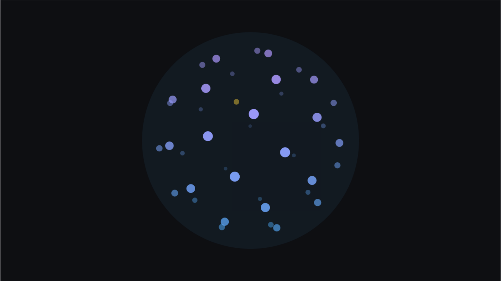<figcaption>Dot globe, 6 s.</figcaption></figure>

### Double helix

A double helix turning on its long axis: two strands of 14 dots (blue and pink) with 14 thin rungs between them. A rung is seen edge on twice a turn, so its scale goes through zero.

<figure>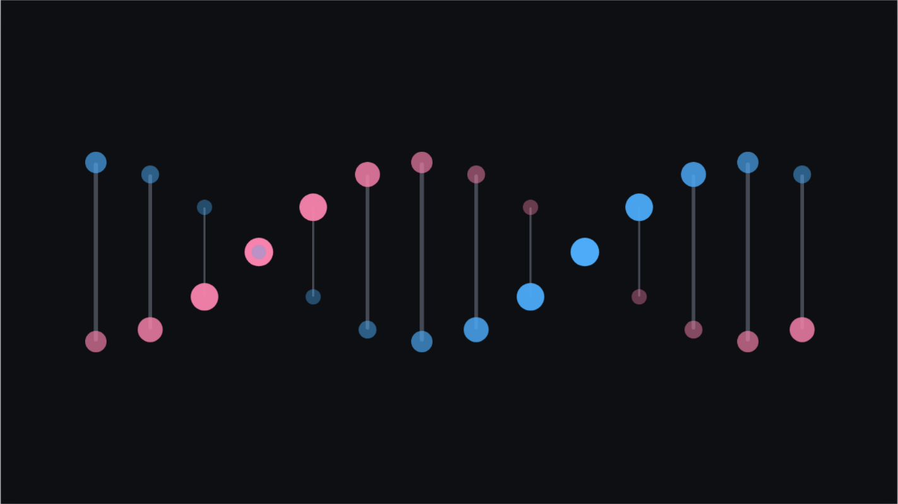<figcaption>Double helix, 4 s.</figcaption></figure>

### Planet and moons

Three moons (Io, Europa and Titan) circle a planet, **passing in front of it and behind it**. A circle seen from a low angle is a flat ellipse, so each orbit is an ellipse turned a little on the screen. A moon is a pair of layers that swap places at the crossing. Around them are the dotted orbits, the planet with its shine and glow, and a field of stars.

<figure>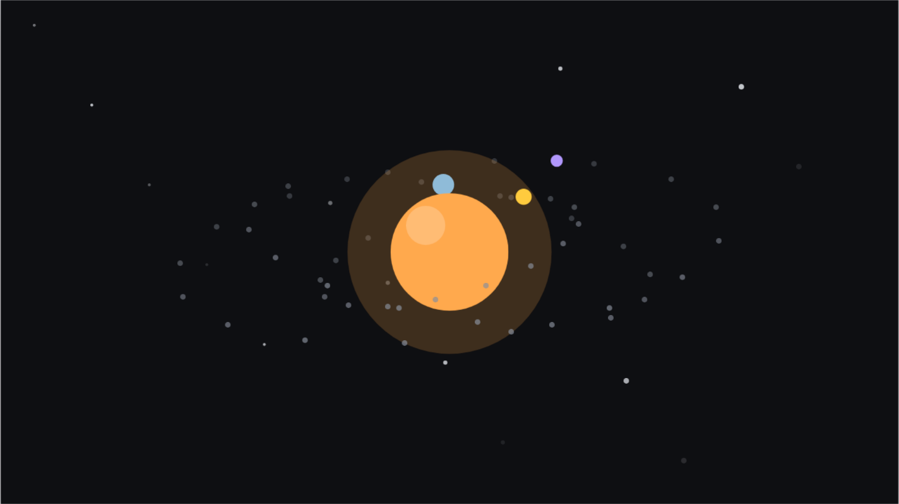<figcaption>Planet and moons, 8 s.</figcaption></figure>

### Card carousel

Five cards on a ring (each card is a front and a back layer) and five pager dots. It turns **one card at a time**, with a rest between the steps (`Cubic.InOut` over 760 ms of every 1.2 s), and the cards at the back are behind those at the front.

<figure>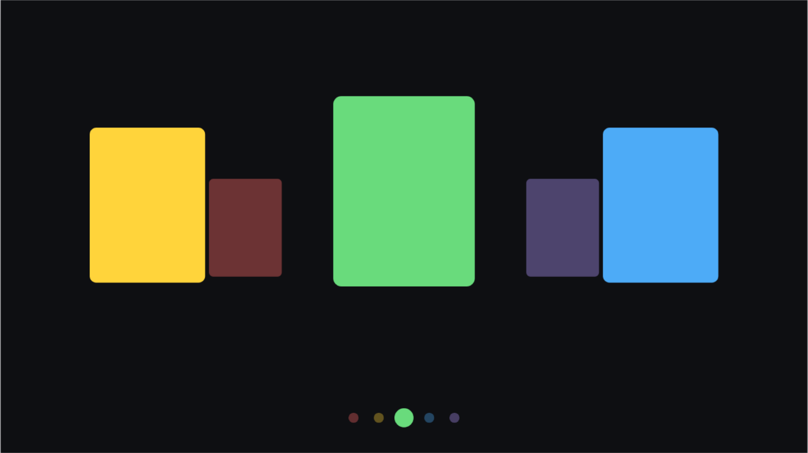<figcaption>Card carousel, 6 s.</figcaption></figure>

### Warp tunnel

Rings of lights rush past the viewer, twisting as they come: five rings of ten lights, each ring following the last. At the end of a flight the ring jumps back to the far end, with the jump written as two keyframes one millisecond apart.

<figure>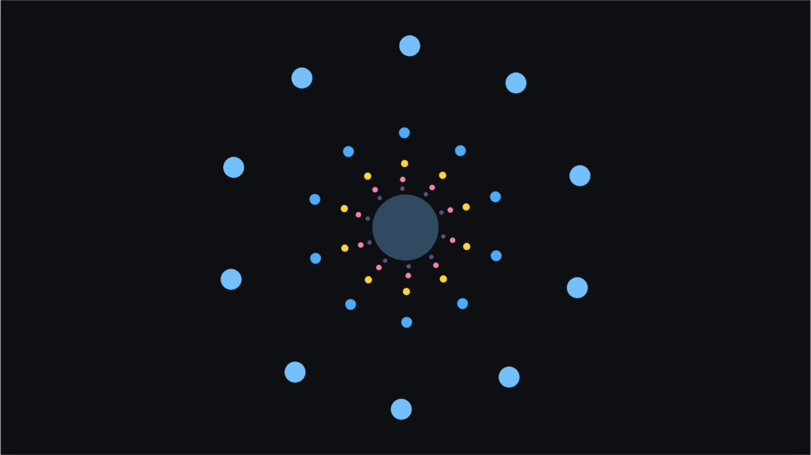<figcaption>Warp tunnel, 3.6 s. It has the most keyframes of the flat scenes: 1,474.</figcaption></figure>

## Product motion

The next three are **product motion**: an interface that builds itself, a pointer that uses it. They are 15 to 17 seconds long and have 127 to 173 layers, folded in the timeline. How they are built is in [Product motion scenes](guide-product-motion).

### Sign-in flow

A button, a form, a code and a profile. A button is pressed and becomes a card; an email is typed, then a password, then a six-digit code; a profile appears and its bell rings. On a light ground.

<figure>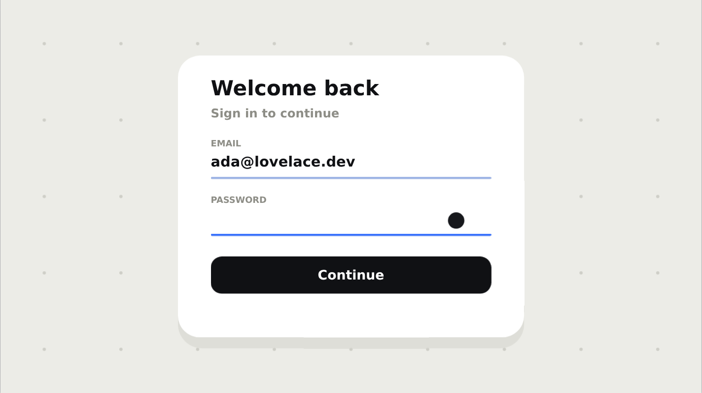<figcaption>Sign-in flow, 16.4 s.</figcaption></figure>

### Launch film

A prompt, streaming code and the page it makes. A mark, a prompt, code streaming past, and then a glass card with a headline and a button that asks to be pressed. On a dark ground with slow warm light.

<figure>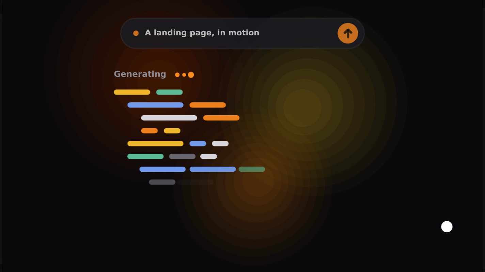<figcaption>Launch film, 15.6 s.</figcaption></figure>

### Dashboard

Numbers that count, bars, a line and a pointer: a side bar, numbers that count, bars that grow, a line that draws itself with a reader running along it, and a progress meter. The pointer changes the view twice, and everything answers.

<figure>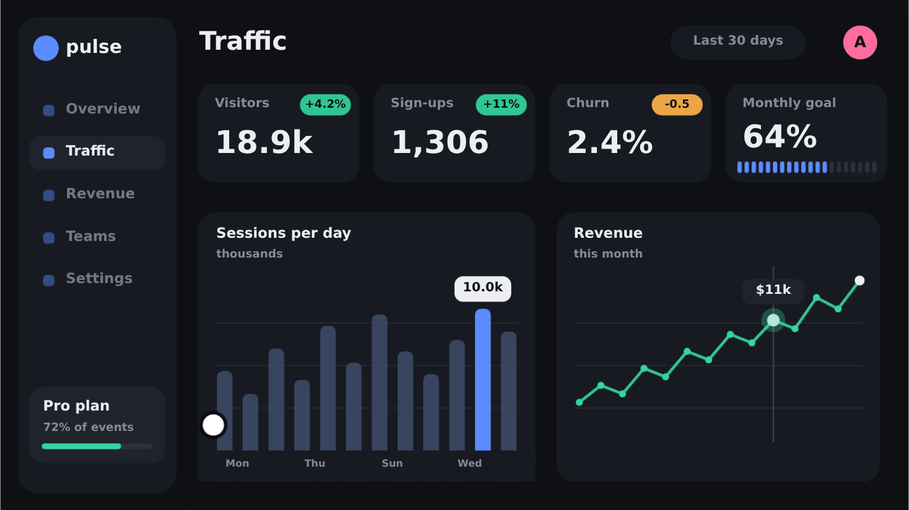<figcaption>Dashboard, 17.2 s. It is the biggest: 173 layers and about 117 KB of code.</figcaption></figure>

## Real 3D

### Black hole

Light traced around a hole, with planets: a real **three.js** scene, in one layer with the shape `three`, and two captions. The scene is the layer's own code, in the code panel with the timeline, with real `import`s. The timeline flies the camera: `rotation` is where it is on its orbit around the hole (once around in 16 s, so it loops) and `scale` is how close it is. How it works, and how to edit it, is in [Three.js scenes](guide-three) and [Three.js scene contract](ref-scene).

<figure>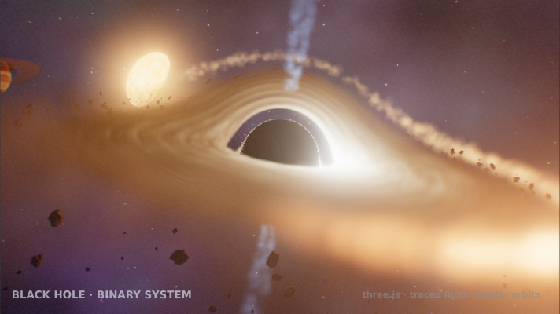<figcaption>Black hole, 16 s. The picture is made on your graphics card, so it takes a moment to appear.</figcaption></figure>

## See also

- [Your first animation](guide-first-animation): start from an empty timeline instead.
- [Menus and actions](ref-menu)
- [Sharing and opening links](guide-share): the links of the big templates are very long.
