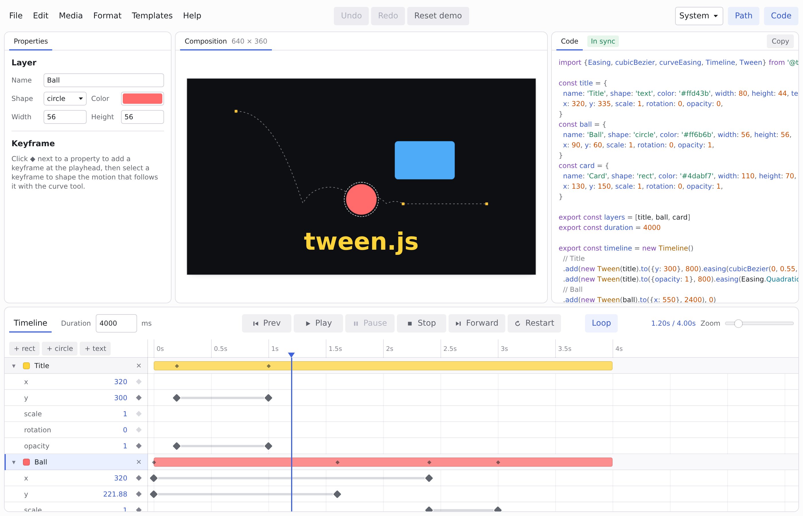
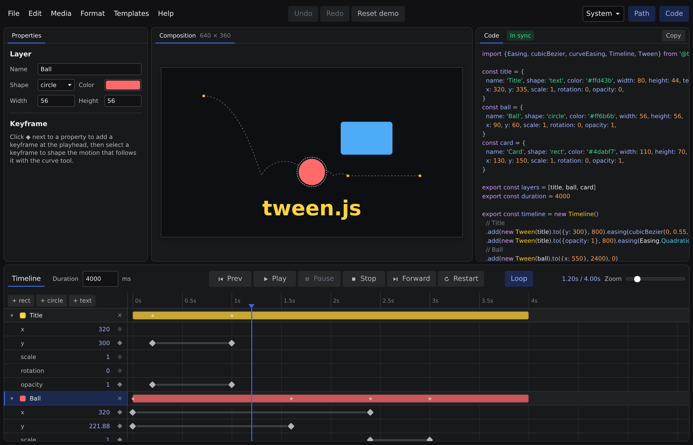

# Themes

The editor has a light and a dark theme, and follows your device unless you choose one. These docs use the same choice.

<figure style="margin:0"><figcaption>Light</figcaption></figure>
<figure style="margin:0"><figcaption>Dark</figcaption></figure>

## The theme dropdown

The dropdown in the header, next to **Path** and **Code**, has three choices:

| Choice                   | What it does                                                                                                                                                                         |
| ------------------------ | ------------------------------------------------------------------------------------------------------------------------------------------------------------------------------------ |
| **System** (the default) | Follows your device's light or dark setting, and changes with it while the editor is open. No script is involved: it is CSS (`color-scheme: light dark` and `light-dark()` colours). |
| **Light**                | Always light.                                                                                                                                                                        |
| **Dark**                 | Always dark.                                                                                                                                                                         |

The choice is **remembered** in this browser and **shared with these docs**: the docs' own dropdown (at the top of the sidebar) reads and writes the same setting, and an open docs page follows a change made in the editor. (The editor itself reads the setting when it loads.)

## How it works

| Piece          | What it is                                                                                                                                                                                                                                                                                  |
| -------------- | ------------------------------------------------------------------------------------------------------------------------------------------------------------------------------------------------------------------------------------------------------------------------------------------- |
| `data-theme`   | When you choose **Light** or **Dark**, the page's `<html>` element gets `data-theme="light"` or `data-theme="dark"`, which overrides the device. **System** has no attribute at all. A few lines in the page's head set it before the first paint, so there is no flash of the wrong theme. |
| Storage        | The choice is in local storage under the key `tweenjs-timeline-editor-theme`, with the value `light` or `dark`. Choosing **System** removes the key.                                                                                                                                        |
| `color-scheme` | `:root` says `color-scheme: light dark`; `[data-theme='light']` and `[data-theme='dark']` narrow it. Form controls, scrollbars and the colours below all follow it.                                                                                                                         |

## The palette

The interface is styled to look like [Radix Themes](https://www.radix-ui.com/themes), on [Radix Colors](https://www.radix-ui.com/colors). Radix's components are React-only, so what is shared is its tokens: twelve steps per colour scale, joined for light and dark with `light-dark()` in `src/radix-scales.css` (generated by `scripts/radix-scales.mjs`), and the space, type, radius and shadow scales in `src/radix.css`.

As in Radix Themes, the interface uses two aliases and nothing else for its colour:

| Alias                                                | Is               | Used for                                                                                                                              |
| ---------------------------------------------------- | ---------------- | ------------------------------------------------------------------------------------------------------------------------------------- |
| `--gray-1` … `--gray-12`, `--gray-a1` … `--gray-a12` | Radix **slate**  | Backgrounds (steps 1 to 2), controls (3 to 5), borders (6 to 8), text (11 to 12). The `a` steps are the same colours as transparency. |
| `--accent-1` … `--accent-12`                         | Radix **indigo** | The accent: buttons, the selected tab, the focus ring, links.                                                                         |

The scales for red, green, amber, purple, cyan and orange are also there, for the status badge (green, amber, red) and the code highlighting.

Changing the two aliases recolours the whole editor.

> [!NOTE]
> The **stage** is the artwork, not the interface: the composition is dark (`#0e0f12`) in both themes.

## What does not follow the theme

- The three.js scenes draw their own picture.
- Pictures in these docs have a light and a dark version, and show the one that matches the docs' theme.
