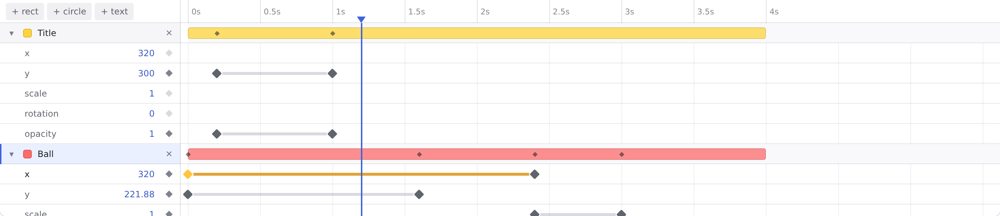
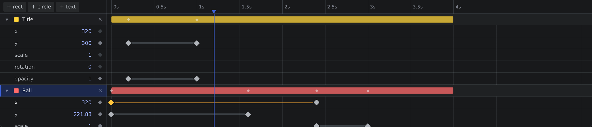
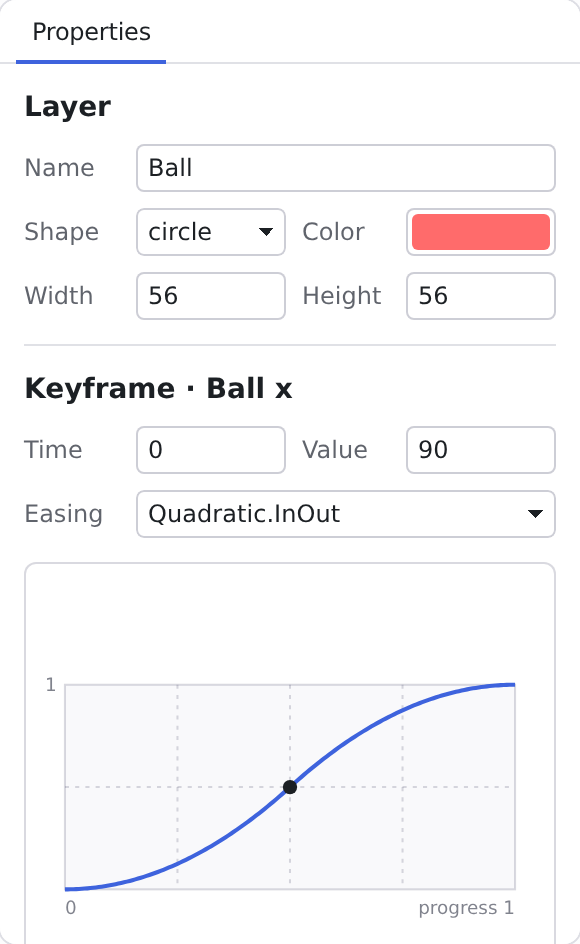
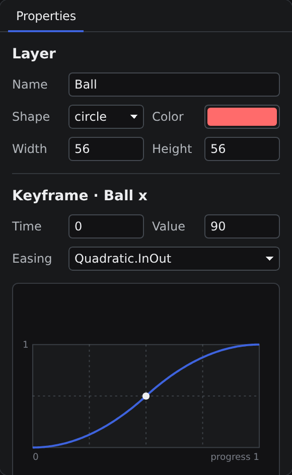
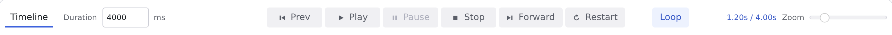
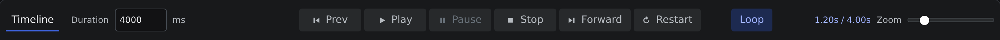

# Timeline, keyframes and playback

The bottom of the window is the **playback bar** and the **timeline**. Together they are where an animation is made: you move the playhead, you set values, and the editor turns them into keyframes.

<figure class="themed">

<figcaption>The timeline with the demo: Title and Ball rows, their five property rows, and the playhead at 1.2 s.</figcaption>
</figure>

## Try it

A small timeline with the same ideas: a ball with keyframes on `x` and `y`, and a box that grows. Drag the playhead, or press Play.

The ball has three keyframes on each of `x` and `y`. Between two keyframes the value moves along an easing; the easing belongs to the keyframe the segment **leaves** (see [the keyframe fields](ref-timeline?id=the-keyframe-fields)).

## The timeline panel

### Rows

| Row               | What it shows                                                                                                                                                                                                                |
| ----------------- | ---------------------------------------------------------------------------------------------------------------------------------------------------------------------------------------------------------------------------- |
| **Ruler**         | A tick and a label (`0s`, `0.5s`, `1s`…) at regular steps, chosen so ticks are at least 60 px apart at the current zoom. The ruler row's left cell has the **+ rect**, **+ circle** and **+ text** buttons.                  |
| **Layer row**     | The fold button (▾ / ▸), a swatch of the layer's colour, its name, and ✕ to delete it. Its lane is a bar of the layer's colour as long as the timeline, with a small mark at every time that has a keyframe on any property. |
| **Property rows** | One each for `x`, `y`, `scale`, `rotation` and `opacity`, when the layer is not folded.                                                                                                                                      |

A property row has, from the left: the **name**, a **value field**, and the **◆ button**. In its lane the keyframes are drawn as diamonds, and between neighbouring keyframes a thin **segment** bar. The selected keyframe is amber; so is the segment that leaves it. The selected row is highlighted.

### The playhead

The blue line with a marker on the ruler is the playhead. Everything on the stage shows the timeline at that time, and the value fields show the values there.

| To                                  | Do                                                                                                                                                                                                                                                                            |
| ----------------------------------- | ----------------------------------------------------------------------------------------------------------------------------------------------------------------------------------------------------------------------------------------------------------------------------- |
| Move the playhead                   | Click the ruler, or press on it and drag (**scrub**). Positions snap to the 10 ms grid and stay between 0 and the duration.                                                                                                                                                   |
| Step it                             | <kbd>←</kbd> / <kbd>→</kbd>: 10 ms. With <kbd>Shift</kbd>: 100 ms.                                                                                                                                                                                                            |
| Go to the start or the end          | <kbd>Home</kbd> / <kbd>End</kbd>.                                                                                                                                                                                                                                             |
| Go to the previous or next keyframe | **Prev** and **Forward** buttons, or <kbd>Page Up</kbd> / <kbd>Page Down</kbd>. They step between the keyframes of the _selected layer_, or of _all layers_ if none is selected. With no keyframe before, **Prev** goes to 0 s; with none after, **Forward** goes to the end. |

While it plays, the timeline scrolls to keep the playhead in view.

### Zoom

The **Zoom** slider (at the right of the playback bar) sets the pixels per millisecond: from 0.05 to 1, default 0.2 (so 1 s is 200 px). Zoom is view state; it is not saved.

## Setting values and making keyframes

A property is **static** while it has no keyframes: it has one value for the whole timeline. It is **animated** once it has keyframes.

| To                                     | Do                                                                                                                                                                                      | What happens                                                                                                                                                                                      |
| -------------------------------------- | --------------------------------------------------------------------------------------------------------------------------------------------------------------------------------------- | ------------------------------------------------------------------------------------------------------------------------------------------------------------------------------------------------- |
| Add a keyframe at the playhead         | Click the **◆** of a property row.                                                                                                                                                      | A keyframe is added at the playhead with the property's current value. The ◆ is drawn amber while the playhead is on a keyframe.                                                                  |
| Remove the keyframe under the playhead | Click the **◆** again.                                                                                                                                                                  | The keyframe goes. If it was the last one, the property becomes static, keeping that value.                                                                                                       |
| Add a keyframe anywhere                | **Double-click** an empty part of the property's lane.                                                                                                                                  | A keyframe at that time (snapped to 10 ms) with the value the animation has there. Double-clicking where a keyframe already is does nothing.                                                      |
| Change a value                         | Type it in the row's **value field** (it applies when you leave the field or press <kbd>Enter</kbd>), or in the **Properties** panel, or drag the layer on the stage (for `x` and `y`). | On a static property the value changes. On an animated one, a keyframe at the playhead is updated, or added if there is none.                                                                     |
| Select a keyframe                      | Click it.                                                                                                                                                                               | Its row is selected, and the **Keyframe** section of Properties shows it. Clicking a property row selects the row (and its layer) without a keyframe.                                             |
| Move a keyframe                        | Drag it sideways.                                                                                                                                                                       | It moves in time, snapped to 10 ms, between 0 and the duration. It may pass its neighbours, but never lands on a time where the property already has a keyframe. The whole drag is one undo step. |
| Delete a keyframe                      | Select it and press <kbd>Delete</kbd> or <kbd>Backspace</kbd>.                                                                                                                          | The keyframe goes; if it was the last one the property becomes static, keeping its value.                                                                                                         |

Value fields follow the playhead while it moves and show up to two decimals; the field you are typing in is left alone.

The step of the value fields: 1 for `x`, `y` and `rotation`; 0.05 for `scale` and `opacity`.

## The keyframe fields

With a keyframe selected, the **Keyframe** section of the Properties panel is headed `Keyframe · <layer> <property>` and has:

<figure class="themed">

</figure>

| Field      | What it does                                                                                                                  | Limits                                                                                                                         |
| ---------- | ----------------------------------------------------------------------------------------------------------------------------- | ------------------------------------------------------------------------------------------------------------------------------ |
| **Time**   | The keyframe's time in ms. Steps of 10. Moves the keyframe.                                                                   | 0 to the duration. A time where the property already has a keyframe is refused, and the field shows the time it kept.          |
| **Value**  | The property's value at this keyframe.                                                                                        | Any number.                                                                                                                    |
| **Easing** | **Custom curve**, or one of tween.js's built-in easings, grouped by family (`Linear.None`, `Quadratic.InOut`, `Bounce.Out`…). | Disabled on the last keyframe of a property: an easing shapes the motion **towards the next keyframe**, and the last has none. |
| **Curve**  | A graph and buttons to draw the easing by hand.                                                                               | Described in [Curve tool](ref-curve).                                                                                          |

Choosing **Custom curve** keeps the shape: the easing that was there is traced into an editable curve. The buttons below the graph (**Linear**, **Ease**, **Ease in**, **Ease out**, **Ease in-out**, **Overshoot**, **Anticipate**, **Bounce**) replace the curve with a preset.

> [!NOTE]
> Where the easing lives: the motion from keyframe _A_ to the next keyframe _B_ is shaped by the easing stored on **A**. In the generated code that is the `.easing(...)` of the tween that ends at _B_.

## The playback bar

<figure class="themed">

</figure>

| Control           | What it does                                                                                                                                                                                                     |
| ----------------- | ---------------------------------------------------------------------------------------------------------------------------------------------------------------------------------------------------------------- |
| **Duration** (ms) | The length of the timeline. At least 100 ms, and never shorter than the last keyframe: a smaller value is raised to that, and the field shows what was applied. An edit is an undo step. Disabled while playing. |
| **Prev**          | To the previous keyframe, else the start. <kbd>Page Up</kbd>.                                                                                                                                                    |
| **Play**          | Plays from the playhead (from 0 if it is at the end). Shows as pressed while playing. <kbd>Space</kbd>.                                                                                                          |
| **Pause**         | Pauses. The playhead rests on the 10 ms grid. Disabled when nothing plays. <kbd>Space</kbd>.                                                                                                                     |
| **Stop**          | Pauses and goes to 0 s.                                                                                                                                                                                          |
| **Forward**       | To the next keyframe, else the end. <kbd>Page Down</kbd>.                                                                                                                                                        |
| **Restart**       | Pauses, goes to 0 s and plays.                                                                                                                                                                                   |
| **Loop**          | Pressed (the default): at the end the timeline starts again from 0. Not pressed: it stops at the end. Not saved.                                                                                                 |
| **Time readout**  | `1.20s / 4.00s`: the playhead and the duration.                                                                                                                                                                  |
| **Zoom**          | See [above](ref-timeline?id=zoom).                                                                                                                                                                               |

Playback time comes from the screen's own frame clock, so the speed is the same on 60, 120 or 144 Hz displays. A frame that comes very late (a hidden tab) advances at most 250 ms: it resumes instead of jumping.

## The editing lock

While the timeline **plays**, nothing can be moved or changed.

| What                                                                                                                                                          | While playing                                                    |
| ------------------------------------------------------------------------------------------------------------------------------------------------------------- | ---------------------------------------------------------------- |
| Properties fields (layer and keyframe)                                                                                                                        | Disabled (greyed).                                               |
| Value fields and ◆ buttons in the timeline, the Duration field                                                                                                | Disabled.                                                        |
| Dragging a layer on the stage, dragging a keyframe, the curve graph                                                                                           | Refused. The cursor over them is "not allowed".                  |
| Delete key, double-click on a lane, the Edit menu's layer items, Scale…                                                                                       | Refused.                                                         |
| Refused edits say                                                                                                                                             | _Pause to edit: nothing can be moved or changed while it plays._ |
| Selecting layers, rows and keyframes; scrubbing; Prev/Forward; zoom; Path and Code toggles; Undo and Redo; opening, creating, templates, imports; typing code | Still work.                                                      |

Pause, make the edit, play again.

## When it plays by itself

The editor never starts playing on its own, with one exception that you control.

| You do                                                                  | Result                                                                                                                                                                                                        |
| ----------------------------------------------------------------------- | ------------------------------------------------------------------------------------------------------------------------------------------------------------------------------------------------------------- |
| Load the page, or reload it                                             | Paused at 0 s.                                                                                                                                                                                                |
| **File › Create**, **File › Open…**, **Import…**, opening a shared link | Replaces the timeline, **stops playback and puts the playhead at 0 s**. Also forgets that you pressed Play: the next template waits for you.                                                                  |
| Choose a **template**, **Demo**, or press **Reset demo**                | The timeline is replaced and the playhead goes to 0 s. It **plays from the start only if you had pressed Play** (or Restart, or <kbd>Space</kbd>) **and not paused since**; otherwise it stays paused at 0 s. |
| Press **Pause**, **Stop** or <kbd>Space</kbd> while playing             | Forgets that you chose to play.                                                                                                                                                                               |

So: press Play once, and browsing templates plays each one; pause, and they wait at 0 s again.

## Undo and Redo

The header's **Undo** and **Redo** (and <kbd>Ctrl</kbd>+<kbd>Z</kbd>, <kbd>Ctrl</kbd>+<kbd>Shift</kbd>+<kbd>Z</kbd> or <kbd>Ctrl</kbd>+<kbd>Y</kbd>) step through the last 200 edits. A drag, a template, an import or a file open is one step. Playhead moves, selection, folding, zoom and view toggles are not steps.
