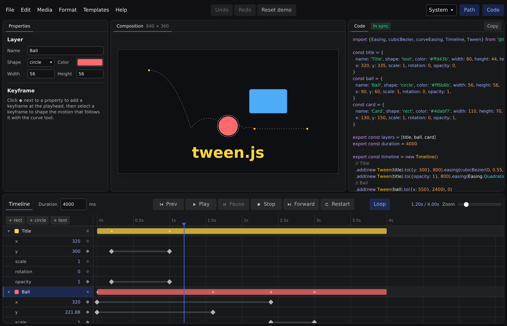
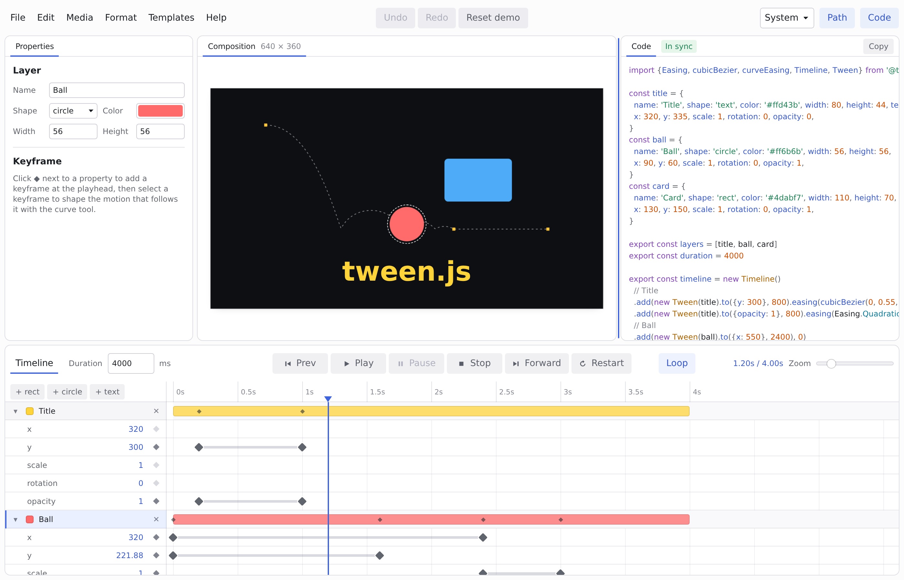
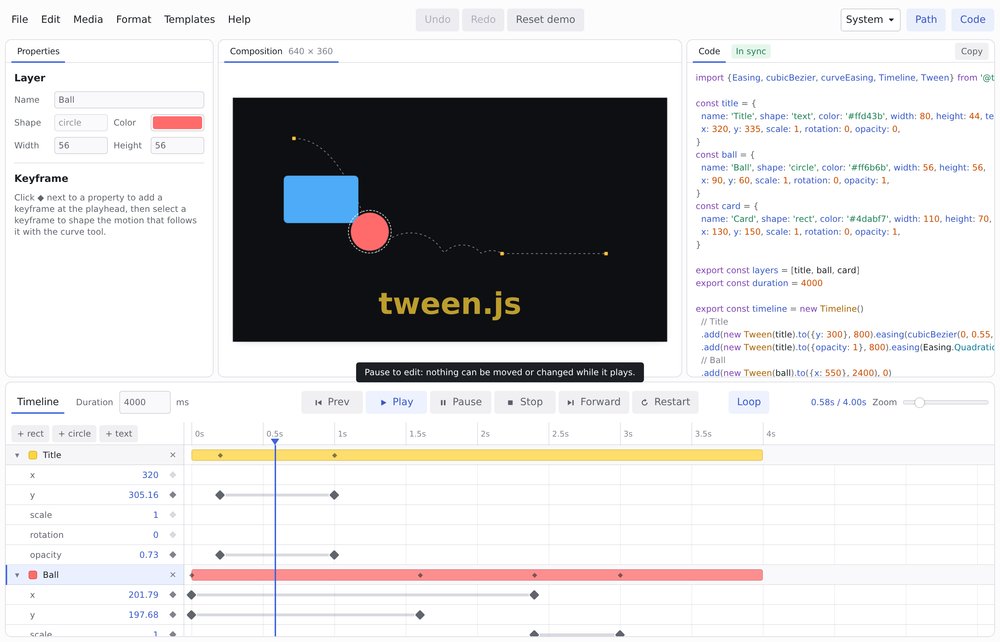
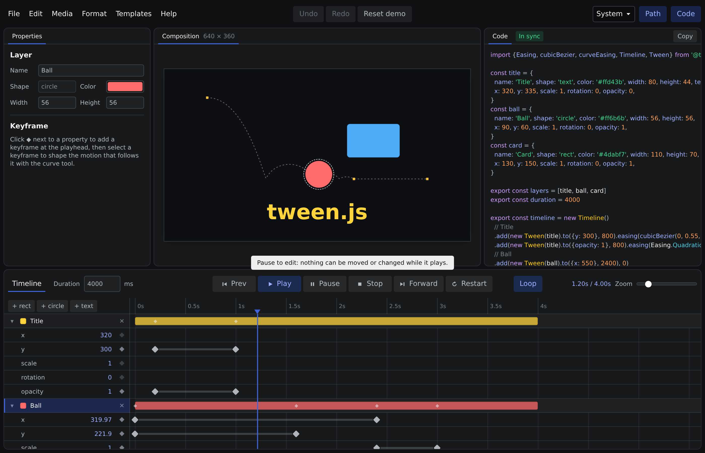

# The window and panels

The editor is one window with a header, three panels around the stage, a playback bar and the timeline. Everything below is on screen at once; the only things you can hide or resize are the Code panel and the panel sizes.

<figure class="themed">

<figcaption>The window with the demo timeline, the Ball layer selected and the playhead at 1.2 s.</figcaption>
</figure>

## The parts

| Part                       | Where              | What it is                                                                                                                                                                            |
| -------------------------- | ------------------ | ------------------------------------------------------------------------------------------------------------------------------------------------------------------------------------- |
| **Menus**                  | Header, left       | File, Edit, Media, Format, Templates, Help. See [Menus and actions](ref-menu).                                                                                                        |
| **Undo, Redo, Reset demo** | Header, middle     | Undo and Redo step through your edits (up to 200 steps). Reset demo replaces the timeline with the demo, as one undo step.                                                            |
| **Theme, Path, Code**      | Header, right      | The theme dropdown (see [Themes](ref-themes)), and two toggle buttons described [below](ref-window?id=the-toggles).                                                                   |
| **Properties**             | Left panel         | The selected layer's fields and the selected keyframe's easing and curve. See [Layers and Properties](ref-layers).                                                                    |
| **Composition**            | Centre             | The stage: a fixed 640 × 360 picture of the animation, scaled to fit. Layers are drawn here, and you drag them here.                                                                  |
| **Code**                   | Right panel        | The timeline as tween.js code, kept in step with the editor. See [Code format](ref-code). It has a **Copy** button and a status next to its name (`In sync`, a warning, or an error). |
| **Playback bar**           | Above the timeline | The Duration field, the transport buttons, Loop, the time readout and Zoom. See [Timeline, keyframes and playback](ref-timeline).                                                     |
| **Timeline**               | Bottom panel       | The ruler, one row per layer and one row per property, with their keyframes.                                                                                                          |

## The stage

The composition is 640 × 360 units, whatever size it is drawn: `x` and `y` of every layer are in these units, with `(0, 0)` at the top-left corner and a layer's `x`, `y` at the middle of the layer (a text may be anchored at its left or right side instead; see [Layers and Properties](ref-layers?id=text-fields)).

- **Click a layer** to select it. A selected layer has a dashed outline. **Click the empty stage** to select nothing.
- **Drag a layer** to move it. The position is written at the playhead: an animated `x` or `y` gets or updates a keyframe there, a property without keyframes simply changes its value. The whole drag is one undo step.
- The first layer in the list is drawn on top of the others.
- A layer with the shape `three` is a 3D scene drawn on a canvas by its own code ([Three.js scene contract](ref-scene)). If its code fails, the error is written over the layer.

## The toggles

| Button   | Pressed (default)                                                                                                                                                                                       | Not pressed                                                                                                                                            |
| -------- | ------------------------------------------------------------------------------------------------------------------------------------------------------------------------------------------------------- | ------------------------------------------------------------------------------------------------------------------------------------------------------ |
| **Path** | The stage draws the path the selected layer travels: a dashed line, with a small square at each position keyframe. It appears only when the selected layer has at least two keyframes on `x` or on `y`. | No path.                                                                                                                                               |
| **Code** | The Code panel is shown at the right.                                                                                                                                                                   | The Code panel is hidden and the stage takes its width. The code is still kept in step in the background; it is written again when you show the panel. |

Both buttons are plain view settings: they are not undo steps and they are not remembered after a reload (both start pressed).

## Resizing the panels

Three **dividers** lie in the gaps between the cards. Each resizes the panel beside it.

| Divider                                | Resizes            | Default | Smallest |
| -------------------------------------- | ------------------ | ------- | -------- |
| Left, between Properties and the stage | Properties (width) | 290 px  | 200 px   |
| Right, between the stage and Code      | Code (width)       | 430 px  | 240 px   |
| Bottom, above the timeline             | Timeline (height)  | 300 px  | 120 px   |

<figure class="themed">

<figcaption>A divider turns into the accent colour when you hover it. Here, the right one.</figcaption>
</figure>

- **Drag** a divider with the mouse, touch or pen. Dragging away from the panel's own edge of the window makes it larger. The cursor keeps its shape wherever the pointer goes during the drag.
- **Arrow keys**: focus a divider (they are tab stops) and press the arrow that moves it. Each press changes the size by 16 px. The left divider uses ← and →, the right one ← (larger) and → (smaller), the bottom one ↑ (larger) and ↓ (smaller).
- **Double-click** a divider to bring its panel back to the default size.
- The stage always keeps at least **260 px of width and 160 px of height**: a panel cannot grow so far that less is left. A smaller browser window squeezes the panels; the sizes you chose come back when the window grows again.
- The sizes are **remembered** in this browser (local storage key `tweenjs-timeline-editor-layout`).

Each divider is a `separator` with an `aria-label` ("Resize the Properties panel", "Resize the Code panel", "Resize the Timeline panel") and an `aria-valuenow`, so screen readers announce it.

## While the timeline plays

While it plays, **nothing can be moved or changed**. The Properties fields, the value fields and ◆ buttons of the timeline and the Duration field are greyed out, and the cursor over layers, keyframes and curve points is "not allowed". A drag or a menu edit is refused with the message _Pause to edit: nothing can be moved or changed while it plays._

<figure class="themed">

<figcaption>A refused drag while playing. The fields are greyed out; the toast says why.</figcaption>
</figure>

Still available while it plays: selecting layers, rows and keyframes, scrubbing the ruler, zoom, Pause, Stop, Prev and Forward, the toggles, Undo and Redo, the menus that replace the timeline (Create, Open, templates, imports) and typing in the Code panel. See [Timeline, keyframes and playback](ref-timeline?id=the-editing-lock) for the details.

## What is saved

- The **timeline** is saved in this browser after every change (`localStorage`, key `tweenjs-timeline-editor-v1`) and is back when you reload. Nothing is uploaded.
- The **panel sizes** and the **theme** are saved under their own keys.
- Selection, zoom, Loop, Path and Code are not saved.
- Which layers are folded in the timeline is saved with the timeline, but it is not code and it is not an undo step.
